<div dir="rtl">

# ⚙️ سازندهٔ چرخ‌دندهٔ سحند | Sahand Gear Maker

**طراحی پارامتریک چرخ‌دنده — کاملاً آفلاین، فارسی و راست‌به‌چپ، با خروجی‌های مهندسی واقعی**

<h3 align="center">
  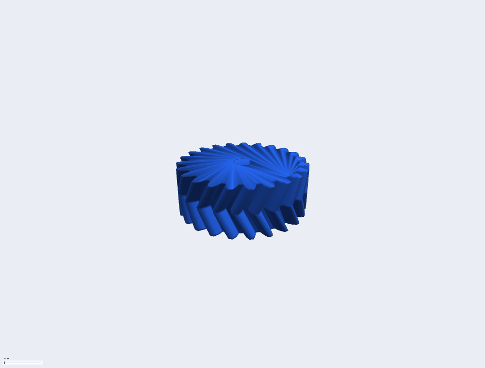
  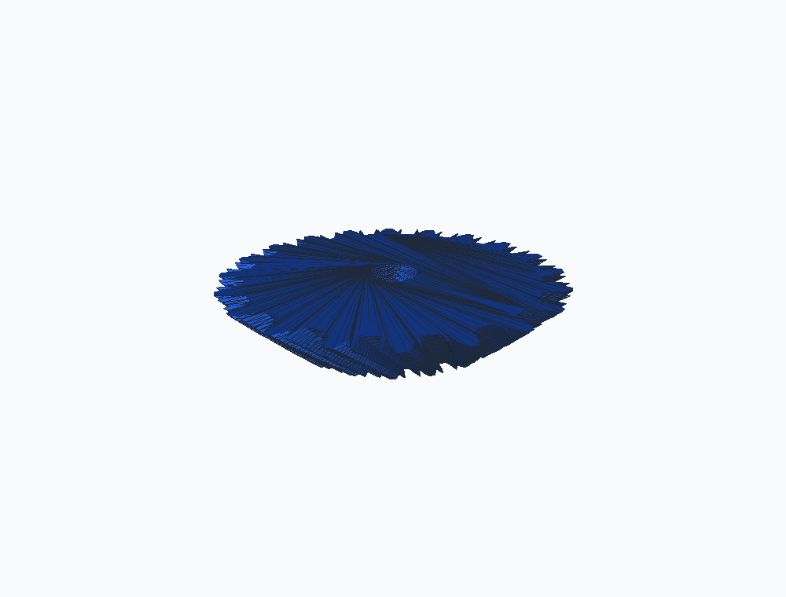
  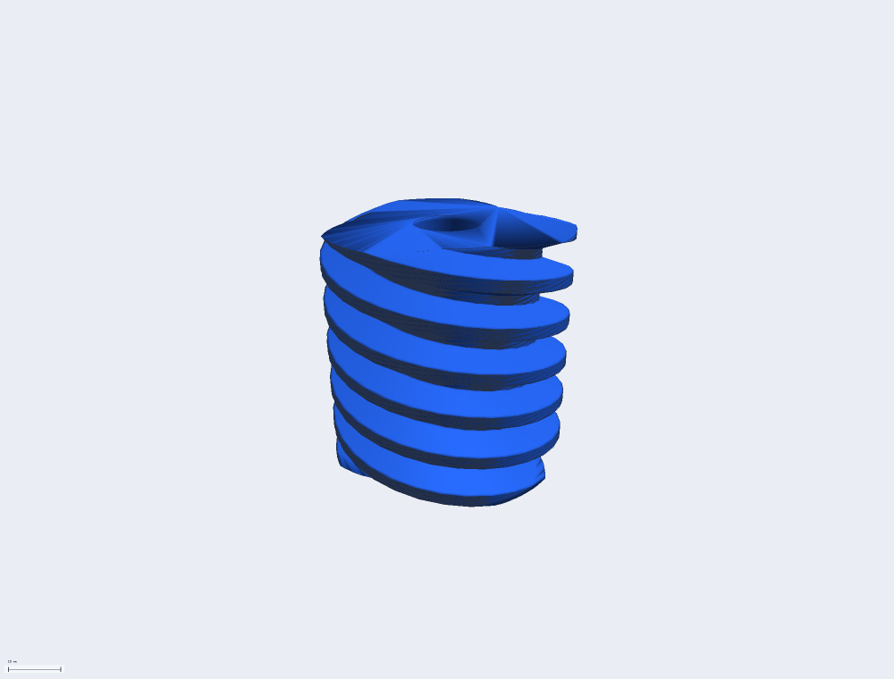
</h3>

<p align="center">
  <a href="https://github.com/pranses2011/Sahand_Gear_Maker/actions/workflows/core.yml">
    </a>
  <a href="https://github.com/pranses2011/Sahand_Gear_Maker/actions/workflows/windows.yml">
    </a>
  <a href="https://github.com/pranses2011/Sahand_Gear_Maker/actions/workflows/release.yml">
    </a>
  
  
  
  
  
</p>

---

## 📑 فهرست

- [معرفی](#-معرفی)
- [قابلیت‌ها](#-قابلیت‌ها)
- [خانواده‌های چرخ‌دنده](#-خانواده‌های-چرخ-دنده-۱۹-خانواده)
- [گالری](#-گالری)
- [شروع سریع](#-شروع-سریع)
- [خط فرمان (CLI)](#-خط-فرمان-sgm-cli)
- [معماری](#-معماری)
- [فرمت‌های ورودی/خروجی](#-فرمت‌های-ورودیخروجی)
- [نقشهٔ راه](#-نقشهٔ-راه--وضعیت-تکمیل)
- [حریم خصوصی و آفلاین](#-حریم-خصوصی-و-آفلاین)
- [آزمون‌ها و کیفیت](#-آزمون‌ها-و-کیفیت)
- [مستندات](#-مستندات)
- [مجوز](#-مجوز)

---

## 🎯 معرفی

**سازندهٔ چرخ‌دندهٔ سحند** یک ابزار مهندسی دسکتاپ برای طراحی پارامتریک چرخ‌دنده است که از ابتدا برای کاربر فارسی‌زبان، بدون هیچ وابستگی به اینترنت و بدون ارسال هیچ داده‌ای طراحی شده است. هستهٔ هندسی برنامه مستقل از رابط کاربری است و روی لینوکس/ویندوز قابل ساخت و آزمون است؛ رابط کاربری WPF با فونت وزیرمتنِ همراه برنامه، راست‌به‌چپ کامل و پالت رنگی متناسب فارسی ارائه می‌شود.

برنامه صادق است: هر قابلیتی که ادعا می‌کند واقعاً پیاده‌سازی و آزموده شده و محدودیت‌ها و تقریب‌های مهندسی (مثل روش Tredgold برای مخروطی یا طرح‌ریزی تولید برای تاجی) صریحاً در کاتالوگ قابلیت، تشخیص‌ها و مستندات اعلام می‌شوند.

### ✨ ویژگی‌های کلیدی

| | قابلیت | توضیح |
|---|---|---|
| 🧮 | **موتور هندسی واقعی** | پروفیل اینولوت با تلرانس وتر، مش‌های آب‌بند (manifold) با اعتبارسنجی حجم/توپولوژی |
| 🖼️ | **پیش‌نمایش حرفه‌ای (نسخهٔ ۰٫۳)** | رندر موازی tile-parallel با رشتهٔ جدا، ضدپلگی SSAA×2 در سکون، سایه‌زنی گورا، گرید/محور/مقیاس گرافیکی، اینرسی دوربین، زوم به مکان‌نما، ViewCube، نماهای نام‌دار، پرسپکتیو/ارتو، انتخاب با کلیک (پیکینگ)، منوی زمینه‌ای، HUD زنده |
| 🎛️ | **کنترل‌های شیئ** | درخت پروژه با چشم/قفل/رنگ، جابه‌جایی/چرخش/مقیاس/شفافیت عددی per-part، هایلایت انتخاب |
| 🔗 | **مونتاژ زنده در UI** | گراف روابط ۱۱گانه با نتیجهٔ سازگاری، چیدمان خودکار، ویزارد سیاره‌ای، پخش‌کنندهٔ حرکت (سینماتیک ایدئال)، نمای انفجاری |
| 🛠️ | **بررسی و اندازه‌گیری** | ابزار فاصله/زاویه روی بوم، صفحهٔ برش نمایشی، گزارش تحلیل هندسی، بررسی برخورد تقریبی، نمای دوم ارتوگرافیک |
| ↩️ | **واگرد/ازنو + بازیابی** | Undo/Redo ۵۰ گامی (Ctrl+Z/Y)، ذخیرهٔ خودکار با بازیابی، پروژه‌های اخیر |
| ⚙️ | **۱۹ خانوادهٔ چرخ‌دنده** | از ساده و مارپیچ تا کرم، مخروطی، هیپوئید، بیضوی، هارمونیک و هزارخار |
| 🧩 | **مونتاژ و سینماتیک** | جفت/قطار/سیاره‌ای/هارمونیک با روابط مرجع و پیش‌نمایش حرکت ایدئال |
| 📐 | **نقشهٔ فنی فارسی** | SVG و PDF با فونت تعبیه‌شده، شکل‌دهی حروف فارسی و جدول پارامتر |
| 📦 | **۷ فرمت خروجی + ۳ فرمت ورودی** | STL/OBJ/PLY/GLB/3MF/AMF/DXF + ورودی مدل مرجع STL/OBJ/PLY |
| 🔍 | **تحلیل و ابزار بررسی** | نسبت تماس، undercut، برخورد مش، دستیار انتخاب نسبت، اندازه‌گیری |
| 🗂️ | **گونه‌ها و بازیابی** | Variant با مقایسهٔ پارامتری + ذخیرهٔ خودکار و بازیابی پس از خرابی |
| 🖥️ | **CLI خودکار** | `sgm-cli` برای ساخت/خروجی/نقشه/تحلیل در خط فرمان و CI |
| 🔒 | **کاملاً آفلاین** | هیچ درخواست شبکه‌ای اجباری؛ فونت و همهٔ منابع همراه برنامه |

---

## 🚀 قابلیت‌ها در یک نگاه

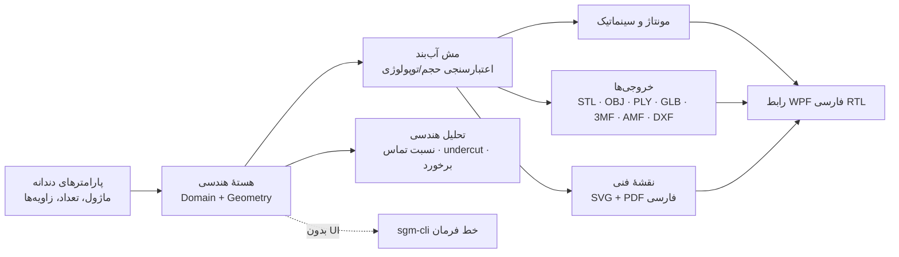

---

## ⚙️ خانواده‌های چرخ‌دنده (۱۹ خانواده)

| خانواده | وضعیت | روش هندسی |
|---|:---:|---|
| خارجی مستقیم / مارپیچ / جناغی | ✅ | اینولوت با تلرانس وتر؛ گپ مرکزی واقعی جناغی |
| داخلی مستقیم / مارپیچ | ✅ | رینگ دندانهٔ واقعی (نه استوانهٔ ساده) |
| شانهٔ مستقیم / مارپیچ | ✅ | منشور دندانه‌دار با گام سازگار |
| مخروطی مستقیم / مارپیچ | ✅ | پروفیل معادل Tredgold + مارپیچ لگاریتمی ثابت‌زاویه |
| کرم (ZA) / چرخ کرم | ✅ | سطح پیچی دقیق + گلوگاه گلوبوئیدی (پوشش ابزار کرم‌نما) |
| مارپیچ متقاطع | ✅ | هندسهٔ هلیکی + محاسبهٔ زاویهٔ محور Σ=β₁+β₂ |
| تاجی / پیشانی | ✅ | دندانهٔ شعاعی با ارتفاع کاهشی (طرح‌ریزی تولید) |
| هیپوئیدی | ✅ | مخروطی مارپیچ با روابط آفست |
| سیکلوئیدی | ✅ | اپیسایکلوئید سر + هیپوسایکلوئید شعاعی (قرارداد ساعت‌سازی) |
| غیرمدور بیضوی | ✅ | حل محیط با انتگرال E(e)؛ بور روی کانون |
| فِلکسی‌پلاین هارمونیک | ✅ | فنجان حالت آزاد + موج‌ساز بیضوی در مونتاژ |
| هزارخار خارجی / داخلی | ✅ | اینولوت کوتاه با برازش گام/قطر پایه |

> 📋 جزئیات کامل روش‌ها و محدودیت‌های صادقانه: [ماتریس قابلیت](docs/CAPABILITY-MATRIX.md)

---

## 🖼 گالری

همهٔ تصاویر زیر **خروجی واقعی رندرر نرم‌افزاری خود برنامه** هستند که در CI ویندوزی تولید و به‌صورت خودکار به این مخزن افزوده می‌شوند:

| | | |
|:---:|:---:|:---:|
|  | 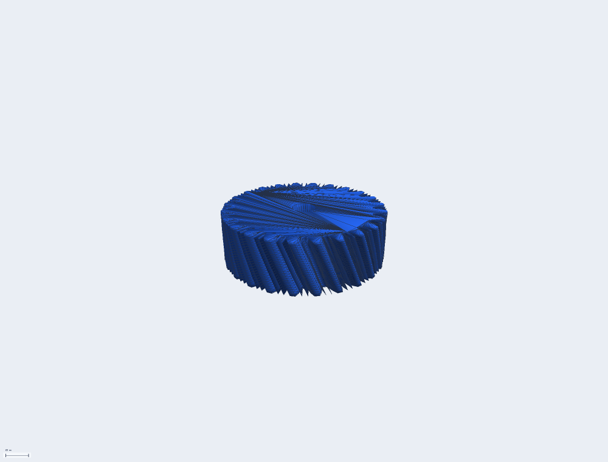 |  |
| **خارجی مستقیم** | **مارپیچ** | **جناغی (دومارپیچ)** |
| 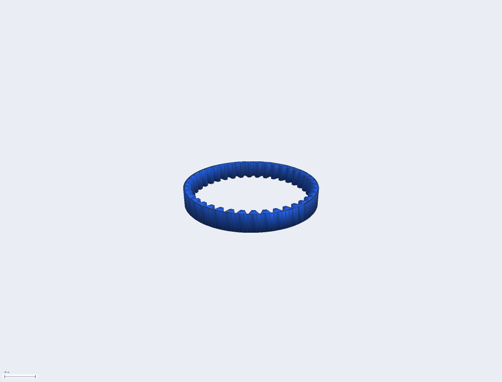 | 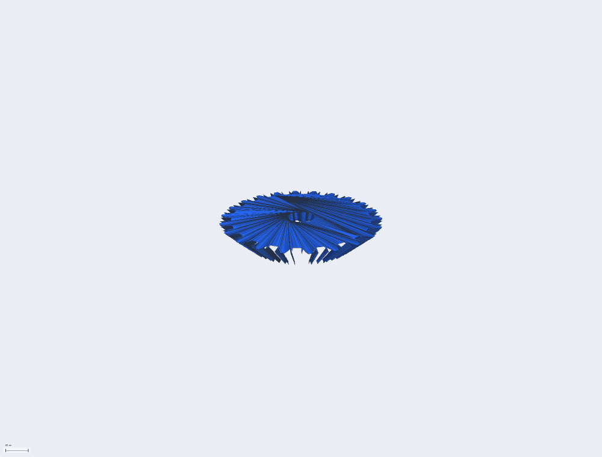 |  |
| **داخلی (رینگ واقعی)** | **مخروطی مستقیم** | **مخروطی مارپیچ** |
|  | 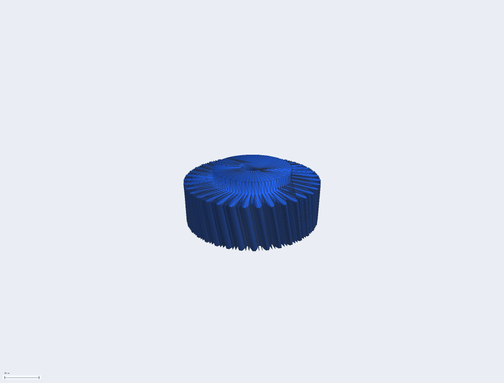 | 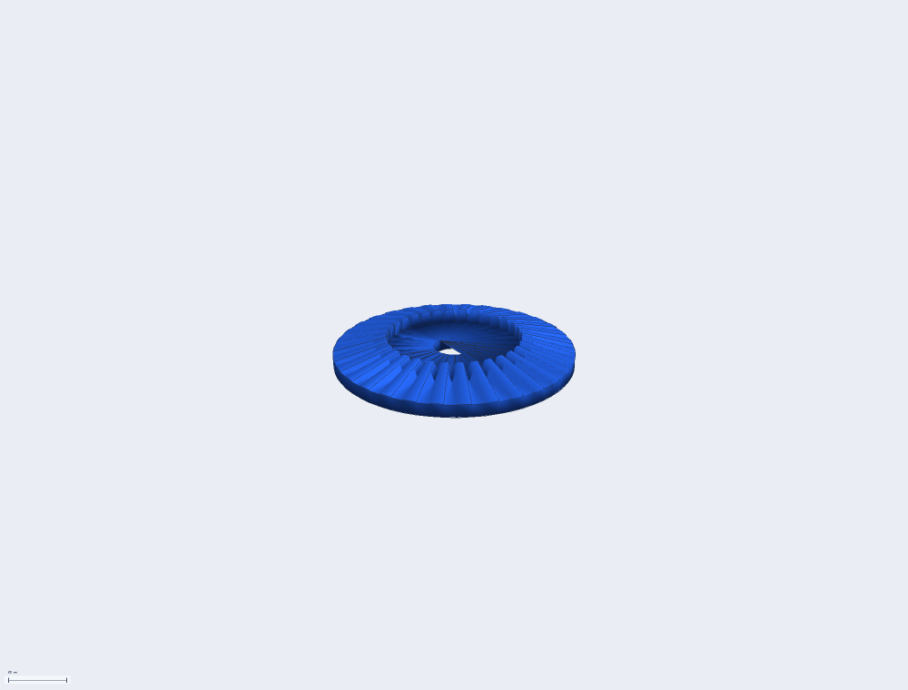 |
| **کرم حلزونی ZA** | **چرخ کرم گلوگاه‌دار** | **تاجی/پیشانی** |
| 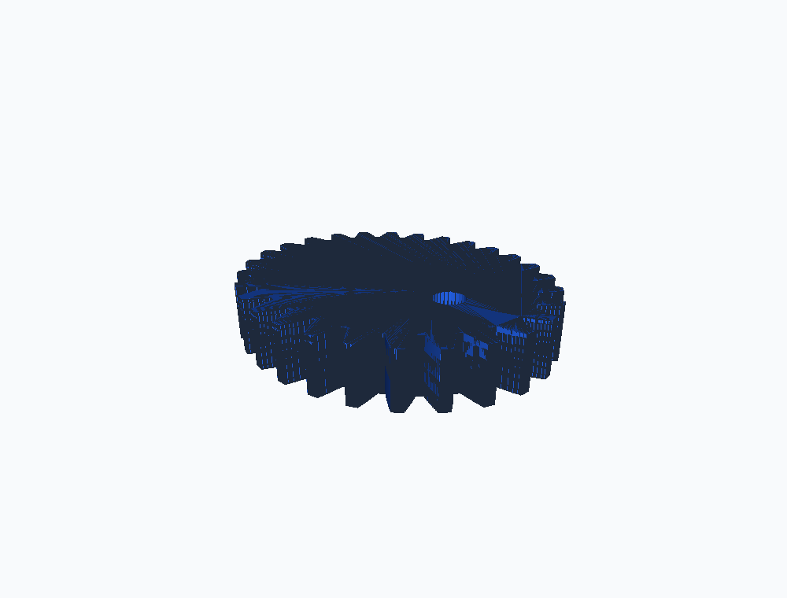 | 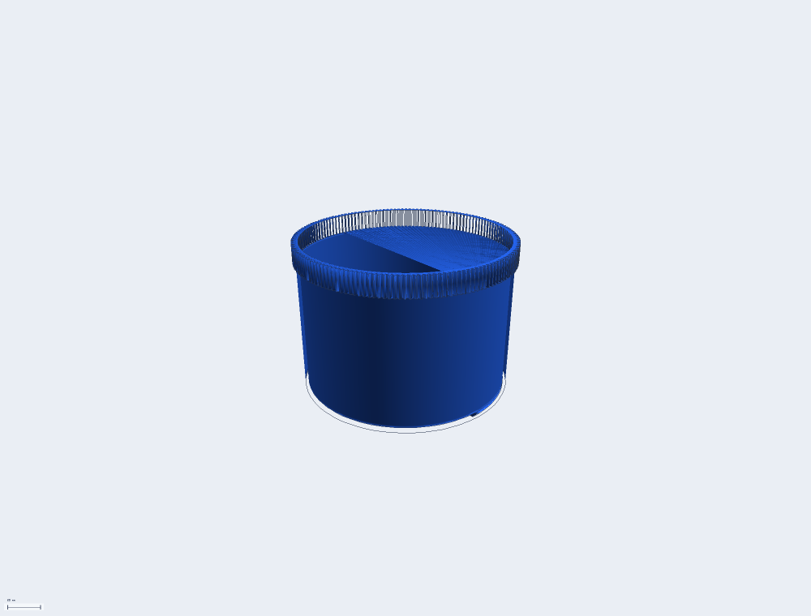 | 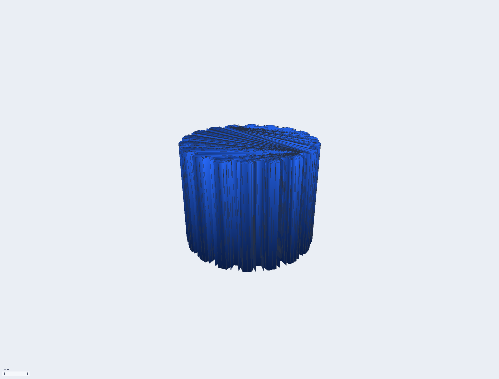 |
| **غیرمدور بیضوی** | **فِلکسی‌پلاین هارمونیک** | **هزارخار اینولوت** |

و نمای رابط کاربری فارسی راست‌به‌چپ:

<p align="center">
  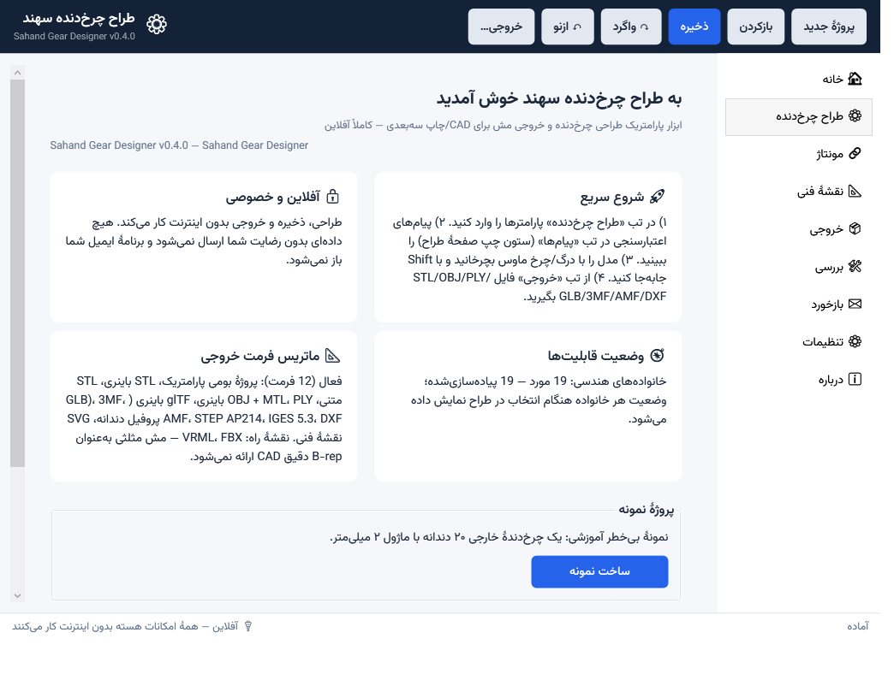
</p>

صحنه‌های موتور پیش‌نمایش جدید (نسخهٔ ۰٫۳ — چندقطعه‌ای، گرید و محور، حالت‌های نمایش و هایلایت انتخاب):

| | | |
|:---:|:---:|:---:|
| 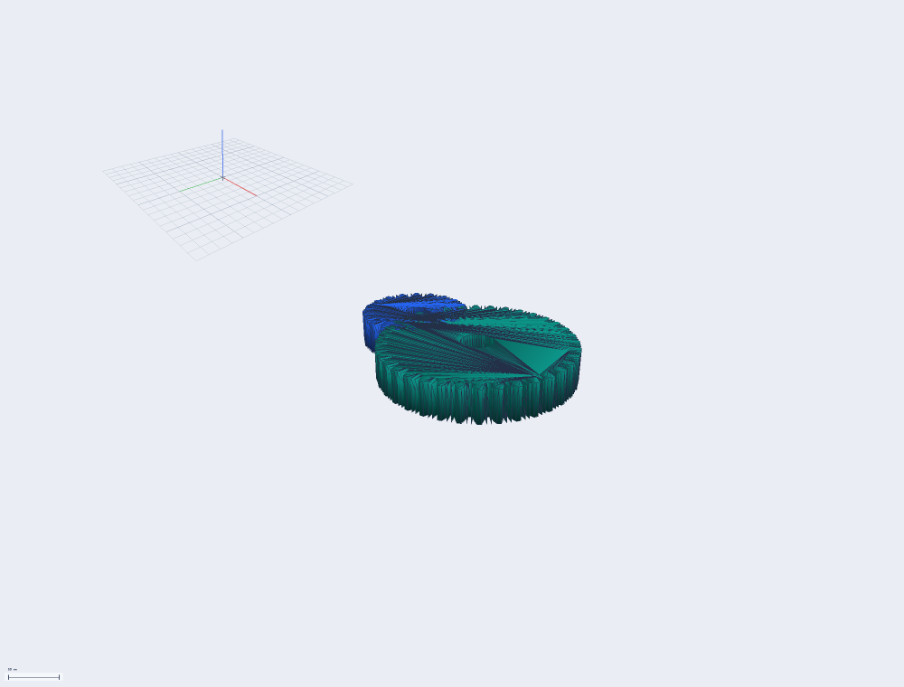 | 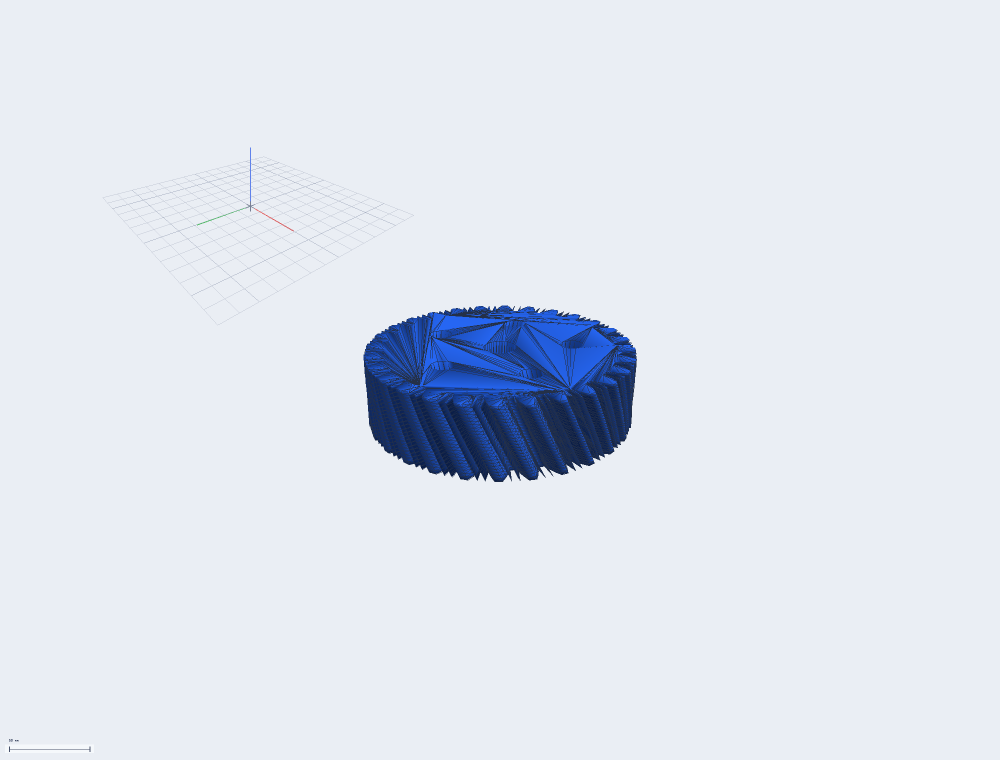 | 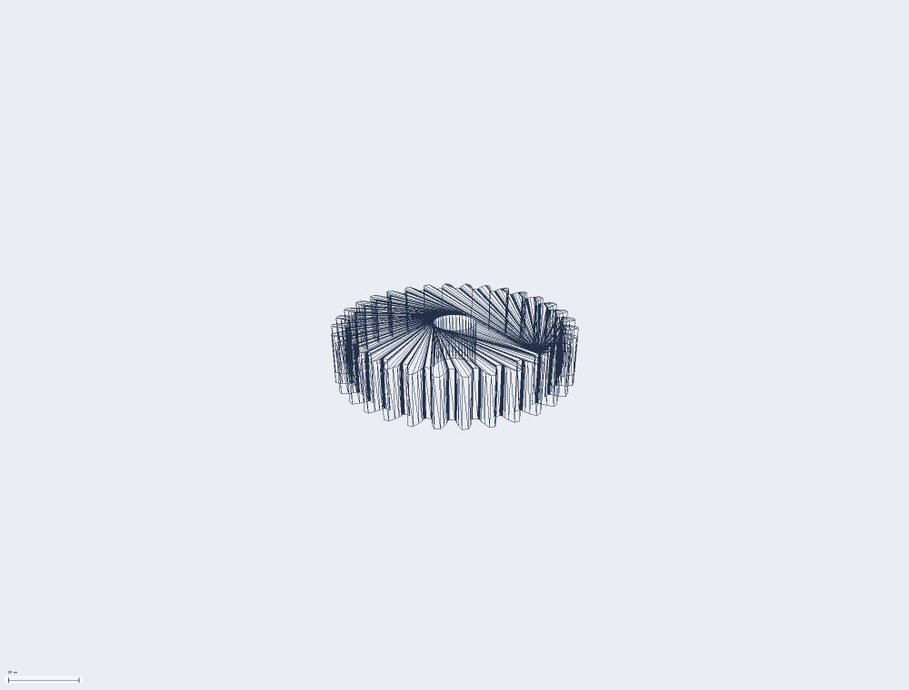 |
| **جفت درگیر + گرید** | **گرید + محورهای XYZ** | **حالت سیمی** |
|  | 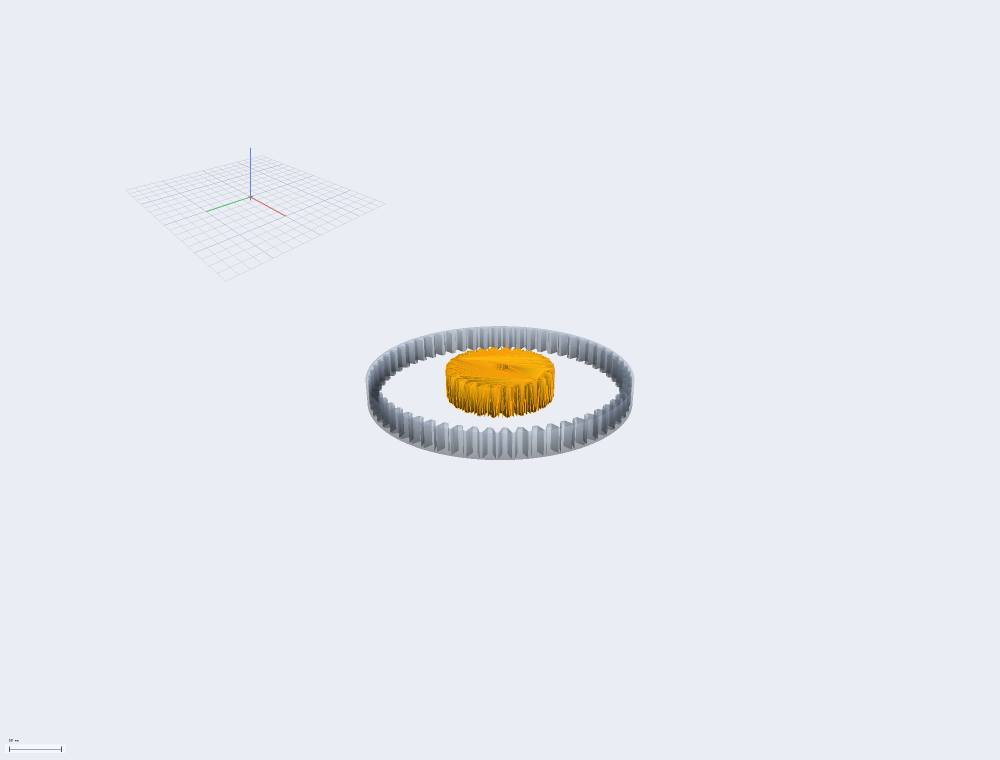 | |
| **سایهٔ گورا** | **هایلایت انتخاب + شفافیت** | |

---

## 🏁 شروع سریع

### راه‌اندازی برای توسعه

```bash
git clone https://github.com/pranses2011/Sahand_Gear_Maker.git
cd Sahand_Gear_Maker

# ساخت و آزمون هسته (لینوکس/WSL/macOS/ویندوز)
dotnet restore tests/SahandGearMaker.Tests
dotnet build -c Release src/SahandGearMaker.Domain src/SahandGearMaker.Math \
  src/SahandGearMaker.Geometry src/SahandGearMaker.Assembly \
  src/SahandGearMaker.Persistence src/SahandGearMaker.Exports src/SahandGearMaker.Drawing
dotnet test tests/SahandGearMaker.Tests -c Release

# اجرای برنامهٔ ویندوزی (فقط ویندوز)
dotnet run --project src/SahandGearMaker.App -c Release
```

### ساخت برنامهٔ ویندوزی

```bash
dotnet publish src/SahandGearMaker.App -c Release -o publish/app
```

> 💡 بیلد آمادهٔ ویندوزی (artifact) از سربرگ **Actions ← windows-build-screenshots** قابل دانلود است.

راهنمای کامل: [docs/BUILD.md](docs/BUILD.md) · [docs/USER-GUIDE.md](docs/USER-GUIDE.md)

---

## 💻 خط فرمان `sgm-cli`

خودکارسازی کامل بدون UI — مناسب اسکریپت و CI:

```bash
# ساخت پروژهٔ جدید (مخروطی، ماژول ۳، ۲۴ دندانه)
sgm-cli new --family BevelSpur --module 3 --teeth 24 --width 18 --bore 12 \
            --name "چرخ محرک" --out gearbox.sgdproj

# خروجی همهٔ قطعات (STL باینری/متنی، OBJ، PLY، GLB، 3MF، AMF)
sgm-cli export gearbox.sgdproj --format 3mf --outdir output/

# نقشهٔ فنی فارسی (SVG + PDF با فونت تعبیه‌شده)
sgm-cli drawing gearbox.sgdproj --outdir drawings/

# تحلیل هندسی + بررسی جفت‌ها
sgm-cli analyze gearbox.sgdproj

# ورودی مدل مرجع (فقط بازبینی؛ پارامتریک نمی‌شود)
sgm-cli import reference.stl
```

---

## 🏛 معماری

```mermaid
flowchart TB
    subgraph UI["🖥️ SahandGearMaker.App (WPF, net8.0-windows)"]
        V[نماها: خانه/طراح/مونتاژ/نقشه/خروجی/بررسی/تنظیمات/بازخورد/درباره]
        R[بوم Viewport3D — رشتهٔ رندر جدا]
    end
    subgraph CLI["💻 sgm-cli"]
        C[خط فرمان آفلاین]
    end
    subgraph Core["🧮 هستهٔ مستقل از UI (net8.0)"]
        D[Domain — پارامترها/اعتبارسنجی/کاتالوگ]
        G[Geometry — سازنده‌های مش آب‌بند]
        A2[Assembly — جفت/سینماتیک/تحلیل]
        P[Persistence — sgdproj اتمی/گونه‌ها/autosave]
        E[Exports — ۷ فرمت + ورودی مش]
        DR[Drawing — نقشهٔ SVG/PDF فارسی]
        S[Scene — رندرر موازی/پیکینگ/دوربین (۰٫۳)]
    end
    UI --> Core
    CLI --> Core
    S --> G
    D --> G --> A2
    D --> P
    G --> E
    G --> DR
```

- **هستهٔ آفلاین و مستقل**: همهٔ محاسبات بدون UI و بدون شبکه؛ ساخت/آزمون روی لینوکس.
- **صداقت مهندسی**: انواع «نقشهٔ راه» مدل جعلی نمی‌سازند؛ تقریب‌ها (Tredgold و…) اعلام می‌شوند.
- **ذخیرهٔ اتمی**: فایل پروژه هرگز نیمه‌کاره نمی‌ماند؛ دادهٔ ناشناختهٔ schema حفظ می‌شود.

جزئیات کامل: [docs/ARCHITECTURE.md](docs/ARCHITECTURE.md)

---

## 🔄 فرمت‌های ورودی/خروجی

| جهت | فرمت | وضعیت | نکته |
|---|---|:---:|---|
| خروجی | STL باینری/متنی | ✅ | واحد در فایل کد نمی‌شود؛ در گزارش اعلام می‌شود |
| خروجی | OBJ + MTL | ✅ | با فایل متریال جانبی |
| خروجی | PLY باینری | ✅ | با نرمال‌ها |
| خروجی | GLB (glTF) | ✅ | تبدیل mm→m طبق مشخصات glTF |
| خروجی | **3MF** | ✅ | ZIP/OPC استاندارد با اعتبارسنجی پس از نوشتن |
| خروجی | **AMF** | ✅ | XML با واحد صریح |
| خروجی | **DXF (پروفیل)** | ✅ | R12 سازگار برای برش لیزری/CAM دوبعدی |
| خروجی | **SVG / PDF نقشه** | ✅ | فارسی کامل با فونت تعبیه‌شده |
| خروجی | SGDPROJ | ✅ | پروژهٔ پارامتریک نسخه‌دار با ذخیرهٔ اتمی |
| ورودی | STL / OBJ / PLY | ✅ | فقط «مدل مرجع» — هرگز پارامتریک نمی‌شود |
| — | STEP / IGES | 🗺 | نیازمند هستهٔ B-rep با مجوز مناسب؛ مش به‌عنوان B-rep معرفی نمی‌شود |

---

## 🗺 نقشهٔ راه — وضعیت تکمیل

### نقشهٔ راه شش‌فازی نسخهٔ ۰٫۳ (ANALYSIS-AND-ROADMAP) — همهٔ فازها ✅

| فاز | قابلیت | وضعیت |
|---|---|:---:|
| ۰ | تثبیت پایه: نسخهٔ واحد از MSBuild، کاتالوگ = منبع حقیقت UI، فعال‌سازی 3MF/AMF/DXF/SVG، رفع باگ Parts | ✅ |
| ۱ | **پیش‌نمایش حرفه‌ای**: رشتهٔ رندر جدا + tile-parallel + SSAA + برش نزدیک + گورا + گرید/محور + پیکینگ + اینرسی + ViewCube + نماهای نام‌دار + کنترل‌های شیئ کامل | ✅ |
| ۲ | اتصال کامل موتور به UI: ۱۹ خانواده در فرم، نقشهٔ فنی، مدل مرجع، گونه‌ها، خروجی دسته‌ای | ✅ |
| ۳ | مونتاژ زنده: گراف روابط، چیدمان خودکار، ویزارد سیاره‌ای، پخش‌کنندهٔ حرکت، نمای انفجاری، دستیار نسبت | ✅ |
| ۴ | ابزار بررسی: اندازه‌گیری فاصله/زاویه، صفحهٔ برش، تحلیل هندسی، برخورد تقریبی، نمای دوم ارتو | ✅ |
| ۵ | UX و انتشار: Undo/Redo، تنظیمات، فایل‌های اخیر، کتابخانهٔ نمونه، انتشار پرتابل + Release خودکار | ✅ |

### بسته‌های نسخهٔ ۰٫۲ (پیش‌تر کامل)

| بسته | قابلیت | وضعیت |
|---|---|:---:|
| A | ذخیرهٔ خودکار + بازیابی پس از خرابی | ✅ |
| A | دستیار انتخاب اندازه/نسبت (reverse sizing) | ✅ |
| A | بررسی سازگاری/برخورد/فاصلهٔ قطعات | ✅ |
| A | نقشهٔ دوبعدی + SVG/PDF فارسی | ✅ |
| B | پیش‌نمایش حرکت/سینماتیک (جفت/قطار/سیاره‌ای/هارمونیک) | ✅ |
| B | گونه‌ها (Variants) + جدول مقایسه | ✅ |
| B | خروجی دسته‌ای با گزارش | ✅ |
| B | ورود مدل مرجع (STL/OBJ/PLY) | ✅ |
| B | کتابخانهٔ محلی نمونه‌ها | ✅ (پوشهٔ `samples/`) |
| C | همهٔ خانواده‌های هندسی نقشهٔ راه (۱۲ خانوادهٔ جدید) | ✅ |
| C | خروجی 3MF/AMF/DXF | ✅ |
| C | API/اسکریپت آفلاین (`sgm-cli`) | ✅ |
| — | محاسبهٔ استحکام/عمر بر پایهٔ استاندارد (AGMA/ISO) | 🚫 آگاهانه خارج از دامنه — نیازمند استاندارد معتبر، آزمون مرجع و بازبینی متخصص |
| — | افزونهٔ اجرای کد ناشناس | 🚫 آگاهانه ممنوع (سیاست امنیتی سند ۰۵) |

---

## 🔐 حریم خصوصی و آفلاین

- ✅ **هیچ telemetry/درخواست اجباری** هنگام راه‌اندازی؛ قابل تأیید با مانیتور شبکه.
- ✅ فونت وزیرمتن (مجوز OFL) همراه بستهٔ برنامه؛ بدون دانلود اینترنتی.
- ✅ ارسال بازخورد **فقط با رضایت صریح** و پیش‌نمایش محتوا؛ صف محلی در صورت قطعی.
- ✅ گواهی‌نامهٔ جست‌وجوی مخزن برای نبود توکن/رمز: [docs/PRIVACY.md](docs/PRIVACY.md)

---

## 🧪 آزمون‌ها و کیفیت

```
dotnet test tests/SahandGearMaker.Tests -c Release
```

- **۱۴۲ آزمون xUnit** — همه سبز در CI لینوکس و ویندوز:
  - دامنه: اعتبارسنجی، ارقام هندسی، آب‌بندی مش، بازتولیدپذیری، fuzz، جفت‌ها،
    سینماتیک (ویلیس/شانه/هارمونیک)، نقشهٔ فنی، شکل‌دهی فارسی، گونه‌ها،
    autosave، round-trip ورودی/خروجی، خروجی دسته‌ای،
    **موتور صحنهٔ ۰٫۳** (برش نزدیک، culling، پیکینگ، دوربین انیمیت، SSAA،
    کارایی مش سنگین < ۵۰۰ms، خط اندازه‌گیری، بقا هندسه با صفحهٔ برش).
- **معیار آب‌بندی**: هر یال جهت‌دار دقیقاً ۲ بار؛ حجم علامت‌دار مثبت.
- **اعتبارسنجی پس از نوشتن**: همهٔ صادرکننده‌ها فایل را دوباره می‌خوانند.

---

## 📚 مستندات

| سند | توضیح |
|---|---|
| [معماری](docs/ARCHITECTURE.md) | لایه‌ها، تصمیم‌ها، محدودیت‌های صادقانه |
| [ماتریس قابلیت](docs/CAPABILITY-MATRIX.md) | وضعیت دقیق همهٔ خانواده‌ها/فرمت‌ها با روش‌ها |
| [راهنمای ساخت](docs/BUILD.md) | ساخت روی لینوکس/ویندوز + انتشار |
| [راهنمای کاربر](docs/USER-GUIDE.md) | کار با برنامهٔ ویندوزی |
| [حریم خصوصی](docs/PRIVACY.md) | سیاست داده و آفلاین |
| [گزارش تحویل](docs/FINAL-REPORT.md) | جمع‌بندی صادقانهٔ تحویل |
| [اعلان‌های شخص ثالث](ThirdPartyNotices.md) | فونت وزیرمتن (OFL) و بسته‌ها |

---

## 📄 مجوز

مجوز [MIT](LICENSE) — متن ساده.

**اعلان فونت:** فونت [وزیرمتن](https://github.com/rastikerdar/vazirmatn) با مجوز [OFL 1.1](Assets-License) همراه برنامه توزیع می‌شود.

---

<div align="center">

**ساخته‌شده با ⚙️ و 💙 — سازندهٔ چرخ‌دندهٔ سحند**

</div>

</div>
