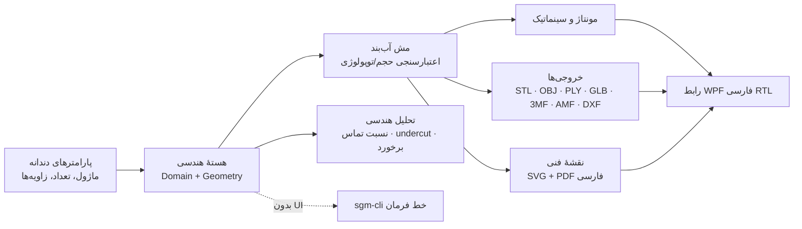
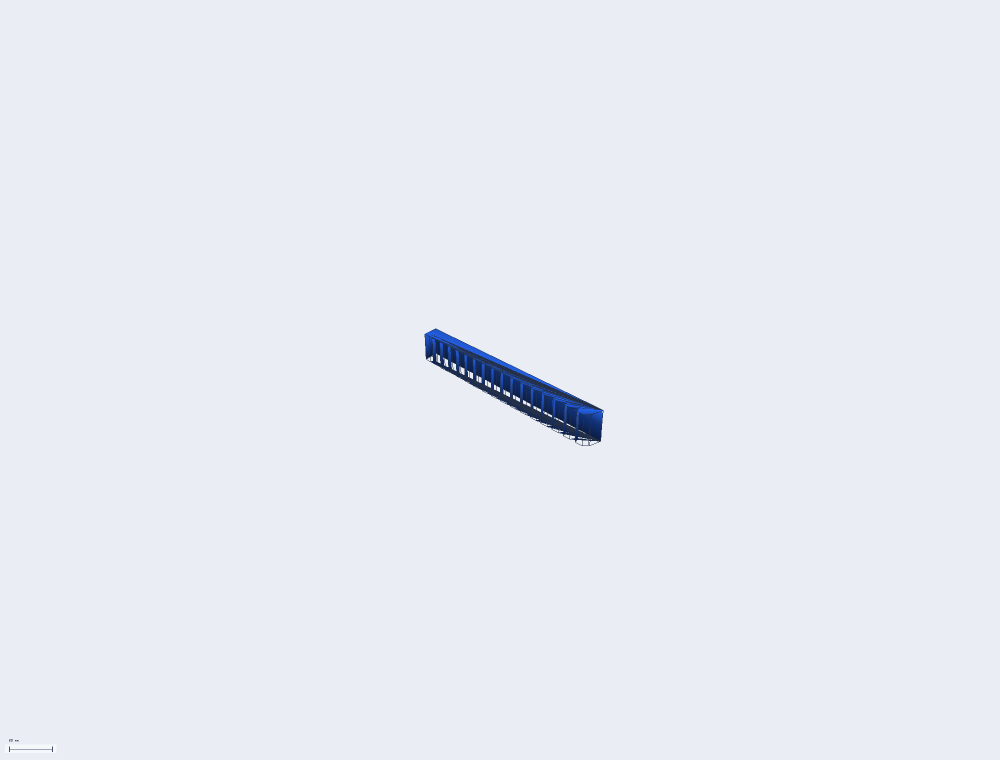
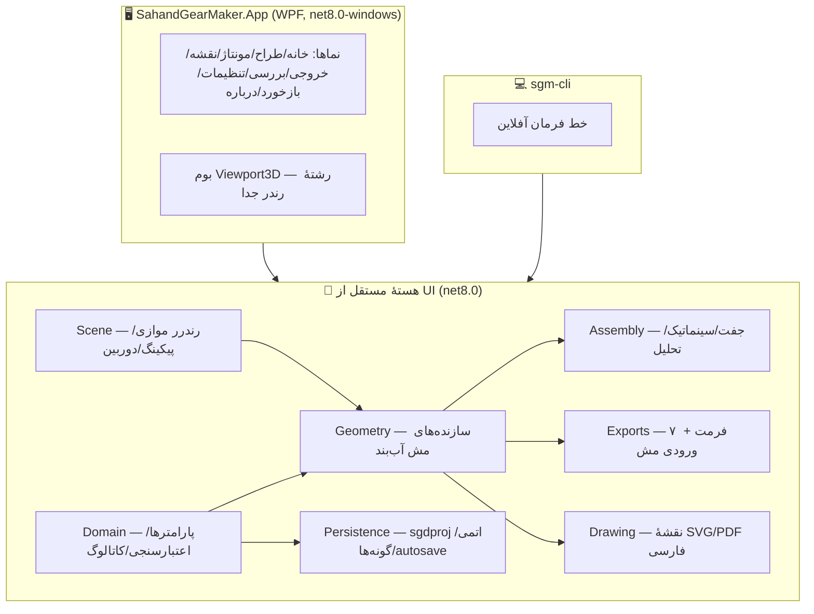

<div dir="rtl">

# ⚙️ طراح چرخ‌دندهٔ سهند | Sahand Gear Designer

### نسخهٔ ۰٫۴٫۰ — طراحی پارامتریک چرخ‌دنده، کاملاً آفلاین، فارسی و راست‌به‌چپ، با خروجی‌های مهندسی واقعی

<p align="center">
  <a href="https://github.com/pranses2011/Sahand_Gear_Maker/releases/latest">
    </a>
  <a href="https://github.com/pranses2011/Sahand_Gear_Maker/actions/workflows/core.yml">
    </a>
  <a href="https://github.com/pranses2011/Sahand_Gear_Maker/actions/workflows/windows.yml">
    </a>
  <a href="https://github.com/pranses2011/Sahand_Gear_Maker/actions/workflows/release.yml">
    </a>
  
  
  
  
  
</p>

<h3 align="center">
  
</h3>
<p align="center"><sub>رابط کاربری واقعی نسخهٔ ۰٫۴٫۰ — عنوان پنجره و سربرگ برنامه همیشه شمارهٔ نسخه را نشان می‌دهند.</sub></p>

<h3 align="center">
  
  
  
</h3>

---

## 📑 فهرست

- [دانلود و اجرا](#-دانلود-و-اجرا)
- [معرفی](#-معرفی)
- [تازه‌های نسخهٔ ۰٫۴٫۰](#-تازههای-نسخهٔ-۰۴۰)
- [قابلیت‌ها](#-قابلیت‌ها)
- [خانواده‌های چرخ‌دنده](#-خانوادههای-چرخ-دنده-۱۹-خانواده)
- [گالری کامل](#-گالری-کامل)
- [شروع سریع](#-شروع-سریع)
- [خط فرمان (CLI)](#-خط-فرمان-sgm-cli)
- [معماری](#-معماری)
- [فرمت‌های ورودی/خروجی](#-فرمتهای-ورودیخروجی)
- [نقشهٔ راه](#-نقشههای-راه--وضعیت-تکمیل)
- [حریم خصوصی و آفلاین](#-حریم-خصوصی-و-آفلاین)
- [آزمون‌ها و کیفیت](#-آزمونها-و-کیفیت)
- [مستندات](#-مستندات)
- [مجوز](#-مجوز)

---

## ⬇️ دانلود و اجرا

| بسته | توضیح |
|---|---|
| 📦 **[SahandGearDesigner-0.4.0-win-x64-portable.zip](https://github.com/pranses2011/Sahand_Gear_Maker/releases/latest)** | برنامهٔ کامل ویندوز (x64) — **پرتابل و بدون نیاز به نصب و اینترنت**؛ فایل ZIP را باز کنید و `SahandGearDesigner.exe` را اجرا کنید |
| 🖥️ [sgm-cli-0.4.0-win-x64.zip](https://github.com/pranses2011/Sahand_Gear_Maker/releases/latest) | ابزار خط فرمان (ساخت/خروجی/نقشه/تحلیل) برای اسکریپت و CI |

> بستهٔ پرتابل **self-contained** است و شامل زمان اجرای .NET ۸ و فونت فارسی وزیرمتن است؛ هیچ پیش‌نیازی ندارد.
> همهٔ انتشارها از صفحهٔ [Releases](https://github.com/pranses2011/Sahand_Gear_Maker/releases) در دسترس‌اند و به‌صورت خودکار با هر تگ `vX.Y.Z` ساخته می‌شوند.

---

## 🎯 معرفی

**طراح چرخ‌دندهٔ سهند** یک ابزار مهندسی دسکتاپ برای طراحی پارامتریک چرخ‌دنده است که از ابتدا برای کاربر فارسی‌زبان، بدون هیچ وابستگی به اینترنت و بدون ارسال هیچ داده‌ای طراحی شده است. هستهٔ هندسی برنامه مستقل از رابط کاربری است و روی لینوکس/ویندوز قابل ساخت و آزمون است؛ رابط کاربری WPF با فونت وزیرمتنِ همراه برنامه، راست‌به‌چپ کامل و پالت رنگی متناسب فارسی ارائه می‌شود.

برنامه صادق است: هر قابلیتی که ادعا می‌کند واقعاً پیاده‌سازی و آزموده شده و محدودیت‌ها و تقریب‌های مهندسی (مثل روش Tredgold برای مخروطی یا طرح‌ریزی تولید برای تاجی) صریحاً در کاتالوگ قابلیت، تشخیص‌ها و مستندات اعلام می‌شوند.

### ✨ ویژگی‌های کلیدی

| | قابلیت | توضیح |
|---|---|---|
| 🧮 | **موتور هندسی واقعی** | پروفیل اینولوت با تلرانس وتر، مش‌های آب‌بند (manifold) با اعتبارسنجی حجم/توپولوژی |
| 🖼️ | **پیش‌نمایش حرفه‌ای** | رندر موازی tile-parallel با رشتهٔ جدا، بافر با وضوح فیزیکی DPI، ضدپلگی SSAA در سکون (تا ×۴ در کپچر)، سایه‌زنی گورا، **لبه‌های ویژه** (فقط شکست‌های واقعی سطح)، گرید پایدار مبتنی بر نما، اینرسی دوربین، زوم به مکان‌نما، ViewCube، نماهای دقیق (بالا/پایین قائم)، پرسپکتیو/ارتو، انتخاب با کلیک (پیکینگ)، منوی زمینه‌ای، HUD زنده |
| 🎛️ | **کنترل‌های شیئ** | درخت پروژه با چشم/قفل/رنگ، جابه‌جایی/چرخش/مقیاس/شفافیت عددی per-part، انتخاب با تینت ملایم (رنگ قطعه حفظ می‌شود) |
| 🔗 | **مونتاژ زنده در UI** | گراف روابط ۱۱گانه با نتیجهٔ سازگاری، چیدمان خودکار، ویزارد سیاره‌ای با **فاز دقیق دندانهٔ سیاره‌ها**، پخش‌کنندهٔ حرکت (سینماتیک ایدئال)، نمای انفجاری |
| 🛠️ | **بررسی و اندازه‌گیری** | ابزار فاصله/زاویه روی بوم، صفحهٔ برش نمایشی، گزارش تحلیل هندسی، بررسی برخورد تقریبی، نمای دوم ارتوگرافیک |
| ↩️ | **واگرد/ازنو + بازیابی** | Undo/Redo ۵۰ گامی (Ctrl+Z/Y)، ذخیرهٔ خودکار با بازیابی، پروژه‌های اخیر |
| 🏷️ | **نسخهٔ همیشه‌نمایان** | شمارهٔ نسخه از منبع واحد MSBuild هم در **عنوان پنجرهٔ برنامه** و هم سربرگ و صفحهٔ «درباره» نمایش داده می‌شود |
| ⚙️ | **۱۹ خانوادهٔ چرخ‌دنده** | از ساده و مارپیچ تا کرم، مخروطی، هیپوئید، بیضوی، هارمونیک و هزارخار |
| 📐 | **نقشهٔ فنی فارسی** | نمای دایره‌ای + **نمای جانبی**، زوم ۲۰٪ تا ۸۰۰٪، SVG و PDF با فونت تعبیه‌شده، شکل‌دهی حروف فارسی و جدول پارامتر |
| 📦 | **۷ فرمت خروجی + ۳ فرمت ورودی** | STL/OBJ/PLY/GLB/3MF/AMF/DXF + ورودی مدل مرجع STL/OBJ/PLY؛ **محدودهٔ خروجی** (قطعه/مونتاژ تجمیعی/جدا) و کیفیت‌های Ultra و Precision |
| 🖥️ | **CLI خودکار** | `sgm-cli` برای ساخت/خروجی/نقشه/تحلیل در خط فرمان و CI |
| 🔒 | **کاملاً آفلاین** | هیچ درخواست شبکه‌ای اجباری؛ فونت و همهٔ منابع همراه برنامه |

---

## 🆕 تازه‌های نسخهٔ ۰٫۴٫۰ — بستهٔ رفع ۱۲ ایراد گزارش‌شدهٔ کاربران

این نسخه حاصل بازخورد مستقیم کاربران نسخهٔ ۰٫۳٫۰ است؛ هر مورد ریشه‌یابی و در لایهٔ درست (موتور هندسی / رندر / UI) اصلاح شده و با آزمون خودکار پوشش داده شده است:

| # | ایراد گزارش‌شده | ریشه و اصلاح |
|---|---|---|
| ۱ | دندانه‌های چینش سیاره‌ای روی هم می‌افتادند | فاز دندانهٔ هر سیاره (ψᵢ) و چرخش حلقه (θᵣ) از روابط دقیق درگیری محاسبه و اعمال می‌شود؛ پخ نوک ۰٫۱۵m برای هر سه عضو (روش متداول ساخت) |
| ۲ | عکس خروجی پیش‌نمایش تار بود | بافر رندر در پیکسل فیزیکی DPI (شارپ روی نمایش‌های ۱۲۵٪/۱۵۰٪) + کپچر اختصاصی با SSAA تا ×۴ |
| ۳ | بین دندانه‌ها زائده دیده می‌شد | بازطراحی کامل فیلهٔ ریشه به برآرِش مماس‌پیوسته (شبه‌تروکوئید) + رفع ترتیب معکوس پهلوهای چرخ داخلی (پرش ۴mm) |
| ۴ | سایه/رنگ مش‌های مثلثی یکپارچه نبود | «سایه + لبه» فقط لبه‌های ویژه (شکست واقعی سطح با زاویهٔ دیهدرال > ۲۵°) را می‌کشد، نه همهٔ یال‌های مثلث‌بندی |
| ۵ | گرید و محورها پرش می‌کردند | روکش‌ها در فضای پیکسلی SSAA رسم می‌شوند + گام گرید از نمای دوربین (نه ابعاد قطعات) — چگالی ثابت و لنگر در مبدأ |
| ۶ | نقشه فنی زوم نداشت و تک‌زاویه بود | زوم چرخ ماوس/دکمه‌ها/اندازهٔ صفحه + نمای جانبی (ارتفاع) با جزئیات بور/توپی در کنار نمای دایره‌ای |
| ۷ | کیفیت خروجی کم بود | پیش‌تنظیم‌های جدید «خیلی دقیق (Ultra) 0.004mm» و «حداکثر (Precision) 0.002mm» — هندسه واقعاً با تلرانس ظریف‌تر بازسازی می‌شود |
| ۸ | لیست فرمت‌های صفحه خروجی زشت بود | فهرست فقط نام کوتاه فرمت + کارت توضیح کامل (وضعیت، پسوند، کاربرد، یادداشت) کنار فهرست |
| ۹ | نمای «بالا» کمی زاویه داشت | دوربین در قطب بی‌تقابل شد (راست تحلیلی) و کلمپ ارتفاع دقیقاً ±۹۰° — نمای بالا کاملاً قائم |
| ۱۰ | تغییر رنگ روی قطعه اعمال نمی‌شد | انتخاب حالا تینت ۳۰٪ است (رنگ قطعه دیده می‌شود) + پذیرش هگز سه‌رقمی/ARGB در رنگ‌ها |
| ۱۱ | با چند قطعه فقط اولین قطعه خروجی گرفته می‌شد | محدودهٔ خروجی: قطعهٔ انتخابی / **مونتاژ تجمیعی همهٔ قطعات با جای‌گذاری صحنه** / فایل جدا برای هر قطعه |
| ۱۲ | تب‌های ناوبری بالای صفحه خالی بودند | نوار تب حذف شد (ناوبری از فهرست سمت راست) — بدون نوار خالی بالای محتوا |

---

## 🆕 تازه‌های نسخهٔ ۰٫۳٫۰

### نقشهٔ راه شش‌فازی ارتقا ۰٫۳ (همهٔ فازها تکمیل ✅)

| فاز | قابلیت | وضعیت |
|---|---|:---:|
| ۰ | تثبیت پایه: نسخهٔ واحد از MSBuild، کاتالوگ = منبع حقیقت UI، فعال‌سازی 3MF/AMF/DXF/SVG، رفع باگ Parts | ✅ |
| ۱ | **پیش‌نمایش حرفه‌ای**: کتابخانهٔ Scene جدید (رندر tile-parallel، SSAA×2، برش Sutherland-Hodgman، گورا + specular، پیکینگ Möller-Trumbore، دوربین انیمیت با اینرسی) + کنترل Viewport3D (صف فرمان قفل‌محور، ViewCube، نوار ابزار، HUD، منوی زمینه‌ای) + بازطراحی کامل صفحهٔ طراح | ✅ |
| ۲ | اتصال کامل موتور به UI: ۱۹ خانواده در فرم، نقشهٔ فنی زنده، مدل مرجع شبح، گونه‌ها، خروجی دسته‌ای | ✅ |
| ۳ | مونتاژ زنده: گراف روابط، چیدمان خودکار، ویزارد سیاره‌ای، پخش‌کنندهٔ حرکت، نمای انفجاری، دستیار نسبت | ✅ |
| ۴ | ابزار بررسی: اندازه‌گیری فاصله/زاویه با برچسب روی بوم، صفحهٔ برش، تحلیل هندسی، برخورد تقریبی، نمای دوم ارتو | ✅ |
| ۵ | UX و انتشار: تنظیمات با اثر واقعی، کتابخانهٔ نمونه، انتشار پرتابل + Release خودکار، اسکرین‌شات‌های خودکار CI | ✅ |

### تثبیت انتشار (پس از ۰٫۳٫۰)

- 🏷️ **شمارهٔ نسخه در عنوان نرم‌افزار** — عنوان پنجره و سربرگ برنامه همیشه `v0.3.0` را از منبع واحد MSBuild نشان می‌دهند.
- 📸 **کپچر رابط برای مستندات داخل خود برنامه** — با اجرای `SahandGearDesigner.exe --screenshot <پوشه>`؛ رفع ریشه‌ای خطای بارگذاری منابع WPF در میزبان بیرونی و پایداری کامل اسکرین‌شات‌های CI.
- 🔄 **چرخهٔ خودکار اسکرین‌شات** — هر اجرای CI ویندوزی، همهٔ تصاویر گالری این صفحه را دوباره تولید و به مخزن کامیت می‌کند تا همیشه با آخرین وضعیت برنامه هماهنگ باشند.
- 📋 رویهٔ [چک‌لیست انتشار](docs/RELEASE-CHECKLIST.md) — با هر تغییر: بازنویسی README، به‌روزرسانی «دربارهٔ» مخزن و شماره‌گذاری نسخه.

<details>
<summary><b>📜 بسته‌های تکمیل‌شدهٔ نسخهٔ ۰٫۲ (پیش‌تر)</b></summary>

| بسته | قابلیت | وضعیت |
|---|---|:---:|
| A | ذخیرهٔ خودکار + بازیابی پس از خرابی | ✅ |
| A | دستیار انتخاب اندازه/نسبت (reverse sizing) | ✅ |
| A | بررسی سازگاری/برخورد/فاصلهٔ قطعات | ✅ |
| A | نقشهٔ دوبعدی + SVG/PDF فارسی | ✅ |
| B | پیش‌نمایش حرکت/سینماتیک (جفت/قطار/سیاره‌ای/هارمونیک) | ✅ |
| B | گونه‌ها (Variants) + جدول مقایسه | ✅ |
| B | خروجی دسته‌ای با گزارش | ✅ |
| B | ورود مدل مرجع (STL/OBJ/PLY) | ✅ |
| C | همهٔ خانواده‌های هندسی نقشهٔ راه (۱۲ خانوادهٔ جدید) | ✅ |
| C | خروجی 3MF/AMF/DXF | ✅ |
| C | API/اسکریپت آفلاین (`sgm-cli`) | ✅ |
| — | محاسبهٔ استحکام AGMA/ISO | 🚫 آگاهانه خارج از دامنه — نیازمند استاندارد معتبر، آزمون مرجع و بازبینی متخصص |
| — | افزونهٔ اجرای کد ناشناس | 🚫 آگاهانه ممنوع (سیاست امنیتی سند ۰۵) |

</details>

---

## 🚀 قابلیت‌ها در یک نگاه



---

## ⚙️ خانواده‌های چرخ‌دنده (۱۹ خانواده)

| خانواده | وضعیت | روش هندسی |
|---|:---:|---|
| خارجی مستقیم / مارپیچ / جناغی | ✅ | اینولوت با تلرانس وتر؛ گپ مرکزی واقعی جناغی |
| داخلی مستقیم / مارپیچ | ✅ | رینگ دندانهٔ واقعی (نه استوانهٔ ساده) |
| شانهٔ مستقیم / مارپیچ | ✅ | منشور دندانه‌دار با گام سازگار |
| مخروطی مستقیم / مارپیچ | ✅ | پروفیل معادل Tredgold + مارپیچ لگاریتمی ثابت‌زاویه |
| کرم (ZA) / چرخ کرم | ✅ | سطح پیچی دقیق + گلوگاه گلوبوئیدی (پوشش ابزار کرم‌نما) |
| مارپیچ متقاطع | ✅ | هندسهٔ هلیکی + محاسبهٔ زاویهٔ محور Σ=β₁+β₂ |
| تاجی / پیشانی | ✅ | دندانهٔ شعاعی با ارتفاع کاهشی (طرح‌ریزی تولید) |
| هیپوئیدی | ✅ | مخروطی مارپیچ با روابط آفست |
| سیکلوئیدی | ✅ | اپیسایکلوئید سر + هیپوسایکلوئید شعاعی (قرارداد ساعت‌سازی) |
| غیرمدور بیضوی | ✅ | حل محیط با انتگرال E(e)؛ بور روی کانون |
| فِلکسی‌پلاین هارمونیک | ✅ | فنجان حالت آزاد + موج‌ساز بیضوی در مونتاژ |
| هزارخار خارجی / داخلی | ✅ | اینولوت کوتاه با برازش گام/قطر پایه |

> 📋 جزئیات کامل روش‌ها و محدودیت‌های صادقانه: [ماتریس قابلیت](docs/CAPABILITY-MATRIX.md)

---

## 🖼 گالری کامل

همهٔ تصاویر زیر **خروجی واقعی رندرر نرم‌افزاری خود برنامه** هستند که در CI ویندوزی تولید و به‌صورت خودکار به این مخزن افزوده می‌شوند؛ بنابراین همیشه با آخرین نسخهٔ برنامه به‌روز هستند.

### نمای رابط کاربری (کپچر واقعی از خود برنامه)

<p align="center">
  
</p>
<p align="center"><sub>کپچر خودکار از پنجرهٔ اصلی — تولیدشده با پرچم <code>--screenshot</code> در CI</sub></p>

### ۱۹ خانوادهٔ چرخ‌دنده (رندر موتور جدید)

| | | |
|:---:|:---:|:---:|
|  |  |  |
| **خارجی مستقیم** | **مارپیچ** | **جناغی (دومارپیچ)** |
|  |  |  |
| **داخلی (رینگ واقعی)** | **مخروطی مستقیم** | **مخروطی مارپیچ** |
|  |  |  |
| **کرم حلزونی ZA** | **چرخ کرم گلوگاه‌دار** | **تاجی/پیشانی** |
|  |  |  |
| **غیرمدور بیضوی** | **فِلکسی‌پلاین هارمونیک** | **هزارخار اینولوت** |
|  | | |
| **شانهٔ مستقیم** | | |

### صحنه‌های موتور پیش‌نمایش

| | | |
|:---:|:---:|:---:|
|  |  |  |
| **جفت درگیر + گرید** | **گرید + محورهای XYZ** | **حالت سیمی** |
|  |  | |
| **سایهٔ گورا** | **هایلایت انتخاب + شفافیت** | |

---

## 🏁 شروع سریع

### راه‌اندازی برای توسعه

```bash
git clone https://github.com/pranses2011/Sahand_Gear_Maker.git
cd Sahand_Gear_Maker

# ساخت و آزمون هسته (لینوکس/WSL/macOS/ویندوز)
dotnet restore tests/SahandGearMaker.Tests
dotnet build -c Release src/SahandGearMaker.Domain src/SahandGearMaker.Math \
  src/SahandGearMaker.Geometry src/SahandGearMaker.Assembly \
  src/SahandGearMaker.Persistence src/SahandGearMaker.Exports src/SahandGearMaker.Drawing
dotnet test tests/SahandGearMaker.Tests -c Release

# اجرای برنامهٔ ویندوزی (فقط ویندوز)
dotnet run --project src/SahandGearMaker.App -c Release
```

### ساخت برنامهٔ ویندوزی

```bash
dotnet publish src/SahandGearMaker.App -c Release -o publish/app
```

> 💡 بیلد آمادهٔ ویندوزی (artifact) از سربرگ **Actions ← windows-build-screenshots** و بستهٔ پرتابل از صفحهٔ [Releases](https://github.com/pranses2011/Sahand_Gear_Maker/releases) قابل دانلود است.

### کپچر رابط برای مستندات (داخل خود برنامه)

```bash
# در پوشهٔ برنامهٔ منتشرشده — برای بازتولید ui-main.png
SahandGearDesigner.exe --screenshot <پوشهٔ خروجی>
```

راهنمای کامل: [docs/BUILD.md](docs/BUILD.md) · [docs/USER-GUIDE.md](docs/USER-GUIDE.md)

---

## 💻 خط فرمان `sgm-cli`

خودکارسازی کامل بدون UI — مناسب اسکریپت و CI:

```bash
# ساخت پروژهٔ جدید (مخروطی، ماژول ۳، ۲۴ دندانه)
sgm-cli new --family BevelSpur --module 3 --teeth 24 --width 18 --bore 12 \
            --name "چرخ محرک" --out gearbox.sgdproj

# خروجی همهٔ قطعات (STL باینری/متنی، OBJ، PLY، GLB، 3MF، AMF)
sgm-cli export gearbox.sgdproj --format 3mf --outdir output/

# نقشهٔ فنی فارسی (SVG + PDF با فونت تعبیه‌شده)
sgm-cli drawing gearbox.sgdproj --outdir drawings/

# تحلیل هندسی + بررسی جفت‌ها
sgm-cli analyze gearbox.sgdproj

# ورودی مدل مرجع (فقط بازبینی؛ پارامتریک نمی‌شود)
sgm-cli import reference.stl
```

---

## 🏛 معماری



- **هستهٔ آفلاین و مستقل**: همهٔ محاسبات بدون UI و بدون شبکه؛ ساخت/آزمون روی لینوکس.
- **صداقت مهندسی**: انواع «نقشهٔ راه» مدل جعلی نمی‌سازند؛ تقریب‌ها (Tredgold و…) اعلام می‌شوند.
- **ذخیرهٔ اتمی**: فایل پروژه هرگز نیمه‌کاره نمی‌ماند؛ دادهٔ ناشناختهٔ schema حفظ می‌شود.
- **نسخهٔ منبع واحد**: شمارهٔ نسخه فقط در `$(Version)` پروژه‌ها تعریف می‌شود و از آن در عنوان پنجره، «درباره» و بستهٔ انتشار می‌آید.

جزئیات کامل: [docs/ARCHITECTURE.md](docs/ARCHITECTURE.md)

---

## 🔄 فرمت‌های ورودی/خروجی

| جهت | فرمت | وضعیت | نکته |
|---|---|:---:|---|
| خروجی | STL باینری/متنی | ✅ | واحد در فایل کد نمی‌شود؛ در گزارش اعلام می‌شود |
| خروجی | OBJ + MTL | ✅ | با فایل متریال جانبی |
| خروجی | PLY باینری | ✅ | با نرمال‌ها |
| خروجی | GLB (glTF) | ✅ | تبدیل mm→m طبق مشخصات glTF |
| خروجی | **3MF** | ✅ | ZIP/OPC استاندارد با اعتبارسنجی پس از نوشتن |
| خروجی | **AMF** | ✅ | XML با واحد صریح |
| خروجی | **DXF (پروفیل)** | ✅ | R12 سازگار برای برش لیزری/CAM دوبعدی |
| خروجی | **SVG / PDF نقشه** | ✅ | فارسی کامل با فونت تعبیه‌شده |
| خروجی | SGDPROJ | ✅ | پروژهٔ پارامتریک نسخه‌دار با ذخیرهٔ اتمی |
| ورودی | STL / OBJ / PLY | ✅ | فقط «مدل مرجع» — هرگز پارامتریک نمی‌شود |
| — | STEP / IGES | 🗺 | نیازمند هستهٔ B-rep با مجوز مناسب؛ مش به‌عنوان B-rep معرفی نمی‌شود |

---

## 🗺 نقشه‌های راه — وضعیت تکمیل

| سند | وضعیت |
|---|---|
| [نقشهٔ راه شش‌فازی ۰٫۳ (پیش‌نمایش حرفه‌ای، کنترل شیئ، اتصال موتور، مونتاژ، بررسی، UX/انتشار)](docs/ANALYSIS-AND-ROADMAP.md) | ✅ همهٔ فازها تکمیل — [گزارش تحویل ۰٫۳](docs/DELIVERY-0.3.0.md) |
| [نقشهٔ راه نسخهٔ ۰٫۲ (خانواده‌ها، مونتاژ، نقشه، خروجی‌ها)](docs/FINAL-REPORT.md) | ✅ تکمیل |

روندهای همیشگی مخزن: [چک‌لیست انتشار](docs/RELEASE-CHECKLIST.md) — با هر تغییر معنادار، README و «دربارهٔ» مخزن بازنویسی و شمارهٔ نسخه و اسکرین‌شات‌ها به‌روز می‌شوند.

---

## 🔐 حریم خصوصی و آفلاین

- ✅ **هیچ telemetry/درخواست اجباری** هنگام راه‌اندازی؛ قابل تأیید با مانیتور شبکه.
- ✅ فونت وزیرمتن (مجوز OFL) همراه بستهٔ برنامه؛ بدون دانلود اینترنتی.
- ✅ ارسال بازخورد **فقط با رضایت صریح** و پیش‌نمایش محتوا؛ صف محلی در صورت قطعی.
- ✅ گواهی‌نامهٔ جست‌وجوی مخزن برای نبود توکن/رمز: [docs/PRIVACY.md](docs/PRIVACY.md)

---

## 🧪 آزمون‌ها و کیفیت

```
dotnet test tests/SahandGearMaker.Tests -c Release
```

- **۱۶۶ آزمون xUnit** — همه سبز در CI لینوکس و ویندوز:
  - دامنه: اعتبارسنجی، ارقام هندسی، آب‌بندی مش، بازتولیدپذیری، fuzz، جفت‌ها،
    سینماتیک (ویلیس/شانه/هارمونیک)، نقشهٔ فنی، شکل‌دهی فارسی، گونه‌ها،
    autosave، round-trip ورودی/خروجی، خروجی دسته‌ای،
    **موتور صحنهٔ ۰٫۳** (برش نزدیک، culling، پیکینگ، دوربین انیمیت، SSAA،
    کارایی مش سنگین < ۵۰۰ms، خط اندازه‌گیری، بقا هندسه با صفحهٔ برش).
- **معیار آب‌بندی**: هر یال جهت‌دار دقیقاً ۲ بار؛ حجم علامت‌دار مثبت.
- **اعتبارسنجی پس از نوشتن**: همهٔ صادرکننده‌ها فایل را دوباره می‌خوانند.

---

## 📚 مستندات

| سند | توضیح |
|---|---|
| [معماری](docs/ARCHITECTURE.md) | لایه‌ها، تصمیم‌ها، محدودیت‌های صادقانه |
| [ماتریس قابلیت](docs/CAPABILITY-MATRIX.md) | وضعیت دقیق همهٔ خانواده‌ها/فرمت‌ها با روش‌ها |
| [راهنمای ساخت](docs/BUILD.md) | ساخت روی لینوکس/ویندوز + انتشار |
| [راهنمای کاربر](docs/USER-GUIDE.md) | کار با برنامهٔ ویندوزی |
| [چک‌لیست انتشار](docs/RELEASE-CHECKLIST.md) | رویهٔ نسخه‌گذاری، بازنویسی README/About و اسکرین‌شات‌ها |
| [تحلیل و نقشهٔ راه](docs/ANALYSIS-AND-ROADMAP.md) | سند شش‌فازی ارتقای ۰٫۲ → ۰٫۳ |
| [گزارش تحویل ۰٫۳](docs/DELIVERY-0.3.0.md) | جمع‌بندی فازهای ۰ تا ۵ |
| [گزارش نهایی ۰٫۲](docs/FINAL-REPORT.md) | جمع‌بندی صادقانهٔ تحویل پیشین |
| [حریم خصوصی](docs/PRIVACY.md) | سیاست داده و آفلاین |
| [اعلان‌های شخص ثالث](ThirdPartyNotices.md) | فونت وزیرمتن (OFL) و بسته‌ها |

---

## 📄 مجوز

مجوز [MIT](LICENSE) — متن ساده.

**اعلان فونت:** فونت [وزیرمتن](https://github.com/rastikerdar/vazirmatn) با مجوز [OFL 1.1](Assets-License) همراه برنامه توزیع می‌شود.

---

<div align="center">

**ساخته‌شده با ⚙️ و 💙 — طراح چرخ‌دندهٔ سهند v0.3.0**

</div>

</div>
