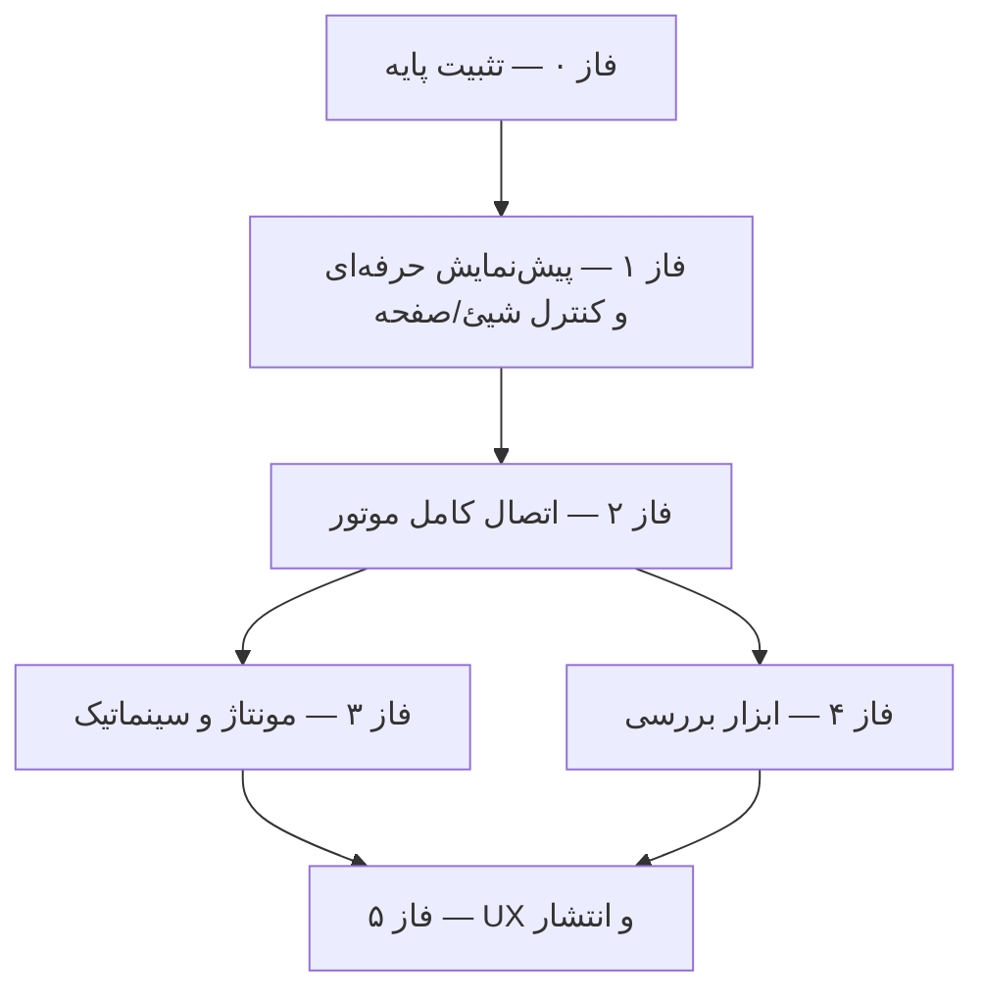

<div dir="rtl">

# 🔬 تحلیل جامع و نقشهٔ راه ارتقا — Sahand Gear Maker

| مشخصهٔ سند | مقدار |
|---|---|
| نسخهٔ سند | 1.0 — 2026/10/18 |
| نسخهٔ تحلیل‌شدهٔ برنامه | 0.2.0 (کامیت `469c9b8`) |
| دامنهٔ تحلیل | تمام ۱۱ پروژهٔ سورس، ۶ فایل آزمون، مستندات، CI و اتصال UI↔موتور |
| هدف | شناسایی دقیق کمبودها برای «افزایش عملکرد و کارایی» + «پیش‌نمایش حرفه‌ای، روان، دارای کنترل صفحه و شیئ» + نقشهٔ راه اجرایی |
| وضعیت CI در زمان تحلیل | ✅ core-build-test (اوبونتو) و ✅ windows-build-screenshots (ویندوز) هر دو سبز |

---

## 🎯 ۱. خلاصهٔ مدیریتی

برنامهٔ **سازندهٔ چرخ‌دندهٔ سهند** در لایهٔ «موتور هندسی» به بلوغ چشمگیری رسیده است: ۱۹ خانوادهٔ چرخ‌دنده با مش آب‌بند، موتور مونتاژ و سینماتیک کامل، ۷ فرمت خروجی + ۳ فرمت ورودی، نقشهٔ فنی فارسی با PDF/SVG، مدیریت گونه و ذخیرهٔ خودکار، ۱۰۸ آزمون واحد سبز و دو خط CI فعال. این دارایی‌ها واقعی‌اند و در کتابخانه‌ها و CLI قابل اثبات‌اند.

اما تحلیل دقیق اتصال لایه‌ها یک یافتهٔ محوری دارد: **رابط کاربری دسکتاپ فقط کسری کوچک (حدود ۱۰ تا ۱۵ درصد) از توان واقعی موتور را در اختیار کاربر می‌گذارد.** کاربرِ رابط گرافیکی فقط به ۵ خانواده از ۱۹ خانواده، ۴ فرمت از ۹ مسیر خروجی و هیچ صفحهٔ مونتاژ/حرکت/گونه/اندازه‌گیری دسترسی ندارد؛ در حالی که همهٔ این‌ها در کتابخانه‌ها آماده و آزموده‌شده‌اند و CLI از آن‌ها استفاده می‌کند. به بیان دیگر، مشکل اصلی «نبودِ قابلیت» نیست؛ **مشکل اصلی «پل‌زدن نشدن بین موتور و رابط کاربری» و «پیش‌نمایش سه‌بعدی پایه» است.**

دومین یافتهٔ محوری، کیفیت سامانهٔ پیش‌نمایش است: رندرر نرم‌افزاری فعلی یک رسترایزر تک‌رشته‌ای ساده است که فاقد ضدپلگی، برش صفحهٔ نزدیک (near-plane clipping)، سایه‌زنی نرم، شبکهٔ زمین و محورها، انتخاب شیئ از روی بوم، اینرسی دوربین و رندر چندقطعه‌ای است؛ در هر فریم هم بوم و بافرها را از نو تخصیص می‌دهد و روی رشتهٔ UI اجرا می‌شود. نتیجه، تجربه‌ای «کارکردی اما غیرحرفه‌ای» است — دقیقاً همان محوری که درخواست ارتقای شما روی آن است.

سومین یافته، ناسازگاری‌های محتوایی است: متن صفحهٔ خانه و فهرست فرمت‌های تب خروجی از وضعیت واقعی موتور عقب مانده‌اند (مثلاً 3MF و DXF در UI «نقشهٔ راه» خوانده می‌شوند در حالی که صادرکنندهٔ آن‌ها موجود و فعال است) و شمارهٔ نسخهٔ `AppInfo` هنوز `0.1.0` است در حالی که مستندات 0.2.0 را اعلام می‌کنند.

این سند این سه یافته را با جزئیات فنی، شواهد کد و جدول‌های اولویت‌بندی تشریح می‌کند و در پایان یک **نقشهٔ راه شش‌فازی** با معیار پذیرش مشخص برای هر فاز ارائه می‌دهد تا به‌صورت مرحله‌ای و با تأیید شما اجرا شود.

---

## 🧪 ۲. روش و دامنهٔ تحلیل

تحلیل به‌صورت «از پایین به بالا» و «از بیرون به درون» انجام شد:

1. **مرور کامل ساختار مخزن:** ۶۸ کامیت، ۱۱ پروژهٔ C#، ۶ فایل آزمون، ۴ سند فنی، ۱۳ اسکرین‌شات، ۲ ورک‌فلو CI.
2. **خواندن کامل بستهٔ الزامات** (`prompts/sahand-gear-designer/01` تا `07`) و استخراج ۴۸ الزام قابل‌بررسی.
3. **مطالعهٔ خط‌به‌خط فایل‌های کلیدی UI:** `SoftwareRenderer.cs`، `DesignerView.xaml(.cs)`، `MainWindow.xaml(.cs)`، `DesignerViewModel.cs`، `ExportViewModel.cs`، `App.xaml`، `HomeView.xaml`.
4. **استخراج API عمومی تمام کتابخانه‌ها** (Domain، Geometry، Assembly، Exports، Drawing، Persistence) و تطبیق تک‌تک آن‌ها با میزان استفاده در پروژهٔ App.
5. **تحلیل کارایی:** الگوهای تخصیص حافظه، مسیر رندر، رفتار rebuild و صف‌بندی.
6. **راستی‌آزمایی زیرساخت:** وضعیت واقعی اجراهای GitHub Actions از طریق API و بررسی بایت‌به‌بایت فایل‌های ورک‌فلو.

سنجه‌های کمی کلیدی:

| سنجه | مقدار |
|---|---|
| کل خطوط C# | ≈ ۱۲٬۶۰۰ خط در ۵۷ فایل |
| بزرگ‌ترین پروژه | Geometry با ۴٬۵۷۳ خط |
| کوچک‌ترین پروژهٔ UI مصرف‌کننده | App با ۱٬۵۰۲ خط (۱۵ فایل) |
| آزمون‌های واحد xUnit | ۱۰۸ `[Fact]` (۶ فایل، ۱٬۴۹۸ خط) |
| خانواده‌های چرخ‌دنده در موتور | ۱۹ |
| خانواده‌های قابل انتخاب در UI | **۵** |
| فرمت‌های خروجی آماده در کتابخانه‌ها | STL×۲، OBJ، PLY، GLB، 3MF، AMF، DXF، SVG، PDF |
| فرمت‌های فعال در UI | **۴** (STL باینری/متنی، OBJ، PLY، GLB) |
| روش‌های عمومی سینماتیک/مونتاژ بدون استفاده در UI | ۱۸+ |

---

## 💎 ۳. دارایی‌های موجود — آنچه قوی است و نباید خراب شود

### ۳.۱ معماری لایه‌ای تمیز

| لایه | خط کد | نقش | کیفیت کلی |
|---|---:|---|---|
| `Math` | 72 | بردار/ماتریس سبک | ✅ کافی |
| `Domain` | 959 | مدل پروژه، پارامترها، اعتبارسنجی، کاتالوگ قابلیت | ✅ قوی |
| `Geometry` | 4,573 | ۱۹ خانواده + پروفیل involute/سیکلوئیدی + مثلث‌بندی | ✅ بسیار قوی |
| `Assembly` | 1,081 | جفت/قطار/سیاره‌ای/سینماتیک/برخورد/دستیار اندازه | ✅ قوی |
| `Exports` | 1,148 | ۷ صادرکننده + ورود مش + خروجی دسته‌ای | ✅ قوی |
| `Drawing` | 1,175 | نقشهٔ فنی، PDF فارسی با فونت تعبیه‌شده، SVG، DXF | ✅ قوی |
| `Persistence` | 316 | ذخیرهٔ اتمی، گونه‌ها، ذخیرهٔ خودکار | ✅ کافی |
| `App` (WPF) | 1,502 | پوستهٔ UI | ⚠️ نازک — محور ضعف |
| `sgm-cli` | 240 | اتوماسیون کامل | ✅ |
| `Screenshots` | 146 | هارنس کپچر CI | ✅ |
| `Tests` | 1,498 | ۱۰۸ آزمون سبز | ✅ |

این جدول تصویر روشنی می‌دهد: **توزیع سرمایه‌گذاری به نفع موتور بوده و UI عقب مانده است** — که از منظر ریسک مهندسی خبر خوبی است، چون ارتقای UI ارزان‌تر و کم‌ریسک‌تر از بازنویسی موتور است.

### ۳.۲ نقاط قوت قابل‌اتکا برای فازهای بعدی

- **کاتالوگ قابلیت زنده (`CapabilityCatalog`):** وضعیت هر خانواده/فرمت را با یادداشت صادقانه نگه می‌دارد؛ هر UI جدید می‌تواند از همین منبع تغذیه شود و «صداقت قابلیت» حفظ شود.
- **مدل دادهٔ کامل:** `GearProject`/`GearPart` از قبل `Placement`، `Mating`، `Variants` و اعتبارسنجی را دارد؛ یعنی UI مونتاژ فقط «نمایش‌دهنده» می‌شود نه «بازطراح مدل داده».
- **CI دوگانهٔ سبز:** هر فاز نقشهٔ راه را می‌توان با `dotnet build + test` روی اوبونتو و ویندوز گیت کرد.
- **رندرر نرم‌افزاری مستقل از GPU:** تصمیم آگاهانهٔ معماری است (سازگاری حداکثری، بدون وابستگی native). مشکل، معماریِ انتخابی نیست؛ **پیاده‌سازی مینیمال آن است.** مسیر ارتقا روشن وجود دارد (بخش ۵).
- **فونت وزیرمتن تعبیه‌شده، RTL کامل، پالت رنگ مستند** — هویت بصری پایه‌گذاری شده و فقط باید عمیق‌تر شود.

---

## 🧭 ۴. یافتهٔ کلیدی ۱ — شکاف «موتور ↔ رابط کاربری» (فهرست کامل)

این بخش قلب تحلیل است: **هر قابلیتی که موتور آن را دارد اما کاربرِ رابط گرافیکی به آن دسترسی ندارد.** اینها ارزان‌ترین و پرارزش‌ترین بهبودها هستند، چون «ساخت» ندارند و فقط «اتصال» می‌خواهند.

### ۴.۱ خانواده‌های چرخ‌دنده: ۵ از ۱۹

`DesignerViewModel.SupportedFamilies` فقط این پنج مورد را لیست می‌کند: `ExternalSpur`, `ExternalHelical`, `ExternalHerringbone`, `InternalSpur`, `Rack`.

این ۱۴ خانوادهٔ آمادهٔ موتور، در UI غایب‌اند:

| # | خانواده | وضعیت موتور | پارامترهای اختصاصیِ بدون فرمِ ویرایش |
|---:|---|---|---|
| ۱ | داخلی مارپیچ (`InternalHelical`) | ✅ کامل | — |
| ۲ | شانهٔ مارپیچ (`HelicalRack`) | ✅ کامل | — |
| ۳ | مخروطی مستقیم (`BevelSpur`) | ✅ کامل | `BevelShaftAngle`, `BevelPitchConeAngle` |
| ۴ | مخروطی مارپیچ (`BevelSpiral`) | ✅ کامل | + `BevelSpiralAngle` |
| ۵ | کرم (`Worm`) | ✅ کامل | `WormPitchDiameterMm`, `WormStartsCount`, `WormIsRightHanded` |
| ۶ | چرخ کرم (`WormWheel`) | ✅ گلوگاه گلوبوئیدی | `WormThroatClearanceMm` |
| ۷ | مارپیچ متقاطع (`CrossedHelical`) | ✅ | — |
| ۸ | تاجی (`CrownFace`) | ✅ طرح‌ریزی مرتبهٔ اول | — |
| ۹ | هیپوئید (`Hypoid`) | ✅ | `HypoidOffsetMm` |
| ۱۰ | سیکلوئیدی (`Cycloidal`) | ✅ قرارداد ساعت‌سازی | — |
| ۱۱ | غیرمدور بیضوی (`NonCircular`) | ✅ | `NonCircularEccentricity` |
| ۱۲ | هارمونیک فلکسی‌پلاین (`Harmonic…`) | ✅ | `HarmonicWaveDeflectionMm`, `HarmonicCupWallThicknessMm` |
| ۱۳ | هزارخار خارجی/داخلی (`Spline…`) | ✅ | `SplineFit`, `SplineBacklashMm`, `SplineStandardNote` |

**ریشهٔ فنی:** فرم `DesignerView` فقط ۸ فیلد عمومی دارد (نام، خانواده، z، m، α، β، پهنا، بور/خار/توپی). کلاس `FamilyParameters` با ۱۵+ پارامتر اختصاصی آماده است اما هیچ `PropertyGrid` یا فرم شرطی برای آن وجود ندارد. **بدون این فرم، حتی افزودن خانواده‌ها به کمبوباکس هم کافی نیست.**

### ۴.۲ خروجی و نقشهٔ فنی: ۴ از ۹ مسیر فعال

`ExportViewModel` فقط STL باینری/متنی، OBJ، PLY و GLB را فعال کرده و این‌ها را «نقشهٔ راه» خوانده: `STEP`, `IGES`, `3MF`, `DXF`. واقعیت موتور:

| مسیر خروجی | وضعیت واقعی کتابخانه | وضعیت UI | نوع شکاف |
|---|---|---|---|
| 3MF (ZIP/OPC استاندارد) | ✅ `Format3mfAmfExporter.Export3mf` — آزموده | ❌ غیرفعال با برچسب «نقشهٔ راه» | فقط اتصال |
| AMF (XML) | ✅ `ExportAmf` | ❌ اصلاً در فهرست نیست | فقط اتصال |
| DXF پروفیل R12 | ✅ `ExportProfileDxf` | ❌ غیرفعال با برچسب «نقشهٔ راه» | فقط اتصال |
| SVG نقشهٔ فنی فارسی | ✅ `SvgDrawingWriter` | ❌ در UI نیست | اتصال + ارجاع پروژه |
| PDF نقشهٔ فنی فارسی (فونت تعبیه) | ✅ `PdfDrawingWriter` | ❌ در UI نیست | اتصال + ارجاع پروژه |

**نکتهٔ معماری مهم:** پروژهٔ `SahandGearMaker.App` اصلاً به `SahandGearMaker.Drawing` ارجاع ندارد؛ یعنی خروجی نقشهٔ فنی (یکی از دستاوردهای برجستهٔ پروژه) فقط از CLI در دسترس است. STEP/IGES به‌درستی غیرفعالند (نبود هستهٔ B-rep — سیاست صادقانهٔ درست) و باید غیرفعال بمانند.

### ۴.۳ مونتاژ و سینماتیک: موتور کامل، UI صفر

کتابخانهٔ Assembly این APIهای آماده را دارد که **هیچ‌کدام در UI استفاده نمی‌شوند**:

- `GearPairCalculator.CheckExternalPair / CheckInternalPair / CheckRackPinion`
- `AdvancedPairCalculator.CheckBevelPair / CheckWormPair / CheckCrossedHelicalPair / CheckCrownPair / CheckNonCircularPair / CheckHarmonicAssembly / CheckSplineConnection / CheckHypoidPair` (۸ جفت‌سنج پیشرفته)
- `PlanetaryGearsetCalculator.Design` + `CompoundTrainCalculator.Evaluate`
- `KinematicsEngine.PairStep / RackStep / CompoundTrainStep / PlanetaryStep / HarmonicStep` (پیش‌نمایش حرکت)
- `InterferenceChecker.Check` (برخورد مش‌ها با cutoff)
- `SizingAssistant.SuggestExternalPair` (دستیار انتخاب نسبت/فاصلهٔ مرکز)
- `GearAnalysisCalculator.Analyze` (نسبت تماس، undercut، ضخامت نوک)

در حالی که سند ۰۲ (بخش ۶.۴) و سند ۰۷ (بخش ۳.۲ و ۳.۴) صفحهٔ مونتاژ، درخت روابط جفت و پیش‌نمایش حرکت را الزام کرده‌اند، تب مونتاژ در برنامه **اصلاً وجود ندارد** و `GearProject.Matings` در UI نادیده گرفته می‌شود (فقط هنگام حذف قطعه پاک می‌شود!).

### ۴.۴ گونه‌ها، ذخیرهٔ خودکار، خروجی دسته‌ای، ورود مدل

| قابلیت آمادهٔ Persistence/Exports | وضعیت UI |
|---|---|
| `VariantManager.Capture / Apply / Compare` + `VariantFile.Save/Load` | ❌ هیچ منو/دکمه‌ای ندارد |
| `AutosaveService` (بازیابی پس از خرابی) | ❌ شروع نمی‌شود |
| `BatchExporter.ExportAll` (گزارش موفق/ناموفق هر فایل) | ❌ |
| `MeshImporter` (ورود STL/OBJ/PLY مرجع) | ❌ فقط CLI |

### ۴.۵ ناسازگاری‌های محتوایی (اصلاحات سریع — «Quick Wins»)

1. **متن صفحهٔ خانه (`HomeView`) قدیمی است:** می‌گوید «پیاده‌سازی‌شده: خارجی مستقیم. محدود: مارپیچ، جناغی، داخلی، شانه…» و «ناتمام: 3MF/DXF» — این با ماتریس قابلیت نسخهٔ 0.2.0 (۱۹ خانواده ✅ و 3MF/DXF ✅) **متناقض** است و اعتبار «صداقت قابلیت» را در اولین صفحه زیر سؤال می‌برد. باید از `CapabilityCatalog` تغذیه شود، نه متن ثابت.
2. **نسخهٔ `AppInfo.Version = "0.1.0"`** در برابر مستندات 0.2.0 — باید منبع واحد نسخه (مثلاً از MSBuild property) تأمین شود.
3. **تیکِ رندر:** در `DesignerView.PartsList_SelectionChanged` شرط `if (_syncing && …)` با پرچم `_syncing` ترکیب شده که در آن مسیر عملاً false است؛ انتخاب قطعه از فهرست در حالت عادی کار می‌کند اما منطق پرچم مبهم و شکننده است و در بازنویسی فاز ۱ باید با binding دوسویهٔ استاندارد MVVM جایگزین شود.

---

## 🖼️ ۵. تحلیل تخصصی پیش‌نمایش سه‌بعدی — محور درخواست ارتقا

درخواست شما: «پیش‌نمایش حرفه‌ای، روان، دارای کنترل‌های صفحه و شیئ». این بخش وضعیت فعلی را با همین سه معیار می‌سنجد و مشخصات فنی هدف را تعریف می‌کند.

### ۵.۱ معماری فعلی در یک نگاه

زنجیرهٔ رندر فعلی چنین است:

```text
رویداد ماوس/پارامتر → QueueRender (Dispatcher در اولویت Background)
  → RenderNow روی رشتهٔ UI:
      new SoftwareRenderer(w,h)        ← تخصیص جدید w×h×4 بایت پیکسل + w×h×4 بایت Z در هر فریم
      Clear + Render(تک‌قطعهٔ انتخابی)  ← تک‌رشته‌ای، بدون cull، بدون clipping
      new WriteableBitmap(...)         ← تخصیص جدید بوم در هر فریم
      Blit → ViewportImage.Source
```

دوربین مداری (`OrbitCamera`) سالم طراحی شده (azimuth/elevation/target/distance) و چرخش/pan/zoom/نماهای استاندارد/قاب‌کردن موجود است — یعنی **استخوان‌بندی درست است؛ گوشت ندارد.**

### ۵.۲ مشکلات کیفیت بصری

| # | مشکل | ریشهٔ کد | اثر تجربهٔ کاربر |
|---:|---|---|---|
| V1 | **پله‌پله بودن لبه‌ها (بدون Anti-Aliasing)** | `FillTriangle` تک‌نمونه‌ای | ظاهر «بازی‌وار» و غیرمهندسی؛ لبه‌های دندانهٔ ریز کاملاً پله‌پله‌اند |
| V2 | **حفره‌های تصادفی هنگام نزدیک‌شدن** | رأس‌های پشت دوربین `NaN` می‌شوند و کل مثلث حذف می‌شود (بدون near-plane clipping) | هنگام زوم به داخل مدل، تکه‌هایی ناگهان محو می‌شوند |
| V3 | **سایه‌زنی تخت (Flat) فقط** | نور بر پایهٔ نرمالِ هر مثلث، `Abs(dot)` | سطح‌های منحنی شبیه چندوجهی‌های خام دیده می‌شوند؛ حجم و انحنا خوانا نیست |
| V4 | **بدون نمایش گرید/محورها/مبدأ** | هیچ ارجاعی به grid/axes در Rendering | کاربر مقیاس و جهت مدل را «حس» نمی‌کند — الزام سند ۰۲ بخش ۶.۳ نقض است |
| V5 | **فقط یک قطعه رندر می‌شود** | `Render(build.Mesh…)` فقط `LastBuild` قطعهٔ انتخابی | «طراحی مجموعه» در بوم دیده نمی‌شود؛ فلسفهٔ مونتاژ غایب است |
| V6 | **بدون رنگ/شفافیت/هایلایت انتخاب** | `baseColor` ثابت آبی برای همه | تمایز قطعات و بازخورد انتخاب صفر است |
| V7 | **حالت خالی بوم کاملاً خالی است** | کامنت خالی در `RenderNow` | اولین برخورد با برنامه «مرده» به نظر می‌رسد |
| V8 | **بدون HUD وضعیت بوم** | — | واحد/شمار مثلث/FPS که سند ۰۲ می‌خواهد، دیده نمی‌شود |

### ۵.۳ مشکلات روانی و کارایی (Fluidity)

| # | مشکل | ریشهٔ کد | اثر |
|---:|---|---|---|
| P1 | **رندر روی رشتهٔ UI** | `Dispatcher.BeginInvoke` بدون رشتهٔ جدا | با بزرگ‌شدن مش (کرم دقیق/هارمونیک با ده‌ها هزار مثلث) UI حین چرخش قفل/لرزش می‌کند |
| P2 | **تخصیص کامل بافرها در هر فریم** | `new SoftwareRenderer` + `new WriteableBitmap` در هر `RenderNow` | فشار GC سنگین؛ میکرو-لگ‌های دوره‌ای؛ روی DPI بالا (نمونهٔ ۲۰۰٪) هزینهٔ ۴ برابر می‌شود |
| P3 | **تک‌رشته‌ای بودن رسترایز** | حلقهٔ `foreach` روی مثلث‌ها | توان CPU چند-هسته‌ای برای روانی مصرف نمی‌شود |
| P4 | **بدون Backface Culling** | رسم همهٔ مثلث‌ها از هر دو سمت | نصفِ کار رندر هدر می‌رود (مش‌های بستهٔ آب‌بند) |
| P5 | **بدون Frustum Culling** | — | هزینهٔ رندر مستقل از زاویهٔ دید می‌ماند |
| P6 | **بدون LOD/رندر تدریجی حین تعامل** | کیفیت رندر ثابت | هنگام درگ با مش سنگین، فریم‌ریت افت می‌کند به‌جای افت کیفیتِ موقت |
| P7 | **بدون اینرسی و انیمیشن نرم دوربین** | پرش آنی زاویه/فاصله | حس «روان و حرفه‌ای» CAD واقعی را نمی‌دهد؛ حرکات خشک و ناگهانی‌اند |
| P8 | **زوم مرکز-محور، نه به سمت مکان‌نما** | `Zoom(factor)` حول Target | کاربر مجبور است برای نگاه به جزئیات، مدام pan کند |
| P9 | **بدون Throttle به نوسش نمایشگر** | رندر به‌ازای هر رویداد ماوس | حرکت‌های سریع صف رندر انباشته می‌کنند |
| P10 | **Rebuild کامل هندسه در هر کلید** | `Numeric_TextChanged → PushToModel → Rebuild` همگام | تایپ در فیلدها با مش‌های سنگین باعث یخ‌زدگی لحظه‌ای می‌شود؛ debounce و ساخت لغوپذیر لازم است |

### ۵.۴ کمبودهای «کنترل شیئ» (Object Controls)

درخواست شما برای کنترل شیئ، امروز عملاً **صفر** پیاده شده است:

| # | قابلیت انتظار یک CAD حرفه‌ای | وضعیت فعلی |
|---:|---|---|
| O1 | انتخاب شیئ با کلیک روی بوم (Picking) | ❌ کلیک فقط برای درگ دوربین است |
| O2 | هایلایت بصری قطعهٔ انتخاب‌شده در صحنهٔ چندقطعه‌ای | ❌ صحنهٔ چندقطعه‌ای وجود ندارد |
| O3 | نمایش/مخفی کردن قطعه | ❌ |
| O4 | شفافیت/حالت شیشه‌ای قطعه | ❌ |
| O5 | رنگ اختصاصی هر قطعه | ❌ مدل داده رنگ دارد، UI ندارد |
| O6 | جابه‌جایی/چرخش/قراردهی قطعه (Placement) در UI | ❌ `GearPart.Placement` در مدل موجود ولی فرمی ندارد |
| O7 | کپی/حذف از روی بوم + منوی زمینه‌ای (ContextMenu) | ❌ |
| O8 | درخت پروژهٔ سلسله‌مراتبی با آیکون/قفل/چشم | ❌ `ListBox` تختِ بدون آیکون |
| O9 | نمای انفجاری (Exploded View) مونتاژ | ❌ |
| O10 | قاب‌کردن تک‌قطعه (Zoom to Part) | ❌ فقط Fit کل مدل |

### ۵.۵ کمبودهای «کنترل صفحه» (Page/Canvas Controls)

| # | قابلیت انتظار | وضعیت فعلی |
|---:|---|---|
| S1 | نوار ابزار حالت نمایش (سایه/لبه/سیمی) قابل کشف | ⚠️ پنهان در راست‌کلیک — غیرقابل کشف |
| S2 | ViewCube/قطب‌نمای نما | ❌ |
| S3 | نماهای ذخیره‌شده/بوک‌مارک دوربین (Named Views) | ❌ |
| S4 | پرسپکتیو ↔ ارتوگرافیک | ❌ (فقط پرسپکتیو ضمنی) |
| S5 | چند-نمای هم‌زمان (Split View: جلو/بالا/ایزو) | ❌ |
| S6 | صفحهٔ برش/Clip Plane برای دیدن داخل | ❌ |
| S7 | تمام‌صفحه/تمرکز بوم + پنل‌های جمع‌شونده | ❌ ستون‌ها ثابت‌اند (سند ۰۲ بخش ۵ می‌خواهد جمع‌شونده باشند) |
| S8 | اسکرین‌شات از بوم با کیفیت انتخابی | ❌ |
| S9 | کنترل صفحه‌کلیدی دوربین و میان‌برها | ❌ |
| S10 | تنظیم جهت چرخش/سرعت ماوس، حالت لمس | ❌ |
| S11 | مقیاس گرافیکی/خط‌کش روی بوم | ❌ |

### ۵.۶ مشخصات فنی «Viewport حرفه‌ای» — طراحی هدف

ترکیب پیشنهادی برای رسیدن به «حرفه‌ای و روان» بدون شکستن تصمیم معماری آفلاین/بدون-وابستگی:

**A) خط رندر (Rendering Pipeline):**

1. **رشتهٔ رندر جدا + حلقهٔ فریم:** یک رشتهٔ پس‌زمینهٔ اختصاصی با صف فریمِ «آخرین-وضعیت-برنده» (coalescing)؛ رشتهٔ UI فقط ورودی را می‌خواند و بوم نهایی را `WritePixels` می‌کند.
2. **بافرهای پایدار:** آرایه‌های پیکسل/Z و `WriteableBitmap` فقط هنگام resize ساخته می‌شوند؛ در فریم‌ها بازاستفاده می‌شوند (رفع P2).
3. **موازی‌سازی:** پردازش موازی روی دسته‌های مثلث با Z-buffer بخش‌بندی‌شده به نوارهای افقی (tile-based) — رفع P3 با مقیاس‌پذیری واقعی روی ۸+ هسته.
4. **Backface culling + frustum culling + AABB سریع:** رفع P4/P5.
5. **Near-plane clipping مثلث‌ها** (Sutherland–Hodgman روی صفحهٔ z=ε): رفع V2 به‌صورت قطعی.
6. **ضدپلگی SSAA×2 در حالت سکون + خاموش در حین درگ:** رفع V1 با مدیریت هزینه.
7. **سایه‌زنی نرم (Gouraud روی نرمال رأس‌ها) + specular ملایم:** رفع V3.
8. **LOD دو-سطحی:** مش «پیش‌نمایش» سبک برای تعامل و مش کامل هنگام رهایی ماوس — رفع P6.
9. **گرید صفحهٔ مرجع + محورهای XYZ رنگی + مبدأ + جعبهٔ احاطه‌کنندهٔ اختیاری:** رفع V4.
10. **رندر صحنهٔ چندقطعه‌ای:** فهرست `SceneObject { Mesh, Transform, Color, Opacity, Flags }` به‌جای تک‌مش؛ هر قطعهٔ پروژه یک شیئ — رفع V5/V6.

**B) تعامل و دوربین:**

11. **اینرسی و میرایی نمایی** در چرخش/pan/زوم + انیمیشن نرم ۶۰ هرتز — رفع P7.
12. **زوم به سمت مکان‌نما** — رفع P8.
13. **Throttle فریم (≈۶۰fps با حذف صف انباشته)** — رفع P9.
14. **نوار ابزار بوم:** دکمه‌های نمایان برای حالت نمایش، گرید، محورها، قاب، اسکرین‌شات، تمام‌صفحه — رفع S1.
15. **ViewCube گوشهٔ بوم** (رندر همان رندرر با مکعب کوچک؛ کلیک = نما) — رفع S2.
16. **نماهای نام‌دار:** ذخیره/بازیابی وضعیت دوربین با نام فارسی در پروژه — رفع S3.

**C) کنترل شیئ:**

17. **Picking رنگی (Color-Picking):** در یک گذر رندر، هر قطعه با شناسهٔ رنگی یکتا رندر می‌شود؛ کلیک → شناسهٔ قطعه → انتخاب همگام با درخت (رفع O1/O2) — الگوریتم قطعی و سبک.
18. **منوی زمینه‌ای بوم:** مخفی/نمایش، قاب‌کردن قطعه، کپی، حذف، رنگ — (رفع O3/O7/O10).
19. **فرم Placement عددی + گیزموی ساده (محورهای رنگی جابه‌جایی)** برای قراردهی قطعات — (رفع O6).
20. **درخت پروژهٔ TreeView واقعی** با آیکون خانواده، چشم مخفی‌سازی، قفل، ویرایش درجا — (رفع O8).
21. **حالت شفافیت/شیشه‌ای و رنگ اختصاصی هر قطعه** — (رفع O4/O5).
22. **نمای انفجاری با ضریب کشش شعاعی** برای مونتاژها — (رفع O9، پس از فاز مونتاژ).

**D) ابزارهای صفحهٔ حرفه‌ای (فازهای بعدی):**

23. صفحهٔ برش (Clip Plane) با اسلایدر و نمایش برش‌خورده — رفع S6.
24. ابزار اندازه‌گیری فاصلهٔ نقطه-به-نقطه و قطر روی بوم.
25. نمای دوم ارتوگرافیک/تقسیم صفحه — رفع S4/S5.
26. اسکرین‌شات PNG با شفافیت/کیفیت — رفع S8.

### ۵.۷ تصمیم فناوری رندر — تحلیل سه گزینه

| معیار | گزینه ۱: ارتقای رندرر نرم‌افزاری (توصیه‌شده) | گزینه ۲: SkiaSharp (GPU) | گزینه ۳: WPF 3D / D3D |
|---|---|---|---|
| سازگاری با تصمیم معماری موجود | ✅ کامل — ادامهٔ همان مسیر | ⚠️ وابستگی native جدید | ⚠️ محدودیت شیدر و پیکینگ |
| آفلاین/بدون نصب اضافه | ✅ ۱۰۰٪ | ⚠️ بستهٔ native باید همراه شود | ✅ |
| مجوز | ✅ MIT (کد خودمان) | ✅ MIT اما زنجیرهٔ وابستگی | ✅ |
| سقف کیفیت/کارایی | خوب تا مش‌های ~۲۰۰k مثلث با tile-parallel | عالی | خوب |
| ریسک CI ویندوزی | ✅ صفر | ⚠️ باید در publish لحاظ شود | ✅ |
| هزینهٔ نگهداری | کم — کد خودمان، آزمون‌پذیر | متوسط | متوسط |

**توصیه:** گزینه ۱ برای فازهای ۱–۲ (کم‌ریسک، صفر-وابستگی، قابل‌آزمون با همان الگوی آزمون‌های موجود) و بازبینی مجدد گزینه ۲ فقط اگر پس از tile-parallel همچنان مش‌های سنگین نیاز به GPU داشته باشند. این دقیقاً همان «توسعهٔ مرحله‌ای با اعلام محدودیت» است که بستهٔ پرامپت الزام کرده است.

---

## ⚙️ ۶. تحلیل کارایی و کیفیت کد UI (فراتر از رندر)

| # | مسئله | شواهد | اصلاح پیشنهادی |
|---:|---|---|---|
| Q1 | **Rebuild همگام در هر حرف تایپ‌شده** | `Numeric_TextChanged → PushToModel → VM.Rebuild()` | Debounce ۲۵۰ms + ساخت در رشتهٔ پس‌زمینه با لغو (آخرین برنده) + preset «پیش‌نمایش» موقت |
| Q2 | **`Parts` در هر بار خواندن، مجموعهٔ جدید می‌سازد** | `public ObservableCollection<GearPart> Parts => new(_project.Parts);` | نگهداری نمونهٔ یکتا با رویداد تغییر |
| Q3 | **همگام‌سازی کامل فرم در هر `PropertyChanged`** | `VM.PropertyChanged += … SyncFromPart()` | اتصال دوسویهٔ انتخابی به فیلد تغییرکرده؛ جلوگیری از پرش مکان‌نما هنگام تایپ |
| Q4 | **رندر و rebuild بدون تفکیک** | `Rebuild_Click` هر دو را پشت‌سرهم می‌زند | جدا کردن «هندسهٔ معتبر» از «نمای رندرشده» |
| Q5 | **DPI-ناخالص** | `(int)ActualWidth` بدون مقیاس DPI | اندازهٔ بوم بر پایهٔ مقیاس DPI + سقف تفکیک رندر |
| Q6 | **نبود Undo/Redo در سطح برنامه** | هیچ ارجاعی نیست — الزام سند ۰۲ بخش ۶.۲ | الگوی Command/Memento روی عملیات قطعه و پارامتر (پشتهٔ محدود ۵۰ گام) |
| Q7 | **متن‌ها عموماً هاردکد فارسی در XAML** | `L.Get` فقط در چند نقطه | گسترش `Localization.cs` به کلیدهای همهٔ صفحات |
| Q8 | **دیالوگ‌های ویندوزی با فرهنگ پیش‌فرض** | `OpenFileDialog` بدون تنظیم فرهنگ | تنظیم فرهنگ UI برای دیالوگ‌ها |

---

## 🧰 ۷. سایر کمبودهای امکاناتی (دسته‌بندی اولویت‌دار)

### دستهٔ A — اتصال موتور به UI (ارزش بالا، هزینهٔ کم)

1. فرم پارامترهای اختصاصی خانواده‌ها (۱۵+ فیلد `FamilyParameters`) با نمایش شرطی بر اساس خانوادهٔ انتخابی.
2. فعال‌سازی خروجی 3MF/AMF/DXF در تب خروجی (صادرکننده‌ها موجودند).
3. افزودن ارجاع پروژهٔ `Drawing` به App + صفحهٔ «نقشهٔ فنی» با پیش‌نمایش SVG و خروجی PDF/SVG.
4. ورود مدل مرجع (STL/OBJ/PLY) از منو + نمایش شفاف در صحنه.
5. به‌روزرسانی خودکار متن خانه از `CapabilityCatalog`.

### دستهٔ B — مونتاژ و حرکت (ارزش بالا، هزینهٔ متوسط)

1. تب «مونتاژ»: درخت روابط جفت (`Mating`) با جفت‌سنج‌های آمادهٔ ۱۱گانه و نمایش نتیجه به‌صورت تأیید/هشدار/بررسی‌نشده.
2. ویزارد سیاره‌ای (`PlanetaryGearsetCalculator.Design`) با قید هم‌مرکزی و فاز.
3. پخش‌کنندهٔ حرکت (`KinematicsEngine`) با کنترل سرعت/توقف/گام‌به‌گام/بازنشانی — الزام سند ۰۷ بخش ۳.۴.
4. دستیار انتخاب نسبت (`SizingAssistant`) با فهرست پیشنهادهای رتبه‌بندی‌شده.

### دستهٔ C — مدیریت پروژه (ارزش متوسط، هزینهٔ کم)

1. پنل گونه‌ها: ثبت/اعمال/مقایسه (`VariantManager.Compare`) با جدول تفاوت‌ها.
2. سرویس ذخیرهٔ خودکار با بازهٔ تنظیم‌شدنی و بازیابی پس از خرابی.
3. خروجی دسته‌ای با نوار پیشرفت و گزارش هر فایل.
4. فایل‌های اخیر + کتابخانهٔ نمونه‌ها از `samples/`.

### دستهٔ D — ابزارهای بررسی (ارزش متوسط، هزینهٔ متوسط)

1. اندازه‌گیری فاصله/قطر/bounding box روی بوم.
2. صفحهٔ برش با اسلایدر.
3. گزارش تحلیل هندسی (`GearAnalysisCalculator.Analyze`) در پنل قابل چاپ.
4. بررسی برخورد (`InterferenceChecker`) با برچسب «تقریبی».

### دستهٔ E — تجربهٔ کاربری و دسترس‌پذیری (ارزش متوسط، هزینهٔ کم تا متوسط)

1. Undo/Redo (Q6) + میان‌برهای صفحه‌کلید + Tab-order کامل.
2. صفحهٔ تنظیمات: واحد نمایش، تم روشن/تیره، جهت چرخش ماوس، مسیر ذخیرهٔ خودکار، حریم خصوصی.
3. پنل‌های جمع‌شونده و چیدمان قابل ذخیره.
4. فهرست فایل‌های اخیر با امکان پاک‌کردن (الزام سند ۰۲ بخش ۶.۱).
5. آیکون‌های برداری یکپارچه (الزام سند ۰۲ بخش ۸ — آیکون‌های فعلی Emoji هستند!).
6. حالت خالی بوم با تصویر شماتیک چرخ‌دنده و راهنمای شروع.

### دستهٔ F — انتشار و بسته‌بندی (ارزش متوسط، هزینهٔ متوسط)

1. نسخهٔ واحد از MSBuild (`AppInfo` از property تزریق شود).
2. خروجی self-contained/portable در CI ویندوزی (فعلاً framework-dependent است).
3. آیکون برنامه و installer آفلاین.
4. انتشار release خودکار با tag + بارگذاری artifact‌ها.

---

## 🗺️ ۸. نقشهٔ راه اجرایی — شش فاز

> **اصل حاکم:** هر فاز با build/test سبز روی هر دو CI تمام می‌شود؛ هیچ فازی بدون معیار پذیرش «تمام» اعلام نمی‌شود و ترتیب فازها وابستگی‌ها را رعایت می‌کند. هر فاز را می‌توان جداگانه به شما تحویل داد و پس از تأیید شما فاز بعدی اجرا شود («تا بهت بگم انجامش بدی»).

### فاز ۰ — تثبیت پایه (پیش‌نیاز همهٔ فازها) — برآورد: کوچک

| # | کار | فایل‌های درگیر |
|---|---|---|
| ۰.۱ | منبع واحد نسخه: `AppInfo.Version` از `$(Version)` MSBuild | `AppInfo.cs`, `App.csproj` |
| ۰.۲ | متن خانه از `CapabilityCatalog` تغذیه شود + حذف متن‌های قدیمی | `HomeView.xaml(.cs)` |
| ۰.۳ | فعال‌سازی 3MF/AMF/DXF در ExportViewModel (صادرکننده‌ها موجودند) + یادداشت صادقانه | `ExportViewModel.cs`, `ExportView.xaml` |
| ۰.۴ | رفع Q2 (نمونهٔ یکتای `Parts`) و فرهنگ دیالوگ‌ها | `DesignerViewModel.cs` |
| ۰.۵ | آزمون‌های رگرسیون UI-Model برای موارد بالا | `RoadmapFeatureTests.cs` |

**معیار پذیرش:** UI هیچ قابلیتِ موجودِ موتور را «نقشهٔ راه» نخواند؛ نسخه‌ها همه‌جا یکی باشد؛ هر ۱۰۸+ آزمون قبلی + آزمون‌های جدید سبز بمانند.

### فاز ۱ — «پیش‌نمایش حرفه‌ای و روان» — قلب درخواست شما — برآورد: بزرگ

**۱A) خط رندر جدید (`Rendering/` بازنویسی):**

| # | کار | رفع |
|---|---|---|
| ۱.۱ | کلاس `Viewport3D` جدید: رشتهٔ رندر جدا + صف فریم coalescing + بافرهای پایدار | P1, P2, P9 |
| ۱.۲ | رسترایز tile-parallel (`Parallel.ForEach` روی نوارهای افقی) | P3 |
| ۱.۳ | Backface/Frustum culling + AABB | P4, P5 |
| ۱.۴ | Near-plane clipping (Sutherland–Hodgman) | V2 |
| ۱.۵ | SSAA×2 در سکون + خاموش در درگ | V1 |
| ۱.۶ | سایه‌زنی Gouraud + specular ملایم + پیش‌محاسبهٔ نرمال رأس | V3 |
| ۱.۷ | گرید مرجع + محورهای XYZ + مبدأ + مقیاس گرافیکی | V4, S11 |
| ۱.۸ | HUD بوم: واحد، شمار مثلث، FPS، حالت | V8 |
| ۱.۹ | حالت خالی حرفه‌ای (شماتیک + راهنما) | V7 |
| ۱.۱۰ | رندر چندقطعه‌ای `SceneObject` + رنگ per-part | V5, V6 |
| ۱.۱۱ | Rebuild لغوپذیر + debounce ۲۵۰ms + preset پیش‌نمایش موقت | P10, Q1 |

**۱B) کنترل‌های صفحه:**

| # | کار | رفع |
|---|---|---|
| ۱.۱۲ | نوار ابزار بوم (حالت نمایش/گرید/محور/قاب/اسکرین‌شات/تمام‌صفحه) | S1, S7, S8 |
| ۱.۱۳ | اینرسی دوربین + میرایی + انیمیشن نرم | P7 |
| ۱.۱۴ | زوم به سمت مکان‌نما + قاب نرم (tween) | P8 |
| ۱.۱۵ | ViewCube گوشهٔ بوم (کلیک = نما) | S2 |
| ۱.۱۶ | نماهای نام‌دار ذخیره در پروژه | S3 |
| ۱.۱۷ | پرسپکتیو/ارتوگرافیک | S4 |
| ۱.۱۸ | کنترل صفحه‌کلیدی + تنظیم جهت/سرعت ماوس | S9, S10 |

**۱C) کنترل‌های شیئ:**

| # | کار | رفع |
|---|---|---|
| ۱.۱۹ | Color-Picking: کلیک روی بوم = انتخاب قطعه + هایلایت | O1, O2 |
| ۱.۲۰ | منوی زمینه‌ای بوم (مخفی/قاب/کپی/حذف/رنگ) | O3, O7 |
| ۱.۲۱ | درخت TreeView با آیکون/چشم/قفل/ویرایش درجا | O8 |
| ۱.۲۲ | شفافیت و رنگ per-part | O4, O5 |
| ۱.۲۳ | فرم Placement (جابه‌جایی/چرخش عددی) | O6 |
| ۱.۲۴ | قاب‌کردن تک‌قطعه | O10 |

**معیار پذیرش فاز ۱:**
- چرخش/pan/زوم یک مش ۵۰k-مثلثی با فریم‌ریت ≥ ۶۰fps روی CPU چهارهسته‌ای مرسوم، بدون قفل UI و بدون تخصیص فریمی.
- هیچ حفره/محو شدن هنگام زوم داخل مدل؛ لبه‌ها در حالت سکون ضدپلگی دارند.
- کلیک روی هر قطعه در صحنهٔ چندقطعه‌ای آن را انتخاب و هایلایت می‌کند و با درخت همگام است.
- گرید/محورها/HUD دیده می‌شوند؛ ۵ اسکرین‌شات CI جدید (چندقطعه‌ای، گرید+محور، حالت‌های نمایش، منوی زمینه‌ای، ViewCube) تولید و در مستندات درج شوند.

### فاز ۲ — اتصال کامل موتور به UI — برآورد: متوسط

| # | کار |
|---|---|
| ۲.۱ | فرم پارامترهای اختصاصی خانواده‌ها (نمایش شرطی ۱۵+ فیلد) + افزودن ۱۴ خانوادهٔ غایب به انتخابگر با برچسب وضعیت کاتالوگ |
| ۲.۲ | صفحهٔ «نقشهٔ فنی»: ارجاع Drawing + پیش‌نمایش + خروجی SVG/PDF فارسی |
| ۲.۳ | ورود مدل مرجع STL/OBJ/PLY + نمایش شفاف |
| ۲.۴ | پنل گونه‌ها (ثبت/اعمال/مقایسه) + ذخیرهٔ خودکار + بازیابی |
| ۲.۵ | خروجی دسته‌ای با گزارش |

**معیار پذیرش:** همهٔ ۱۹ خانواده از UI قابل ساخت/ویرایش/خروجی باشند؛ نقشهٔ PDF فارسی از داخل برنامه ساخته شود؛ گونه‌ها round-trip شوند؛ گزارش batch شکست جزئی را پنهان نکند.

### فاز ۳ — مونتاژ زنده و سینماتیک — برآورد: متوسط تا بزرگ

| # | کار |
|---|---|
| ۳.۱ | تب مونتاژ: گراف روابط جفت + جفت‌سنج‌های ۱۱گانه + نمایش تأیید/هشدار/بررسی‌نشده |
| ۳.۲ | چیدمان خودکار جفت (فاصلهٔ محور، جهت تماس) روی صحنهٔ چندقطعه‌ای |
| ۳.۳ | ویزارد سیاره‌ای (خورشیدی/حامل/رینگ/تعداد و فاز سیاره) |
| ۳.۴ | پخش‌کنندهٔ حرکت: انتخاب عضو ورودی/سرعت/جهت، توقف/گام/بازنشانی، نمایش نسبت لحظه‌ای — با برچسب «سینماتیک ایدئال» |
| ۳.۵ | نمای انفجاری (ضریب کشش شعاعی) |
| ۳.۶ | دستیار انتخاب نسبت/فاصله |

**معیار پذیرش:** یک گیربکس سیاره‌ای کامل از صفر تا انیمیشن چرخان در UI ساخته شود؛ جهت‌ها و نسبت‌ها با محاسبهٔ مستقل آزمون شوند (همان الگوی آزمون‌های KinematicsEngine در سطح UI).

### فاز ۴ — ابزارهای بررسی و اندازه‌گیری — برآورد: متوسط

| # | کار |
|---|---|
| ۴.۱ | ابزار اندازه‌گیری فاصلهٔ نقطه-به-نقطه/قطر/زاویه روی بوم با نمایش واحد و تلرانس نمایشی |
| ۴.۲ | صفحهٔ برش (Clip Plane) با اسلایدر — مدل اصلی دست‌نخورده می‌ماند |
| ۴.۳ | گزارش تحلیل هندسی (نسبت تماس/undercut/ضخامت نوک) + بررسی برخورد تقریبی با برچسب صریح |
| ۴.۴ | نمای دوم ارتوگرافیک (Split View) |

**معیار پذیرش:** اندازهٔ شناخته‌شده (قطر گام) در دو واحد با خطای نمایشی < دقت نمایش؛ برش، هندسهٔ ذخیره‌شده را تغییر ندهد (آزمون round-trip).

### فاز ۵ — تجربهٔ کاربری، انتشار و پولیش — برآورد: متوسط

| # | کار |
|---|---|
| ۵.۱ | Undo/Redo (پشتهٔ ۵۰ گام) + میان‌برها |
| ۵.۲ | صفحهٔ تنظیمات کامل (واحد/تم تیره/ماوس/مسیرها/حریم خصوصی) |
| ۵.۳ | فایل‌های اخیر + کتابخانهٔ نمونه‌ها در صفحهٔ خانه |
| ۵.۴ | آیکون‌های برداری یکپارچه به‌جای Emoji (الزام سند ۰۲ بخش ۸) |
| ۵.۵ | انتشار: publish self-contained portable + installer + Release خودکار با tag |
| ۵.۶ | بازبینی نهایی دسترس‌پذیری: Tab-order، فوکوس، کنتراست، DPI ۱۰۰–۲۰۰٪ |

**معیار پذیرش:** چک‌لیست معیار پذیرش سند ۰۶ (بخش ۶) یک‌به‌یک تیک بخورد؛ بستهٔ portable بدون اینترنت اجرا و طراحی/خروجی کامل انجام شود.

### وابستگی فازها



فازهای ۳ و ۴ پس از فاز ۲ موازی‌اند؛ فاز ۵ آخرین فاز است ولی اقلام ۵.۱ و ۵.۳ می‌توانند زودتر کشیده شوند.

---

## ⚠️ ۹. ریسک‌ها و ملاحظات اجرایی

| # | ریسک | احتمال | اثر | راهکار |
|---:|---|---|---|---|
| R1 | رگرسیون هندسی هنگام بازنویسی Rendering | متوسط | زیاد | رندرر جدید در کنار قدیمی؛ سوییچ با پرچم؛ آزمون‌های مقایسه‌ای پیکسلی در CI |
| R2 | افت فریم روی سخت‌افزار ضعیف | متوسط | متوسط | LOD + سقف تفکیک + حالت «کارایی» در تنظیمات |
| R3 | پیچیدگی فرم خانواده‌های پیشرفته | زیاد | متوسط | فرم شرطی چند-مرحله‌ای + توضیح هر پارامتر + پیش‌فرض‌های امن |
| R4 | خطای انسانی در جفت‌سنج‌ها هنگام اتصال | کم | زیاد | همهٔ محاسبات از کتابخانهٔ آزموده؛ UI فقط نمایش‌گر |
| R5 | حجیم‌شدن XAML و افت خوانایی | متوسط | کم | تجزیهٔ Viewها به UserControlهای کوچک + ViewModel جدا برای بوم |
| R6 | خرابی CI هنگام افزودن قابلیت publish | کم | متوسط | هر فاز جدا کامیت؛ بازبینی ورک‌فلو در فاز ۵ |

**ملاحظات صادقانه:** پیش‌نمایش حرکت «سینماتیک ایدئال» می‌ماند (لقی/انعطاف مدل نمی‌شود — برچسب می‌خورد)؛ بررسی برخورد «تقریبی گسسته» اعلام می‌شود؛ STEP/IGES غیرفعال می‌ماند تا هستهٔ B-rep واقعی توجیه شود؛ هیچ دادهٔ شبکه‌ای جدیدی اضافه نمی‌شود.

---

## 🏁 ۱۰. جمع‌بندی

این تحلیل نشان داد برنامه در «عمق موتور» محصولی بالغ است و گلوگاه اصلی آن سه چیز است:

1. **پل نزدن بین موتور غنی و رابط کاربری نازک** — ده‌ها قابلیتِ آماده و آزموده از چشم کاربر پنهان مانده‌اند؛ ارزان‌ترین ارتقای ممکن.
2. **پیش‌نمایش سه‌بعدی پایه** — بدون ضدپلگی، برش نزدیک، سایهٔ نرم، گرید/محور، چندقطعه‌ای، پیکینگ، اینرسی و رشتهٔ رندر جدا؛ این دقیقاً همان محوری است که فاز ۱ نقشهٔ راه به آن اختصاص یافته و مشخصات فنی کامل آن در بخش ۵.۶ آمده است.
3. **ناسازگاری‌های محتوایی کوچک** (متن خانه، نسخه، فرمت‌های خاموش) که اعتبار «صداقت قابلیت» — مهم‌ترین سرمایهٔ هویتی این پروژه — را فرسوده می‌کنند و در فاز ۰ با هزینهٔ بسیار کم رفع می‌شوند.

اجرای نقشهٔ راه شش‌فازی، برنامه را از «کتابخانهٔ مهندسی عالی با پوستهٔ نمایشی» به «ابزار روزمرهٔ طراحی چرخ‌دنده برای طراح فارسی‌زبان» تبدیل می‌کند — بدون افزودن حتی یک وابستگی جدید، بدون شکستن قول آفلاین بودن و با حفظ همهٔ ۱۰۸ آزمون سبز.

**گام بعدی پیشنهادی:** اعلام تأیید فاز ۰ و فاز ۱ برای شروع اجرا؛ بقیهٔ فازها پس از تحویل و بازبینی شما آغاز می‌شوند.

</div>

