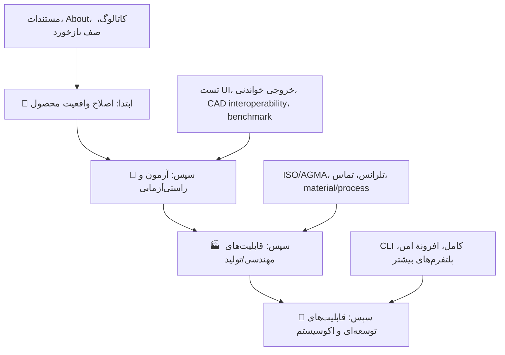
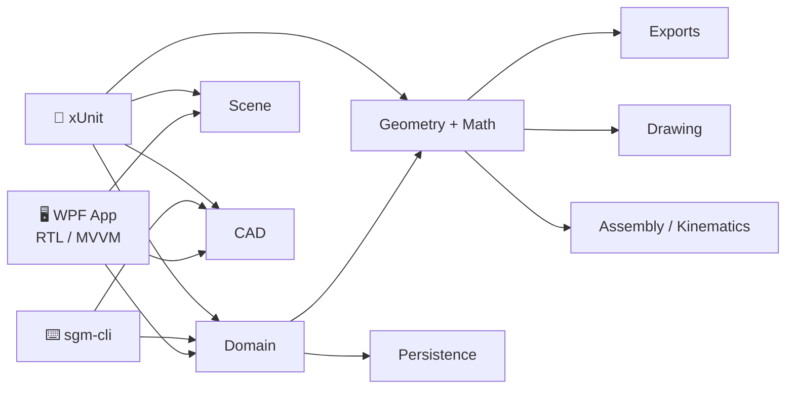

<div dir="rtl">

# 🧭 تحلیل جامع، ممیزی قابلیت‌ها و نقشهٔ راه پیشنهادی
## طراح چرخ‌دندهٔ سهند — Sahand Gear Designer `v0.5.0`

<p align="center">
  
  
  
</p>

> **جمع‌بندی در یک جمله:** پروژه در سطح یک ابزار پارامتریکِ آفلاین با موتور هندسی، رابط فارسی و چرخهٔ انتشار واقعی بسیار جلوتر از یک نمونهٔ اولیه است؛ اما برای آن‌که به یک ابزار مهندسیِ قابل‌اتکا برای تولید تبدیل شود، باید ابتدا **صداقت و یکپارچگی ادعاها/مستندات**، سپس **راستی‌آزمایی خروجی و UI** و بعد **تحلیل استانداردهای طراحی و ساخت** تقویت شوند.

---

## 🪪 شناسنامهٔ این ممیزی

| مورد | مقدار |
|---|---|
| تاریخ تحلیل | `2026/10/19` (UTC) |
| مبنای کد | تگ و HEAD: `v0.5.0`، کامیت `1c59f7fae007b12f651afe5b54304e79db9d7f8e` |
| شاخهٔ بررسی | `arena/5a88624e-sahand-gear-maker` |
| دامنهٔ خوانده‌شده | کل راهکار، UI/WPF، موتور Scene، موتور CAD، CLI، آزمون‌ها، CI، مستندات و نمونه‌ها |
| اندازهٔ مشاهده‌شده | ۹۶ فایل C#، ۱۴ فایل XAML، ۱۹ فایل Markdown، حدود ۲۵٬۳۱۸ خط C# در `src`/`tests`/`tools` |
| آزمون‌های ایستا | ۱۳ فایل آزمون، ۱۹۹ اعلان `[Fact]`/`[Theory]`؛ تعداد اجرای واقعی نظریه‌ها بیش از شمار اعلان‌هاست |
| اجرای محلی در این ممیزی | ⚠️ انجام نشد؛ SDK/فرمان `dotnet` در محیط تحلیل موجود نبود |
| شواهد CI بیرونی | ✅ اجرای اخیر Core و Windows برای همین SHA موفق‌اند؛ [Core](https://github.com/pranses2011/Sahand_Gear_Maker/actions/runs/39236318368) و [Windows](https://github.com/pranses2011/Sahand_Gear_Maker/actions/runs/39236318394). انتشار `v0.5.0` نیز موفق ثبت شده است. |

### روش کار

ممیزی صرفاً به خواندن README محدود نشده است. برای هر نتیجه، مسیر اجرا از مدل دامنه تا UI/CLI، آزمون مرتبط و ادعای مستندات تطبیق داده شد. بنابراین واژه‌های زیر در سراسر سند معنای مشخص دارند:

| برچسب | معنی |
|---|---|
| ✅ **موجود** | در سورس مسیر اجرایی قابل‌مشاهده دارد. |
| 🧪 **آزموده** | آزمون واحد/یکپارچهٔ مرتبط در مخزن وجود دارد؛ به معنی تأیید استاندارد صنعتی نیست. |
| ⚠️ **محدود/تقریبی** | در کد یا کاتالوگ، فرض ساده‌ساز یا عدم‌قطعیت اعلام شده است. |
| ❌ **شکاف** | قابلیت، راستی‌آزمایی یا مسیر کاربر وجود ندارد یا با ادعا ناهم‌خوان است. |
| 🔍 **نیازمند راستی‌آزمایی بیرونی** | صرف آزمون داخلی برای ادعای مهندسی/سازگاری کافی نیست. |

> **مرز مهم:** «مش آب‌بند ساخته می‌شود» با «برای تولید صنعتی ایمن و منطبق با ISO/AGMA است» یکسان نیست. این سند عمداً این دو سطح اطمینان را مخلوط نمی‌کند.

---

## 🎯 نتیجهٔ مدیریتی و اولویت واقعی

### نقشهٔ حرارتی بلوغ (نسبی، نه اندازه‌گیری استاندارد)

| محور | ارزیابی | چرا؟ | اقدام نخست |
|---|:---:|---|---|
| 🧮 مدل‌سازی پارامتریک و خانواده‌ها | 🟢 قوی | ۱۹ خانواده، مدل دامنهٔ جدا، اعتبارسنجی و ساخت مش | حفظ پوشش آزمون هنگام توسعه |
| 🖼️ تجربهٔ طراحی و پیش‌نمایش | 🟢 خوب | Scene مستقل، رندر موازی CPU، picking، نماها، اندازه‌گیری و مونتاژ | تست UI و benchmark سخت‌افزار واقعی |
| 📦 خروجی و تبادل داده | 🟡 خوب اما نیازمند اثبات | مش، نقشه و STEP/IGES وجود دارند؛ اعتبارسنجی همه‌یکسان نیست | راستی‌آزمایی بازخوانی/Interoperability |
| 🏭 آمادگی تولید صنعتی | 🔴 پایین تا متوسط | تحلیل تنش، عمر، تلرانس استاندارد، TCA و فرایند ساخت وجود ندارد | تعریف دامنهٔ استاندارد و موتور محاسبهٔ معتبر |
| 📚 صداقت مستندات و پیام محصول | 🔴 بحرانی | چند سند و خود UI هنوز واقعیت نسخهٔ ۰٫۱/۰٫۲ را می‌گویند | اصلاح فوری و تبدیل کاتالوگ به منبع یگانه |
| 🧪 تضمین کیفیت و انتشار | 🟡 متوسط | آزمون گسترده و CI ویندوز/اوبونتو موجود است، ولی UI/پوشش/امنیت زنجیره ناکامل است | coverage، تست مسیرهای WPF و hardening CI |
| 🖥️ CLI و خودکارسازی | 🟡 متوسط | فرمان‌های مفید دارد، اما محدوده و تحلیل همهٔ روابط را پوشش نمی‌دهد | scope/JSON/exit code و parity با UI |
| ♿ دسترس‌پذیری و بومی‌سازی | 🟡 ابتدایی | RTL و فونت محلی خوب است؛ متن‌ها عمدتاً سخت‌کد و automation محدود است | resource واقعی، keyboard و screen reader |

### قاعدهٔ تصمیم‌گیری



**توصیهٔ کلیدی:** پیش از افزودن خانوادهٔ بیستم یا فرمت جدید، یک چرخهٔ کوتاه «اعتماد مهندسی» انجام شود. در وضعیت فعلی، بیشترین ارزش برای کاربر از درست‌کردن گفته‌ها، مسیرهای موجود و اثبات خروجی‌ها می‌آید؛ نه از افزایش صرف تعداد ویژگی‌ها.

---

# ۱) دارایی‌های واقعی و ارزشمند پروژه

## 🏛️ معماری



- مرزهای اصلی به‌درستی جدا شده‌اند: `Domain` به WPF وابسته نیست و موتورهای `Geometry`، `Assembly`، `Exports`، `Drawing`، `Persistence`، `Scene` و `Cad` مستقل از رابط کاربری هستند.
- رابط WPF تقریباً همهٔ کتابخانه‌های لازم را ارجاع می‌دهد؛ برخلاف وضعیت نسخه‌های قدیمی، صفحه‌های مونتاژ، نقشه، بررسی و خروجی به هسته متصل شده‌اند.
- ذخیرهٔ پروژه نسخه‌دار و اتمی است و دادهٔ ناشناختهٔ نسخه‌های آینده را نگه می‌دارد؛ این یک تصمیم درست برای دوام فایل‌های `.sgdproj` است.

## ✅ قابلیت‌هایی که واقعاً در کد دیده می‌شوند

| حوزه | وضعیت فعلی قابل‌اتکا |
|---|---|
| خانواده‌های هندسی | ۱۹ خانواده در `GearFamily` و `CapabilityCatalog`، با سازنده‌های مجزای استوانه‌ای، مخروطی، کرم، رک، تاجی، هارمونیک و غیرمدور |
| بدنهٔ قطعه | بورهای متنوع، خار، توپی، حفرهٔ سبک‌سازی، پخ و gap جناغی در مدل دامنه و سازنده‌ها |
| صحنه و تعامل | رندر صحنهٔ چندقطعه‌ای، رنگ/شفافیت/نمایش/قفل هر قطعه، انتخاب با کلیک، گرید، محور، clipping، نماهای ذخیره‌شده و اندازه‌گیری |
| مونتاژ | روابط جفت، چیدمان گرافی، ویزارد سیاره‌ای، انیمیشن سینماتیک ایدئال، نمای انفجاری و دستیار نسبت |
| نقشه | نمای فنی فارسی SVG/PDF، جدول پارامترها، نمای جانبی و ایزومتریک |
| مش و چاپ | STL/OBJ/PLY/GLB/3MF/AMF/DXF، کیفیت مش، گزارش حجم/جرم/ابعاد و آماده‌سازی چاپ |
| CAD | مسیر جداگانهٔ STEP AP214 و IGES 5.3 در `SahandGearMaker.Cad` |
| اتوماسیون | `info`، `new`، `export`، `drawing`، `analyze` و `import` در CLI |
| انتشار | CI هسته روی اوبونتو، build/screenshot روی ویندوز و انتشار ZIP خودبسندهٔ `win-x64` |

## 🧪 نقاط قوت آزمون‌ها

پوشش موجود فقط «تست خوش‌مسیر» نیست. در فایل‌های آزمون، نمونه‌هایی از این موارد دیده می‌شود:

- آب‌بندی، حجم مثبت و بازتولیدپذیری خانواده‌های پایه و پیشرفته؛
- پروفیل، undercut، مونتاژ و رابطهٔ ویلیس؛
- round-trip پروژه، نسخهٔ آینده، autosave و variant؛
- خروجی‌های مش، DXF، SVG/PDF و آماده‌سازی چاپ؛
- clipping، picking، SSAA، دوربین و عملکرد Scene؛
- رفع‌های گزارش‌شدهٔ کاربر مانند فاز دندانه، جناغی و continuous drawing.

این سرمایه باید حفظ شود؛ اما بخش «شکاف آزمون» توضیح می‌دهد چرا برای ادعاهای صنعتی یا UI نهایی کافی نیست.

---

# ۲) ایرادهای فوری: اعتماد، یکپارچگی و رفتار کاربر

> این موارد باید پیش از توسعهٔ پرهزینهٔ مهندسی انجام شوند؛ چون هم‌اکنون می‌توانند کاربر را گمراه کنند یا یک مسیر موجود را خراب نگه دارند.

## 🔴 P0-1 — مستندات و متن برنامه با کد نسخهٔ ۰٫۵ همگام نیستند

### شواهد دقیق

| محل | ادعای فعلی | واقعیت کد | اثر |
|---|---|---|---|
| [`AboutView.xaml`](../src/SahandGearMaker.App/Views/AboutView.xaml#L57) | STEP/IGES «پیاده‌سازی نشده» هستند | `ExportViewModel` هر دو را فعال کرده و `CadFile.WriteStep/WriteIges` فراخوانی می‌شود | نقض مستقیم صداقت محصول داخل برنامه |
| [`ExportView.xaml`](../src/SahandGearMaker.App/Views/ExportView.xaml#L10) | همهٔ خروجی‌ها مش مثلثی‌اند | دو گزینهٔ STEP/IGES مسیر CAD جدا دارند | توضیح صفحهٔ خروجی نادرست است |
| [`HomeView.xaml.cs`](../src/SahandGearMaker.App/Views/HomeView.xaml.cs#L36-L40) | متن یکسان «مش ≠ B-rep» را به کل فهرست فرمت‌ها تعمیم می‌دهد | کاتالوگ STEP/IGES را B-rep معرفی می‌کند | پیام مختلط و گیج‌کننده |
| [`USER-GUIDE.md`](USER-GUIDE.md) | نسخهٔ ۰٫۱، نبود کرم/مخروطی و ناسازگاری حفره با بور | کد فعلی همهٔ این موارد را دارد | راهنمای کاربر عملاً منسوخ است |
| [`CAPABILITY-MATRIX.md`](CAPABILITY-MATRIX.md) و [`ARCHITECTURE.md`](ARCHITECTURE.md) | نسخهٔ ۰٫۲ و STEP/IGES خارج از دامنه | کد و README نسخهٔ ۰٫۵ خلاف آن را می‌گویند | منبع حقیقت چندگانه |
| [`BUILD.md`](BUILD.md#L19) | «۵۸ آزمون» | README «۲۴۹» می‌گوید و سورس ۱۹۹ اعلان آزمون دارد | شمارش و راهنمای ساخت غیرقابل اتکا |
| [`README.md`](../README.md#L425) | «همهٔ صادرکننده‌ها فایل را دوباره می‌خوانند» | wrapper مربوط به 3MF/AMF/DXF صریحاً `PostWriteValidated = false` برمی‌گرداند | ادعای کیفیت بیش از واقعیت |

### اصلاح پیشنهادی

1. **یک منبع داده برای قابلیت‌ها و محدودیت‌ها** ایجاد شود؛ `CapabilityCatalog` فقط نام فرمت نباشد و شامل `Kind = Mesh | CadBrep | Drawing`، سطح اعتبارسنجی و محدودیت مهندسی باشد.
2. متن‌های `About`، خانه، خروجی، README، راهنمای کاربر، ماتریس قابلیت، معماری، build و release از همان داده/قالب انتشار تولید یا دست‌کم با یک آزمون «parity» بررسی شوند.
3. راهنما از «تاریخچهٔ نسخه‌ها» جدا شود: راهنمای کاربر باید فقط رفتار کنونی را بگوید؛ تغییرات تاریخی در `CHANGELOG.md` یا Release Notes بروند.
4. ادعای «همهٔ خروجی‌ها validate می‌شوند» به جدول واقعی زیر تبدیل شود:

| گروه خروجی | وضعیت پیشنهادی برای نمایش |
|---|---|
| STL/OBJ/GLB | ✅ اعتبارسنجی ساختاری پس از نوشتن (با ذکر عمق اعتبارسنجی) |
| PLY | 🟡 بررسی طول/ساختار پایه؛ نیازمند parser کامل |
| 3MF/AMF/DXF | 🟡 نوشته می‌شود، اما در کد فعلی بازخوانی/اعتبارسنجی کامل ندارد |
| STEP/IGES | 🔍 تولید B-rep داخلی؛ باید با parser و نرم‌افزارهای مقصد به‌صورت ماتریسی آزموده شود |
| SVG/PDF | ✅ آزمون سند پایه؛ نه گواهی انطباق چاپ/نمایش در همهٔ viewerها |

### معیار پذیرش

- یک command/test مانند `docs:verify` همهٔ شماره‌های نسخه، فهرست فرمت و وضعیت قابلیت را با کاتالوگ تطبیق دهد.
- هیچ متن UI یا Markdown نگوید STEP/IGES «وجود ندارد».
- هر فرمت خروجی دقیقاً یک وضعیت اعتبارسنجی و یک محدودیت قابل‌مشاهده داشته باشد.
- README، `USER-GUIDE`، `BUILD`، `PRIVACY` و `CAPABILITY-MATRIX` در یک PR یکپارچه به نسخهٔ جاری برسند.

---

## 🔴 P0-2 — مدل وضعیت قابلیت‌ها از «محدودیت‌های واقعی» محافظت نمی‌کند

`CapabilityStatus.Limited` تعریف شده است، اما در `CapabilityCatalog` هیچ ورودی از آن استفاده نمی‌کند. در عین حال خود توضیح خانواده‌ها محدودیت‌هایی مانند تقریب Tredgold، نبود پوشش Litvin، نداشتن حل تماس هیپوئید، تلرانس هزارخار و تقریب هندسهٔ غیرمدور را اعلام می‌کند.

### خطر

نمایش همهٔ ۱۹ خانواده با برچسب **Implemented** از نظر فنی نادرست نیست (هندسه ساخته می‌شود)، اما از منظر کاربر صنعتی می‌تواند به‌اشتباه «هم‌ارز استاندارد/تولید» برداشت شود.

### پیشنهاد سطح‌بندی صادقانه

| سطح | نمونهٔ مناسب | پیام پیشنهادی |
|---|---|---|
| ✅ Implemented | spur، helical، rack با قیدهای اعلام‌شده | «هندسه و آزمون ساختاری موجود؛ تحلیل تولید/بار جداست.» |
| ⚠️ Limited | crown/face، hypoid، non-circular، harmonic، spline و هر خانواده با فرض صریح | «هندسه قابل استفاده برای طراحی مفهومی/نمایش؛ مدل تماس، تلرانس یا روش تولید کامل نیست.» |
| 🧪 Experimental | الگوریتم تازه یا خروجی CAD خانوادهٔ پیچیده، تا زمان اثبات بیرونی | «برای ارزیابی؛ قبل از تولید باید validate شود.» |
| 🗺️ Roadmap | فرمت یا خانوادهٔ واقعاً اجرا نشده | «غیرفعال؛ مدل ساختگی تولید نمی‌شود.» |

> پیشنهاد نمی‌شود قابلیت‌های موجود حذف شوند؛ فقط سطح اطمینان و توضیح مناسب باید کنار آن‌ها دیده شود.

---

## 🔴 P0-3 — صف بازخورد قابل‌حذف نیست و موارد قدیمی را ابتدا نمایش نمی‌دهد

این یک باگ رفتاری قطعی است، نه صرفاً پیشنهاد UX:

1. `FeedbackViewModel.RefreshQueue()` فقط **۸ کاراکتر اول** شناسه را در `QueuedSummaries` می‌گذارد.
2. `FeedbackView.RemoveSelected_Click()` همان شناسهٔ کوتاه را استخراج می‌کند.
3. `FeedbackQueue.Remove()` شناسه را با **کل UUID** مقایسه می‌کند؛ بنابراین مورد انتخاب‌شده حذف نمی‌شود.
4. در سازندهٔ `FeedbackViewModel` یا `FeedbackView` نیز فراخوانی اولیهٔ `RefreshQueue()` وجود ندارد؛ صف مانده از اجرای قبلی تا زمان یک ارسال جدید دیده نمی‌شود.

### راه‌حل درست

- به‌جای `ObservableCollection<string>` از `ObservableCollection<QueuedFeedbackItemViewModel>` استفاده شود: `FullId` برای عملیات، `ShortId` فقط برای نمایش.
- `RefreshQueue()` در سازنده/رویداد `Loaded` فراخوانی شود.
- یک آزمون مستقل برای «enqueue → نمایش → حذف انتخاب‌شده → persistence → بازگشایی» نوشته شود.
- کنار هر آیتم، زمان، طول پیام، وضعیت ارسال و دکمهٔ حذف همان آیتم نمایش داده شود؛ parsing متن UI حذف گردد.

### معیار پذیرش

```text
ارسال پیام → بستن برنامه → بازکردن برنامه → دیدن پیام → حذف همان پیام → بازکردن مجدد → پیام وجود ندارد
```

---

# ۳) شکاف‌های مهندسی: از مدل سه‌بعدی تا قطعهٔ قابل تولید

## 🏭 P1-1 — تحلیل استاندارد استحکام، عمر و راندمان وجود ندارد

خود `GearValidator` صریحاً تشخیص‌های «تحلیل تماس/تنش اجرا نشده» و «استحکام، عمر و راندمان در دامنه نیست» تولید می‌کند. این صداقت ارزشمند است؛ گام بعدی باید تبدیل این هشدار به یک ماژول مهندسی واقعی باشد.

### قابلیت‌های پیشنهادی

| بسته | خروجی مورد انتظار | اولویت |
|---|---|:---:|
| طراحی ظرفیت بار مطابق **ISO 6336** | تنش خمشی/تماسی، عوامل بار، ضریب ایمنی و هشدار دامنه | P1 |
| مسیر AGMA (در صورت بازار هدف) | bending/contact rating قابل ردیابی | P2 |
| تحلیل کرم | راندمان وابسته به زاویهٔ lead، ضریب اصطکاک، گرما و self-locking | P1 برای خانوادهٔ Worm |
| عمر و duty cycle | عمر چرخه‌ای، طیف بار، duty و reliability | P2 |
| مواد و عملیات حرارتی | material library، سختی سطح/مغز، حد مجاز تنش | P1 |
| گزارش قابل ممیزی | ورودی، استاندارد/ویرایش، فرض‌ها، فرمول‌ها و واحدها در PDF/JSON | P1 |

### شرط مهم طراحی

این قابلیت نباید به‌صورت یک عدد سبزِ بدون زمینه پیاده شود. هر گزارش باید استاندارد، ویرایش، ضرایب، مقدارهای پیش‌فرض، واحد، محدودهٔ اعتبار و هشدارهای خروج از دامنه را ثبت کند. تا آن زمان، برچسب فعلی «مدل هندسی، نه تأیید تولید» باید حفظ شود.

---

## 🏭 P1-2 — تلرانس، backlash تولیدی و استانداردهای چرخ‌دنده هنوز مدل نمی‌شوند

پارامترهای هندسی مانند backlash و profile shift هستند، اما این با «سیستم تلرانس ساخت و مونتاژ» فرق دارد.

### آنچه پیشنهاد می‌شود

- انتخاب استاندارد (مثلاً ISO 1328 برای دنده‌های استوانه‌ای، DIN 3962/3967 یا استاندارد هدف محصول) و grade کیفیت؛
- تعریف tolerance stack برای bore، خار، spline، runout و مرکز فاصله؛
- محاسبهٔ backlash مؤثر با توجه به مرکز فاصله، profile shift، تلرانس و دما؛
- اطلاعات تولید: hob/shaper/grinding، cutter tip radius، حداقل ضخامت ریشه و توصیهٔ پخ؛
- افزودن GD&T و datumهای قابل ویرایش به نقشهٔ فنی؛
- export جدول tolerance/BOM در CSV و PDF.

**فایده:** این بسته مرز بین «مدل نمایشی» و «دیتای مهندسی قابل تحویل به ساخت» را کوچک می‌کند.

---

## 🏭 P1-3 — تحلیل تماس و مونتاژ باید از «سازگاری اسمی» فراتر برود

مونتاژ فعلی ارزشمند است: نسبت، جهت، فاصلهٔ مرکز، layout، سینماتیک ایدئال و برخورد گسسته دارد. ولی موارد زیر هنوز لازم‌اند:

| شکاف | دلیل اهمیت | پیشنهاد |
|---|---|---|
| TCA / contact pattern | برای bevel، hypoid، worm و helical تماس واقعی و حساسیت مونتاژ مهم است | ابتدا یک solver محدود و شفاف برای spur/helical؛ سپس خانواده‌های پیچیده |
| قیود حلقه‌ای/DOF | layout گرافی به solver قیود چندحلقه‌ای تبدیل نشده است | graph constraint solver، گزارش DOF/overconstraint و حل کمترین مربعات |
| برخورد پیوسته در حرکت | چک مش گسسته ممکن است interpenetration بین گام‌ها را نبیند | swept-volume یا adaptive sampling با برچسب دقت |
| بار، لقی و compliance | سینماتیک اکنون صلب و ایدئال است | مدل سطح‌بندی‌شده backlash/efficiency/compliance، جدا از انیمیشن نمایشی |
| محور/یاتاقان/شفت | گیربکس واقعی فقط چرخ‌دنده نیست | مدل shaft، bearing، housing envelope و BOM پایه |

---

## 🧊 P1-4 — ادعای STEP/IGES باید دقیق‌تر و آزموده‌تر شود

وجود مسیر CAD یک نقطهٔ قوت مهم است؛ با این حال، نام‌گذاری «B-rep دقیق» باید با نوع هندسه هم‌خوان شود.

`CadPartBuilder` دو مسیر دارد:

1. برای خانواده‌های منشوری، capهای صفحه‌ای و سطوح استوانه‌ای (برای بور/حفرهٔ دایره‌ای) می‌سازد.
2. برای خانواده‌های منحنی، مثلث‌های مش را به وجه‌های صفحه‌ای هم‌صفحه تبدیل می‌کند.

بنابراین توپولوژی خروجی B-rep است، اما **flank دندانه الزاماً یک سطح تحلیلی involute/helicoid/NURBS دقیق نیست** و در بخشی از خانواده‌ها faceted planar B-rep است. این تفاوت باید در UI و گزارش خروجی روشن باشد.

### نقشهٔ راه CAD

| مرحله | کار | معیار پذیرش |
|---|---|---|
| ۱ | تغییر واژهٔ «دقیق» به توضیح نوع surface برای هر خانواده | کاربر پیش از export بداند analytic/faceted چیست |
| ۲ | parser/validator داخلی STEP و IGES برای ساختار و توپولوژی | هر فایل تولیدی دوباره parse شود |
| ۳ | golden corpus از فایل‌های ۱۹ خانواده و ویژگی‌های بدنه | hash/structure قابل مقایسه در CI |
| ۴ | interoperability matrix | باز/inspect شدن در حداقل FreeCAD و یک CAD تجاری هدف، با گزارش نسخه |
| ۵ | مسیر high-fidelity | curve/surface واقعی برای involute، helical و خانواده‌های اولویت‌دار یا اتصال به kernel معتبر |

> اگر هدف کوتاه‌مدت «تبادل مدل قابل مشاهده» است، B-rep وجه‌ای قابل قبول است؛ اگر هدف «ویرایش دقیق در CAD و تولید دنده» است، سطح تحلیلی/پارامتریک واقعی و آزمون مقصد ضرورت دارد.

---

## 🖨️ P2 — چاپ سه‌بعدی از آماده‌سازی مش به «DFAM» ارتقا یابد

ماژول فعلی orientation، weld، حذف مثلث یکنواخت، volume/mass و watertightness را انجام می‌دهد. کمبودهای ارزشمند بعدی:

- حداقل ضخامت دندانه و دیواره بر اساس nozzle/layer/material؛
- radial/axial clearance و shrinkage compensation؛
- lead-in/chamfer مناسب مونتاژ چاپی؛
- پیشنهاد support، سطح تماس با bed و هشدار overhang؛
- profile مخصوص FDM/SLA/SLS و material presets قابل ویرایش؛
- 3MF چندماده/رنگ یا metadata چاپ به‌جای صرف mesh؛
- گزارش چاپ قابل ذخیره همراه فایل خروجی.

---

# ۴) شکاف‌های محصول و مسیر کاربر

## 🧩 P1 — یک سیستم واحدها و گزارش پروژهٔ حرفه‌ای لازم است

هسته طول را بر حسب mm نگه می‌دارد و UI فعلی عمدتاً فقط واحد خروجی را بین mm/inch تغییر می‌دهد. برای کاربر حرفه‌ای، لازم است:

- واحد نمایش سراسری (mm/inch) برای فرم، HUD، نقشه، اندازه‌گیری، تحلیل و گزارش؛
- فرهنگ عددی کنترل‌شده و امکان ورود `12.5 mm` یا `0.5 in`؛
- تبدیل بدون تغییر دادهٔ مرجع داخلی؛
- presetهای استاندارد module/DP، pressure angle و face width؛
- گزارش کامل پروژه: قطعات، پارامترها، مواد، رابطه‌ها، نتایج تحلیل، هشدارها و revision history در PDF/CSV/JSON.

## 🔗 P1 — CLI باید هم‌ارز مسیرهای مهم UI باشد

CLI فعلی مفید است، اما برای CI/کارخانه هنوز کامل نیست:

| شکاف مشاهده‌شده | شواهد | پیشنهاد |
|---|---|---|
| `drawing` فقط اولین قطعه را می‌سازد | توضیح command و انتخاب `FirstOrDefault()` | `--part <id|name>`، `--all` و نام فایل قطعی |
| `analyze` فقط چند نوع advanced mating را در switch چاپ می‌کند | external/internal/rack/harmonic/spline/non-circular در گزارش CLI پوشش کامل ندارند | همهٔ `MatingKind`ها از یک API واحد عبور کنند |
| export مش فقط دسته‌ای/جداست | امکان انتخاب scope مونتاژ تجمیعی در UI از CLI معادل ندارد | `--scope selected|each|merged` و اعمال placement |
| DXF در list فرمت CLI نیست | UI DXF دارد | `--format dxf` یا دستور drawing/profile صریح |
| خروجی ماشینی ندارد | متن فارسی برای انسان خوب است اما CI به دادهٔ ساختاریافته نیاز دارد | `--json`، schema version و exit code مشخص |
| ساخت پروژه پیشرفته محدود است | `new` فقط پارامترهای عمومی را می‌گیرد | file template، JSON input و optionهای family-specific |

### معیار پذیرش CLI

هر عملی که در UI برای یک پروژهٔ چندقطعه‌ای ممکن است باید دست‌کم یک مسیر headless قابل اسکریپت داشته باشد؛ خروجی JSON پایدار برای pipelineها و exit code غیرصفر برای خطا/هشدار بحرانی لازم است.

## 🧱 P2 — مدیریت پروژه و همکاری

قابلیت‌های پیشنهادی:

- BOM، properties سفارشی، شمارهٔ قطعه و revision؛
- compare پروژه/variant به‌صورت semantic، نه فقط snapshot؛
- import/export configuration library (materials، standards، templates)؛
- pack پروژه همراه reference meshes و گزارش در یک archive؛
- lock/review برای تغییر پارامترهای بحرانی؛
- changelog داخل فایل `.sgdproj` و امضای گزارش نهایی.

## 🌍 P2 — دسترس‌پذیری، کیبورد و بومی‌سازی واقعی

RTL، فونت Vazirmatn و تعدادی میان‌بر موجودند؛ اما بررسی سورس نشان می‌دهد `AutomationProperties.Name` صریح عمدتاً برای ۹ آیتم ناوبری تعریف شده و بخش بزرگی از متن‌های XAML به‌صورت hard-coded است. کلاس `Localization` وجود دارد ولی استفاده از آن فراگیر نیست.

### کارهای لازم

- انتقال کامل رشته‌ها به `.resx` یا provider چندفرهنگی؛ فارسی/انگلیسی قابل تغییر؛
- نام و HelpText برای دکمه‌های icon-only، viewport، رنگ، tree و نتایج؛
- keyboard navigation و shortcut map کامل؛
- کنتراست، focus state، high-contrast و scale 100–200٪؛
- تست دستی با Narrator و تست خودکار accessibility تا حد امکان؛
- جایگزینی emojiهای وابسته به فونت با آیکون برداری یکپارچه.

---

# ۵) کیفیت، پایداری، امنیت و عملیات

## 🧪 P1 — راهبرد آزمون باید از هسته به محصول کامل برسد

### وضعیت خوب فعلی

- پروژهٔ آزمون به همهٔ libraryهای هسته (از جمله Scene و Cad) ارجاع دارد.
- CI فعلی build/test هسته را روی اوبونتو و کل solution را روی ویندوز انجام می‌دهد.
- اسکرین‌شات واقعی از UI در workflow ویندوزی تولید می‌شود.

### شکاف‌ها

| شکاف | پیامد | اقدام پیشنهادی |
|---|---|---|
| تست WPF/App وجود ندارد | باگ‌های binding، command، دیالوگ، صف بازخورد و setting از CI عبور می‌کنند | تست ViewModel/service بدون UI + smoke/UIA ویندوزی برای مسیرهای اصلی |
| coverage report/gate وجود ندارد | کاهش پوشش نامحسوس می‌ماند | Coverlet/ReportGenerator و threshold مرحله‌ای برای Domain/Geometry/Exports |
| golden/reference engineering fixtures محدود است | فرمول داخلی ممکن است با استاندارد یا CAD مقصد متفاوت باشد | fixtureهای مستقل مرجع با provenance و tolerance مشخص |
| fuzz/property test برای ورودی فایل و پارامترها محدود است | parser و هندسه در لبه‌ها ریسک دارند | property-based testing و corpus malformed files |
| performance budget سخت‌افزار-ناشناخته است | سقف ۲۵۰۰ms فقط regression درشت را می‌گیرد، نه تجربهٔ 60fps | benchmark جدا با سناریو/اندازه مش/CPU ثبت‌شده و trend artifact |
| snapshot تصویری فقط تولید می‌شود | تغییر نامطلوب UI/raster الزاماً تشخیص داده نمی‌شود | pixel/perceptual diff با tolerance و baseline تأییدشده |

### ماتریس پیشنهادی کیفیت


## 🔐 P1 — سخت‌سازی زنجیرهٔ انتشار و وابستگی‌ها

مشاهدات مخزن:

- `global.json`، lockfile NuGet، `.editorconfig`، analyzer policy، `TreatWarningsAsErrors` و SBOM مشاهده نشدند.
- اکشن‌های CI با tagهای شناور (`@v4` و `@v2`) استفاده شده‌اند، نه SHA pin.
- `System.CommandLine` هنوز نسخهٔ `2.0.0-beta4` است.
- release ZIP ساخته می‌شود، اما امضا، checksum منتشرشده، provenance و smoke-test فایل ZIP پس از بسته‌بندی دیده نمی‌شود.
- workflow ویندوز برای commit خودکار اسکرین‌شات permission نوشتن محتوا دارد؛ شرط فعلی push به `main` است و از `pull_request_target` استفاده نمی‌کند، پس خطر فوری کم است، اما privilege باید حداقل باقی بماند.

### بستهٔ پیشنهادی

1. `global.json` و `packages.lock.json` + `--locked-mode` در CI؛
2. Central Package Management یا حداقل بررسی وابستگی و Renovate/Dependabot؛
3. nullable/analyzer/format با خطای CI کنترل‌شده؛
4. pin کردن GitHub Actions به commit SHA و ثبت سیاست به‌روزرسانی؛
5. تولید SBOM (CycloneDX یا SPDX)، checksum SHA-256 و release provenance؛
6. code signing Authenticode برای exe/MSIX یا ZIP قابل‌راستی‌آزمایی؛
7. smoke-test از archive نهایی، نه فقط پوشهٔ publish؛
8. SECURITY.md، CONTRIBUTING.md، support policy و issue templates.

## 🔒 P2 — حریم خصوصی صف بازخورد باید کامل‌تر شود

طراحی آفلاین و نبود telemetry نقطهٔ قوت است. با این حال، متن پیام و راه تماس در `%LocalAppData%\SahandGearDesigner\feedback-queue.json` به‌صورت JSON محلی ذخیره می‌شود.

پیشنهادها:

- نمایش retention/location شفاف و دکمهٔ «بازکردن محل داده‌ها»؛
- حذف موفق/ناموفق واقعی، export bundle دستی و تأیید قبل از پاک‌سازی؛
- استفاده از DPAPI ویندوز برای `contact` و متن‌های حساس، یا حداقل opt-in روشن برای نگه‌داری محلی؛
- محدودیت طول پیام، ثبت خطای قابل‌فهم و آزمون write failure؛
- endpoint از build-time constant به تنظیم امن/امضاشده منتقل شود، اگر قرار است واقعاً فعال شود.

---

# ۶) نقشهٔ راه اجرایی پیشنهادی

## فاز A — «اعتماد و اصلاح فوری» ⏱️ کوچک، بیشترین بازده

| شناسه | خروجی | فایل/حوزهٔ اصلی | معیار پذیرش |
|---|---|---|---|
| A1 | رفع صف بازخورد (نمایش، حذف، تست persistence) | `FeedbackQueue` / `FeedbackViewModel` / `FeedbackView` | حذف یک آیتم پس از restart موفق است |
| A2 | اصلاح About/Home/Export | App XAML/CS | هیچ متن نادرست دربارهٔ STEP/IGES باقی نیست |
| A3 | بازنویسی مستندات جاری | README + تمام `docs/` قدیمی | راهنما مطابق v0.5 و لینک‌ها سالم‌اند |
| A4 | وضعیت `Limited/Experimental` | `CapabilityCatalog` + UI | تقریب‌های مهم از implemented کامل تفکیک می‌شوند |
| A5 | جدول اعتبارسنجی خروجی | Export + docs | برای هر format سطح validation دقیق نشان داده می‌شود |

## فاز B — «اثبات کیفیت» ⏱️ کوچک تا متوسط

| شناسه | خروجی | معیار پذیرش |
|---|---|---|
| B1 | تست ViewModel/Service و regressionهای P0 | باگ صف بازخورد و هر claim اصلاح‌شده آزمون دارد |
| B2 | coverage + test result artifact | پوشش Domain/Geometry/Exports در CI گزارش و trend ثبت می‌شود |
| B3 | round-trip/parse خروجی‌ها | 3MF/AMF/DXF/STEP/IGES حداقل validation ساختاری دارند |
| B4 | visual regression و UI smoke | مسیر create → edit → save → export → reopen روی ویندوز smoke می‌شود |
| B5 | benchmark قابل بازتولید | سناریوهای Scene با مشخصات runner و baseline ذخیره می‌شوند |

## فاز C — «آمادگی مهندسی/ساخت» ⏱️ متوسط تا بزرگ

| شناسه | خروجی | وابستگی |
|---|---|---|
| C1 | استاندارد، material library و گزارش محاسبه | تصمیم بازار/استاندارد هدف |
| C2 | ISO 6336 (یا AGMA) برای spur/helical | fixtureهای مرجع مستقل |
| C3 | backlash/tolerance stack و نقشهٔ تولیدی | C1 |
| C4 | تحلیل کرم، راندمان و حرارت | C1 + مدل اصطکاک |
| C5 | TCA محدود و توسعهٔ solver مونتاژ | C2/C3 |

## فاز D — «تبادل حرفه‌ای و خودکارسازی» ⏱️ متوسط

| شناسه | خروجی | معیار پذیرش |
|---|---|---|
| D1 | CAD interoperability matrix | فایل‌های corpus در CADهای هدف باز و با اندازه/توپولوژی بررسی می‌شوند |
| D2 | CLI parity + `--json` | UI و CLI برای پروژهٔ نمونه نتیجهٔ یکسان می‌دهند |
| D3 | BOM/revision/report package | پروژهٔ چندقطعه‌ای یک package قابل تحویل تولید می‌کند |
| D4 | DFAM profiles | print report بر اساس process/material پیشنهاد قابل توضیح می‌دهد |

## فاز E — «پولیش و اکوسیستم» ⏱️ اختیاری

- multi-language واقعی، accessibility کامل و theme سراسری؛
- template/library، catalog قطعات، import workflow و plug-in **ایمن/امضاشده**؛
- بررسی امکان UI چندسکویی فقط اگر نیاز بازار وجود دارد؛ هستهٔ کنونی برای این حرکت مناسب است، ولی WPF ذاتاً ویندوزی است.

---

# ۷) ترتیب پیشنهادی PR/کامیت‌ها

```text
1. fix(feedback): شناسهٔ کامل آیتم‌های صف + refresh اولیه + آزمون
2. fix(copy): اصلاح About/Home/Export و سطح اعتبارسنجی واقعی هر فرمت
3. docs(v0.5): بازنویسی USER-GUIDE / BUILD / MATRIX / ARCHITECTURE / CHANGELOG
4. feat(catalog): سطح Implemented/Limited/Experimental + نمایش یکنواخت
5. test(quality): coverage، parser/round-trip و UI smoke پایه
6. ci(hardening): SDK lock، lockfile، analyzers، SHA pin، artifacts
7. feat(cli): scope، part/all، dxf و JSON output
8. feat(engineering): standard/material/report foundation
9. feat(iso6336): مسیر spur/helical با fixtureهای مستقل
10. feat(cad): interoperability corpus و high-fidelity CAD roadmap
```

### چرا این ترتیب؟

- کامیت‌های ۱ تا ۴ ریسک پایین و اثر اعتماد بالا دارند.
- کامیت‌های ۵ و ۶ شبکهٔ ایمنی می‌سازند تا توسعهٔ مهندسی بعدی regression ایجاد نکند.
- کامیت‌های ۷ تا ۱۰ قابلیت‌های پرهزینه‌اند و باید روی پایهٔ قابل‌آزمون و صادقانه سوار شوند.

---

# ۸) فهرست قابلیت‌های پیشنهادی با ارزش محصول

| قابلیت | ارزش برای کاربر | پیچیدگی | اولویت |
|---|---:|---:|:---:|
| رفع صف بازخورد + همگام‌سازی مستندات | بسیار زیاد | کم | 🔴 اکنون |
| سطح‌بندی صادقانهٔ قابلیت‌ها | بسیار زیاد | کم | 🔴 اکنون |
| تست UI/visual + coverage | زیاد | متوسط | 🔴 اکنون |
| validation واقعی خروجی‌ها و CAD matrix | زیاد | متوسط | 🟠 بعدی |
| unit system سراسری + report/BOM | زیاد | متوسط | 🟠 بعدی |
| CLI parity و JSON | زیاد | متوسط | 🟠 بعدی |
| ISO 6336/material/life | بسیار زیاد برای تولید | زیاد | 🟠 برنامه‌ریزی‌شده |
| tolerance/GD&T/manufacturing setup | بسیار زیاد برای تولید | زیاد | 🟠 برنامه‌ریزی‌شده |
| DFAM پیشرفته | متوسط تا زیاد | متوسط | 🟡 پس از اعتماد خروجی |
| TCA، NVH، حرارت و bearing/shaft | زیاد اما تخصصی | بسیار زیاد | 🟡 فاز تخصصی |
| VRML/FBX | کم تا متوسط | متوسط | ⚪ فقط با تقاضای بازار |
| UI چندسکویی | وابسته به بازار | زیاد | ⚪ تصمیم محصول |

---

# ۹) جمع‌بندی نهایی

## آنچه نباید تغییر کند ✅

- معماری هستهٔ مستقل از WPF؛
- آفلاین‌بودن و صداقت در مورد محدودیت تحلیل؛
- مدل پارامتریک، ذخیرهٔ اتمی، نمونه‌ها و CLI؛
- سرمایهٔ آزمون‌های هندسی/صحنه؛
- رابط فارسی RTL و فونت محلی؛
- تصمیم آگاهانه برای جلوگیری از اجرای افزونه/اسکریپت ناشناس.

## آنچه باید همین حالا اصلاح شود 🔴

1. **رفتار صف بازخورد** (حذف آیتم و نمایش صف پایدار).
2. **تعارض‌های مستندات و متن UI**، به‌ویژه STEP/IGES، نسخه‌ها، شمار آزمون‌ها و راهنمای کاربر.
3. **تفکیک دقیق مش، B-rep و سطح اعتبارسنجی خروجی**.
4. **استفادهٔ واقعی از وضعیت Limited/Experimental** برای خانواده‌های تقریبی.

## بزرگ‌ترین فرصت رشد 🚀

تبدیل پروژه از «طراح هندسیِ بسیار توانمند» به «ابزار مهندسی قابل تحویل به تولید» از راه این زنجیره است:

```text
پارامتر معتبر
   → هندسهٔ قابل‌تکرار
   → خروجی قابل‌راستی‌آزمایی
   → استاندارد/تلرانس/ماده/بار مستند
   → گزارش قابل ممیزی
   → تصمیم آگاهانه برای ساخت
```

تا پیش از کامل‌شدن این زنجیره، محصول برای **آموزش، نمونه‌سازی، طراحی مفهومی، تجسم، چاپ سه‌بعدی و تبادل مش** بسیار ارزشمند است؛ برای **تولید صنعتی بحرانی** باید همچنان با تأیید مهندس مکانیک، استاندارد منتخب و راستی‌آزمایی CAD/CAM مقصد استفاده شود.

---

<details>
<summary><strong>📌 پیوست: منابع کد کلیدی این ممیزی</strong></summary>

- وضعیت خانواده‌ها و فرمت‌ها: [`src/SahandGearMaker.Domain/Catalog/CapabilityCatalog.cs`](../src/SahandGearMaker.Domain/Catalog/CapabilityCatalog.cs)
- محدودیت‌های اعتبارسنجی و تحلیل: [`src/SahandGearMaker.Domain/Validation/GearValidator.cs`](../src/SahandGearMaker.Domain/Validation/GearValidator.cs)
- مسیر STEP/IGES و نوع سطوح: [`src/SahandGearMaker.Cad/CadPartBuilder.cs`](../src/SahandGearMaker.Cad/CadPartBuilder.cs)
- خروجی و وضعیت post-write validation: [`src/SahandGearMaker.App/ViewModels/ExportViewModel.cs`](../src/SahandGearMaker.App/ViewModels/ExportViewModel.cs)
- صف بازخورد: [`FeedbackQueue.cs`](../src/SahandGearMaker.App/Services/FeedbackQueue.cs)، [`FeedbackViewModel.cs`](../src/SahandGearMaker.App/ViewModels/FeedbackViewModel.cs)، [`FeedbackView.xaml.cs`](../src/SahandGearMaker.App/Views/FeedbackView.xaml.cs)
- CLI: [`src/sgm-cli/Program.cs`](../src/sgm-cli/Program.cs)
- workflowها: [`core.yml`](../.github/workflows/core.yml)، [`windows.yml`](../.github/workflows/windows.yml)، [`release.yml`](../.github/workflows/release.yml)
- آزمون‌ها: [`tests/SahandGearMaker.Tests`](../tests/SahandGearMaker.Tests)

</details>

---

<p align="center">
  <strong>🔎 اصل راهنما:</strong> هر قابلیت جدید باید هم‌زمان <em>محدودهٔ اعتبار، آزمون، پیام کاربر و مستندات</em> داشته باشد؛ در غیر این صورت قابلیت کامل نیست.
</p>

</div>
