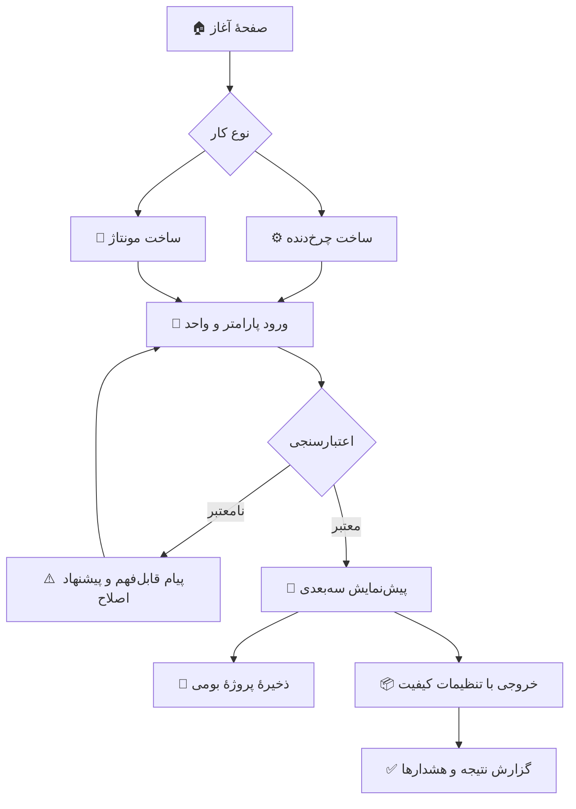

# 🖥️ 02 — محصول، قابلیت‌ها و رابط کاربری

## 1. تعریف محصول

**Sahand Gear Designer | طراح چرخ‌دنده سهند** نرم‌افزار طراحی پارامتریکِ چرخ‌دنده و مونتاژهای چرخ‌دنده برای Windows است. نرم‌افزار باید مدل سه‌بعدیِ قابل مشاهده و قابل خروجی بسازد و به کاربر اجازه دهد اندازه‌ها، نوع دندانه، ویژگی‌های بدنه و روابط مونتاژ را کنترل کند.

این محصول را با یک نرم‌افزار تحلیل کامل تنش، طراحی نهایی برای تولید، CAM یا تأییدیهٔ استاندارد اشتباه نگیر. اگر چنین محاسباتی ساخته نشده، آن‌ها را ارائه‌شده جلوه نده. در UI تفاوت «هندسهٔ قابل مدل‌سازی»، «محاسبهٔ سینماتیکی» و «تحلیل/طراحی مهندسی تأییدشده» را روشن کن.

## 2. کاربران و کارهای کلیدی

| کاربر | نیاز اصلی | نتیجهٔ مورد انتظار |
|---|---|---|
| طراح مکانیک | ساخت چرخ‌دنده، تغییر پارامتر و جفت‌کردن | مدل سه‌بعدی همراه مشخصات روشن |
| دانشجو/آموزش‌گیرنده | فهم اثر تعداد دندانه و پارامترهای پروفیل | پیش‌نمایش زنده و توضیح پارامترها |
| کارگاه/چاپ سه‌بعدی | گرفتن مش با واحد و کیفیت مناسب | فایل سالم، قابل انتقال و دارای گزارش خروجی |
| کاربر CAD | باز کردن مدل در نرم‌افزار دیگری | قالب مناسب با محور، واحد، بدنه و کیفیت کنترل‌شده |

## 3. جریان اصلی کاربر



### مسیر پیشنهادی ساخت چرخ‌دنده

1. انتخاب خانواده و نوع: خارجی، داخلی، حلزونی، مخروطی، سیاره‌ای و غیره.
2. انتخاب روش تعریف: استاندارد/پارامتریک، تنظیمات سفارشی یا نمونهٔ آماده.
3. انتخاب واحد و استانداردِ مورد استفاده (اگر واقعاً پیاده‌سازی شده است).
4. واردکردن پارامترها؛ پارامترهای ضروری و اختیاری از هم متمایز باشند.
5. مشاهدهٔ پیش‌نمایش دوبعدی/سه‌بعدی، ابعاد کلیدی و پیام‌های اعتبارسنجی.
6. افزودن ویژگی‌های بدنه و در صورت نیاز قرار دادن قطعه در مجموعه.
7. ذخیرهٔ پروژه یا خروجی‌گرفتن؛ نمایش خلاصهٔ تنظیمات و نتیجه.

## 4. نقشهٔ ناوبری

| بخش | کاربرد | آیکون پیشنهادی |
|---|---|---|
| 🏠 خانه | پروژهٔ تازه، بازکردن اخیر، نمونه‌ها و آموزش کوتاه | خانهٔ خطی |
| ⚙️ طراح چرخ‌دنده | ایجاد/ویرایش یک قطعه | چرخ‌دندهٔ خطی |
| 🧩 مونتاژ | افزودن قطعات و تعریف روابط | قطعات/اتصال |
| 🔍 بررسی و اندازه‌گیری | فاصله، مقطع، تداخل و بازرسی مدل (مرحله‌ای) | ذره‌بین/کولیس |
| ▶️ حرکت | پیش‌نمایش سینماتیک خانواده‌های پشتیبانی‌شده (مرحله‌ای) | پخش/محور |
| 📐 نقشهٔ فنی | نماها، مقاطع، ابعاد و گزارش PDF/DXF در صورت پشتیبانی | خط‌کش/برگه |
| 📚 کتابخانه | خانواده‌ها، نمونه‌ها و راهنمای پارامترها | کتاب/شبکه |
| 📦 خروجی | فرمت، کیفیت و خروجی دسته‌ای (مرحله‌ای) | جعبه/فلش خروجی |
| 🕘 پروژه و گزارش‌ها | بازیابی/نسخه‌ها، گزارش خطا و وضعیت ارسال محلی | ساعت/برگه |
| ⚙️ تنظیمات | زبان، واحد، تم، مسیرها، حریم خصوصی | تنظیمات |
| ℹ️ درباره | نسخه، سازنده، اطلاعات تماس و حمایت اختیاری | اطلاعات |

## 5. چیدمان صفحهٔ اصلی

چیدمان باید با خواندن فارسی سازگار باشد: نوار ناوبری و پنل‌های متنی در سمت راست، بوم سه‌بعدی در مرکز و نوارهای ابزار قابل دسترس در بالا/پایین. برای صفحهٔ کوچک، پنل‌ها جمع‌شونده باشند؛ بوم مدل نباید به‌خاطر RTL وارونه یا ناقص شود.

```text
┌────────────────────────────────────────────────────────────────────┐
│ 🟦 نوار عنوان: نام پروژه | ذخیره | واگرد/ازنو | خروجی | راهنما    │
├───────────────┬─────────────────────────────────┬──────────────────┤
│ ⚙️ ویژگی‌ها   │                                 │ 🧩 درخت پروژه   │
│ پارامترها     │       🧊 بوم سه‌بعدی             │ قطعات/مونتاژ     │
│ اعتبارسنجی    │       چرخش | نماها | بزرگ‌نمایی  │ انتخاب قطعه      │
│ ابعاد کلیدی   │                                 │                  │
├───────────────┴─────────────────────────────────┴──────────────────┤
│ 📏 واحد/مقیاس | وضعیت هندسه | شمار مثلث | پیام‌ها | آفلاین/صف     │
└────────────────────────────────────────────────────────────────────┘
```

> این یک طرح مفهومی است، نه الزامِ جایگذاری ثابت. پیاده‌سازی باید آزمون‌پذیر باشد و پنل‌ها/فرمان‌ها روی نمایشگرهای DPI بالا نیز درست نمایش داده شوند.

## 6. صفحه‌ها و رفتارها

### 6.1 خانه و پروژه

- «پروژهٔ جدید»، «بازکردن»، «بازکردن آخرین پروژه»، «نمونه‌ها» و «ادامهٔ پروژهٔ قبلی».
- فهرست فایل‌های اخیر در حافظهٔ محلی؛ امکان پاک‌کردن این تاریخچه.
- نمونه‌های بی‌خطر: یک جفت چرخ‌دندهٔ ساده، یک چرخ‌دندهٔ داخلی، و یک سامانهٔ سیاره‌ای نمونه (فقط وقتی هندسهٔ متناظر واقعاً آماده است).
- مسیرهای اخیر نباید بدون نیاز به گزارش شبکه‌ای ارسال شوند.

### 6.2 سازندهٔ پارامتریک

- فرم گروه‌بندی‌شده با برچسب فارسی و نام فنی اختیاری؛ واحد کنار هر فیلد دیده شود.
- فیلد نامعتبر با رنگ، آیکون و متن توضیحی مشخص شود؛ رنگ تنها نشانه نباشد.
- تغییر پارامترهای وابسته باید قابل فهم باشد؛ تغییر ناخواسته/پنهان انجام نشود.
- نمایش مقدار محاسبه‌شده از ورودی کاربر متمایز باشد؛ نتیجهٔ گرد‌شده با مقدار محاسباتی اشتباه نشود.
- بازگشت به مقدار قبلی، undo/redo و برگرداندن تنظیمات پیش‌فرض وجود داشته باشد.

### 6.3 بوم سه‌بعدی

- چرخش، pan، zoom، نماهای استاندارد (جلو/بالا/راست/ایزومتریک)، قاب‌کردن مدل و نمایش محورها.
- حالت نمایش: سایه‌دار، لبه‌دار، سیمی و در صورت پشتیبانی شفافیت.
- انتخاب قطعه از بوم یا درخت؛ هایلایت انتخاب باید با رنگ و نشانگر واضح باشد.
- اطلاعات بوم: واحد، مبدأ، جهت محورهای XYZ و کیفیت/وضعیت هندسه.
- پیش‌نمایش سریع از مش کم‌جزئیات و خروجی نهایی از مش با کیفیتِ انتخاب‌شده جدا باشد.
- خطای ساخت هندسه باید در پنل پیام با امکان دیدن جزئیات تشخیصی نمایش داده شود؛ UI بسته نشود.

### 6.4 مونتاژ

- درخت سلسله‌مراتبی پروژه، نام‌گذاری قطعات، پنهان/نمایان، قفل/بازکردن قفل، حذف و تکثیر.
- افزودن قطعهٔ موجود یا ایجاد قطعهٔ تازه؛ قراردهی بصری یا از طریق پارامتر/قید.
- تعریف زوج چرخ‌دنده با نوع تماس و رابطهٔ لازم؛ مرکزها و جهت‌ها نمایش‌پذیر باشند.
- در سامانهٔ سیاره‌ای، خورشیدی/رینگی/سیاره‌ها در درخت جدا و قیدها/تعداد سیاره‌ها قابل مشاهده باشند.
- خطاهای تداخل هندسی، عدم امکان مونتاژ یا قید ناسازگار به‌صورت هشدار/خطا با توضیح نمایش داده شوند.

### 6.5 خروجی

- فرمت، مسیر، نام فایل، واحد، مبدأ/محورها، قطعهٔ انتخاب‌شده یا کل مونتاژ و تنظیمات کیفیت.
- گزینه‌های غیرفعال با علتِ روشن؛ فرمتِ فهرست‌شده بدون مبدل عملیاتی، «پشتیبانی‌شده» تلقی نشود.
- پیش از ذخیره خلاصهٔ تنظیمات و برآورد مش/حجم (اگر قابل محاسبه است) نشان داده شود.
- پس از پایان، گزارش شامل فایل/فرمت/واحد/کیفیت/هشدارها و نتیجهٔ اعتبارسنجی ارائه شود.

## 7. اولویت قابلیت‌ها

| اولویت | قابلیت‌ها | معیار |
|---|---|---|
| **P0 — هسته** | رابط فارسی/RTL، پروژهٔ بومی با ذخیرهٔ اتمی، نمای سه‌بعدی، چرخ‌دندهٔ سادهٔ خارجی، جفت‌دنده، اعتبارسنجی و حداقل یک خروجی واقعی | یک جریان کامل از ورودی تا فایل خروجی در حالت آفلاین |
| **P1 — کاربری روزمره** | داخلی، مارپیچ، رک، ویژگی‌های حفره/محور/توپی، مونتاژ چندقطعه‌ای، autosave، بررسی سازگاری/تداخل پایه، اندازه‌گیری و نقشهٔ ساده | هر قابلیت آزمون مستقل و محدودیت روشن داشته باشد |
| **P2 — سامانه‌ها و انتقال CAD** | سیاره‌ای/ترکیبی، حرکت سینماتیکی، گونه‌ها و مقایسه، خروجی دسته‌ای، واردکردن مدل مرجع، فرمت‌های بیشتر و B-rep در صورت وجود هستهٔ مناسب | ماتریس قابلیت و مستندات دقیق |
| **P3 — خانواده‌ها و تحلیل‌های پیشرفته** | مخروطی مارپیچ، حلزونی پیشرفته، سیکلوئیدی، هارمونیک، غیرمدور، هیپوئیدی، افزونه‌ها و محاسبات استحکام/عمر | فقط پس از مشخص‌شدن الگوریتم، استاندارد، محدودیت و آزمون مستقل |

این جدول نقشهٔ مرحله‌بندی است؛ نباید فقط با وجود یک گزینه در ComboBox اعلام کرد که قابلیت آماده است.

## 8. طراحی بصری، آیکون و المان‌های گرافیکی

### زبان بصری

- حس کلی: ابزار مهندسی دقیق، آرام، خوانا و حرفه‌ای؛ از ازدحام، سایه‌های اغراق‌شده و انیمیشن غیرضروری پرهیز کن.
- رنگ‌های پیشنهادی: سرمه‌ای `#142238` برای هویت/ناوبری، آبی `#2563EB` برای اقدام اصلی، فیروزه‌ای `#0F9D91` برای وضعیت سالم، کهربایی `#E99A16` برای هشدار، قرمز `#D64545` برای خطا، پس‌زمینهٔ روشن `#F5F7FA` و سطح تیرهٔ تم شب `#18212F`.
- کنتراست متن، رنگ وضعیت، فوکوس صفحه‌کلید و انتخاب قطعه را رعایت کن؛ رنگ به‌تنهایی معنای خطا یا وضعیت نباشد.
- شکل‌های گرافیکی باید هدفمند باشند: نمای ایزومتریک چرخ‌دنده در صفحهٔ خالی، نمودار کوچک ابعاد، نشانهٔ محور و محفظهٔ پیش‌نمایش.

### آیکون‌ها

ایموجی‌های جدول فقط **نشانهٔ خوانا در این سند** هستند. در نرم‌افزار نهایی از مجموعهٔ یکپارچهٔ آیکون‌های برداری/محلی (SVG یا معادل سازگار)، دارای مجوز روشن و بسته‌بندی‌شده استفاده کن؛ از دانلود آیکون هنگام اجرا یا استفاده از Emoji به‌عنوان جایگزین دائمی آیکون مهندسی پرهیز کن.

| کاربرد | نشانهٔ مفهومی در سند | شکل آیکون برنامه |
|---|---:|---|
| چرخ‌دندهٔ خارجی/طراحی | ⚙️ | چرخ‌دندهٔ خطی با دندانهٔ خوانا |
| مونتاژ و قطعات ترکیبی | 🧩 | چند قطعهٔ متصل/درخت |
| سامانهٔ خورشیدی | 🪐 | خورشید مرکزی و سیاره‌های چرخان |
| پارامتر و اندازه | 📐 | کولیس/خط‌کش مهندسی |
| نمای سه‌بعدی | 🧊 | مکعب سه‌بعدی/محور XYZ |
| ذخیره | 💾 | نماد ذخیرهٔ استاندارد |
| خروجی | 📦 | فایل همراه فلش خروجی |
| خطا/هشدار | ⚠️ | مثلث هشدار با رنگ + متن |
| ارسال بازخورد | ✉️ | حباب/برگهٔ پیام، نه نماد بازکردن Mail |
| حالت آفلاین | 🔌 | نشانگر محلی/شبکهٔ قطع‌شده |
| درباره/راهنما | ℹ️ | حرف i خطی |

### تایپوگرافی و خوانایی

- Vazirmatn فونت پیش‌فرض و محلیِ برنامه است؛ همهٔ اندازه‌ها در DPI بالا آزموده شوند.
- اندازه‌های پایهٔ پیشنهادی: متن معمول 13–15 pt، عنوان بخش 18–22 pt، برچسب فیلد حداقل 12 pt؛ از متن ریز برای هشدار فنی استفاده نکن.
- برچسب فارسی در یک طرف و مقدار عددی با جهت مناسب در طرف دیگر قرار گیرد؛ اعداد، نماد درجه، اعشار، علامت منفی و مسیر فایل با RTL مخلوط نشوند.
- متن فنی به‌صورت «زاویهٔ فشار (Pressure angle)» یا راهنمای کوتاه ارائه شود؛ واژه‌نامه یکسان باشد.

## 9. تنظیمات عمومی و دسترس‌پذیری

- زبان فارسی پیش‌فرض؛ همهٔ متن‌ها از منبع قابل ترجمه بیایند تا اضافه‌کردن زبان دیگر ممکن باشد.
- واحد پیش‌فرض قابل انتخاب (میلی‌متر/اینچ) و نمایش مستقل واحد در هر پارامتر؛ تغییر واحد فقط نمایش/ورودی را تبدیل کند، نه اینکه اندازهٔ واقعی مدل را عوض کند.
- تم روشن/تیره، اندازهٔ متن قابل استفاده، کنترل با صفحه‌کلید، ترتیب Tab درست، tooltip قابل دسترس و فرمان‌های Undo/Redo.
- پنجره‌ها روی 100% تا 200% DPI و اندازه‌های مختلف صفحه آزمایش شوند.
- در صفحهٔ خطا، دکمهٔ «کپی جزئیات» و «ساخت گزارش» در دسترس باشد؛ متن فنیِ کامل جدا از متن سادهٔ کاربر باشد.

## 10. معیار تجربهٔ کاربری

کاربر باید بتواند در کمتر از چند دقیقه یک قطعهٔ نمونه بسازد، خطای ورودی را بفهمد، مدل را بچرخاند و در قالبی که واقعاً پشتیبانی می‌شود ذخیره کند. پیام‌ها باید بگویند **چه چیزی نامعتبر است، چرا، و چه کاری می‌توان انجام داد**؛ از پیام‌های مبهم مانند «خطا رخ داد» به‌تنهایی پرهیز شود.

## 11. قابلیت‌های تکمیلی پیشنهادی

برای بهترشدن محصول، این بخش‌ها را مرحله‌ای به ناوبری اضافه کن: **🔍 بررسی و اندازه‌گیری** (فاصله، مقطع، تداخل)، **▶️ حرکت** (سینماتیک محدود به انواع حل‌شده)، **📐 نقشهٔ فنی** (نما/ابعاد/PDF یا DXF در صورت پشتیبانی) و **🕘 پروژه و نسخه‌ها** (autosave، بازیابی، گونه‌ها و مقایسه). دستیار انتخاب اندازه، واردکردن مدل مرجع و خروجی دسته‌ای هم در نقشهٔ راه قرار بگیرند.

این‌ها باید به‌صورت بخش‌های خاموش/مرحله‌ای یا در تب «پیشرفته» افزوده شوند تا رابط اصلی شلوغ نشود. اولویت، وابستگی و معیار پذیرش هر مورد در [بازبینی امکانات و نقشهٔ راه](07-feature-review-and-roadmap.md) آمده است؛ نمایش یک دکمه به‌تنهایی به معنی آماده‌بودن قابلیت نیست.
