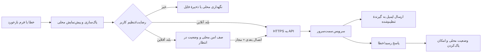

# 🔒 05 — آفلاین، حریم خصوصی، گزارش خطا و انتشار ویندوزی

## 1. رفع تعارض آفلاین بودن و ارسال ایمیل

طراحی/مدل‌سازی، محاسبهٔ هندسه، پیش‌نمایش، ذخیره و خروجی‌گرفتن باید **بدون اینترنت** کار کند. اما ارسال ایمیل به گیرنده از دستگاه کاربر، بدون اتصال اینترنت یا شبکه ممکن نیست. بنابراین این دو نیاز را چنین پیاده‌سازی کن:

1. هستهٔ برنامه هیچ درخواست شبکه‌ایِ اجباری ندارد.
2. گزارش خطا و بازخورد در حالت آفلاین به‌صورت محلی، صف‌شده و قابل بازبینی ذخیره می‌شود.
3. وقتی اینترنت در دسترس بود، برنامه فقط طبق رضایت/تنظیم کاربر از مسیر **HTTPS به یک سرویس سمت‌سرور** ارسال می‌کند؛ آن سرویس ایمیل را به گیرندهٔ پیکربندی‌شده می‌رساند.
4. از برنامهٔ Mail/Outlook/کلاینت ایمیل سیستم استفاده نمی‌شود. استفاده از `mailto:` به‌عنوان پیاده‌سازی ارسال ممنوع است.
5. اگر endpoint سمت‌سرور یا اعتبارسنجی آن تنظیم نشده است، دکمهٔ ارسال غیرفعال یا وضعیت «سرویس ارسال پیکربندی نشده» نمایش داده شود؛ برنامه نباید بگوید «ایمیل ارسال شد».

### معماری گزارش/بازخورد



## 2. گزارش خطا و رضایت کاربر

### سیاست پیشنهادی

- ثبت خطا در فایل محلی برنامه، با چرخش فایل و محدودیت حجم/مدت نگهداری.
- ارسال خودکار گزارش **به‌صورت پیش‌فرض خاموش** باشد؛ در اولین اجرا یا تنظیمات، رضایت جداگانه و روشن بخواهد. اگر کاربر گزینهٔ «ارسال خودکار گزارش‌های تشخیصی» را فعال کرد، گزارش خطاهای بعدی طبق همان رضایت ارسال شود و هر زمان بتواند آن را خاموش کند.
- اگر رضایت خودکار نداده، پس از خطا گزینه‌های «جزئیات»، «بازبینی و ارسال»، «کپی» و «بعداً» نمایش داده شود. خطای بحرانی نباید پنجرهٔ درخواست را بارها تکرار کند.
- متن گزارش، نوع خطا، نسخهٔ برنامه و بخش/عملیات ناموفق را شامل شود؛ محتوای پروژه، فایل‌های کاربر، تصویر صفحه، نام کاربری، مسیر کامل فایل و اطلاعات غیرضروری به‌صورت پیش‌فرض ارسال نشود.
- پیش از ارسال دستی، کاربر بتواند متن را ببیند، حذف کند یا اصلاح کند. مسیرها، نام حساب/فایل و داده‌های محتمل حساس تا حد امکان ماسک شوند.
- هیچ memory dump، محتوای clipboard یا کل پروژه بدون درخواستِ جداگانه و رضایت صریح پیوست نشود.
- خطای شبکه در ارسال، خطای برنامه تلقی نشود؛ صف و محتوای طراحی دست‌نخورده بماند و پیام تلاش مجدد نمایش داده شود.

### API سمت‌سرور

اگر وظیفه شامل ساخت سرویس هم هست، API را از کلاینت جدا و قراردادش را مستند کن. نمونهٔ مفهومی:

```text
POST /api/v1/feedback
Content-Type: application/json

{
  "kind": "bug-report | suggestion",
  "appVersion": "...",
  "locale": "fa-IR",
  "message": "...",
  "diagnostics": { "exceptionType": "...", "stack": "sanitized..." },
  "consent": { "diagnostics": true, "timestampUtc": "..." },
  "clientReportId": "..."
}
```

- آدرس سرویس قابل تنظیم/نسخه‌دار باشد؛ فقط HTTPS مجاز.
- گیرندهٔ ایمیل و رازهای ارسال (SMTP/API key) فقط در تنظیمات امنِ سمت‌سرور باشند؛ در کد، فایل تنظیمات توزیع‌شده، مخزن یا binary کلاینت قرار نگیرند.
- محدودسازی نرخ، محدودیت طول/حجم و نوع پیوست، اعتبارسنجی، جلوگیری از spam و ثبت حداقلیِ سمت‌سرور لازم است.
- دادهٔ ارسالی محدود، هدف و نگهداری آن در اعلامیهٔ حریم خصوصی مشخص، و پاک‌سازی دوره‌ای/درخواست حذف قابل اجرا باشد.
- اگر زیرساخت یا backend خارج از محدودهٔ تحویل است، فقط interface و قرارداد را بساز و صریح بنویس که ارسال واقعی تا راه‌اندازی سرویس ممکن نیست؛ ادعای ارسال کامل نکن.

## 3. بازخورد و پیشنهاد کاربر

- فرم «ارسال نظر یا پیشنهاد» داخل خود برنامه باشد؛ بازکردن نرم‌افزار ایمیل کاربر به‌هیچ‌وجه جایگزین فرم نیست.
- فیلدهای کاربر: دسته (پیشنهاد/گزارش مشکل/سایر)، موضوع اختیاری، متن، راه تماس اختیاری و رضایت ارسال.
- اطلاعات تشخیصی فقط با checkbox مستقل و توضیح روشن افزوده شود.
- در آفلاین: پیش‌نویس محلی با وضعیت «در انتظار ارسال» ذخیره شود؛ کاربر بتواند ویرایش، حذف یا به فایل محلی صادر کند.
- وقتی ارسال ممکن شد، از همان API امن استفاده شود؛ رسید/شناسهٔ درخواست نشان داده شود، بدون فاش‌کردن آدرس سرویس یا secret.
- خط‌مشی حریم خصوصی و پیوند وب‌سایت/ایمیل نویسنده در کنار فرم باشد.

## 4. حریم خصوصی و امنیت محلی

- پیش‌فرض: پروژه‌ها، مدل‌ها، گزارش‌ها و تاریخچه فقط روی دستگاه کاربر بمانند.
- هیچ telemetry، آمار ناشناس، analytics، تبلیغات، cloud sync، AI online یا به‌روزرسانی خودکار بدون رضایت روشن اضافه نشود.
- اگر قابلیت اختیاری شبکه خاموش است، در شروع برنامه هیچ DNS/HTTP/HTTPS request برای گزارش، فونت، لایسنس یا محتوا انجام نشود.
- فایل صف‌شده محلی دسترسی محدود به کاربر ویندوز داشته باشد؛ از DPAPI یا حفاظت بومی مناسب استفاده کن، اما رمزنگاری را به‌عنوان جایگزین رضایت/پاک‌سازی جلوه نده.
- عمر نگهداری فایل log/صف محدود و مستند باشد؛ ابزار «پاک‌کردن گزارش‌ها و صف ارسال» در تنظیمات ارائه شود.
- خطاهای داخلی برای کاربر به فارسی روشن و در log فنی با شناسهٔ رویداد ثبت شوند؛ کلیدها، tokenها، گذرواژه‌ها و محتوای حساس هرگز log نشوند.
- بازکردن لینک خارجی فقط با اقدام روشن کاربر باشد. برنامهٔ آفلاین برای عملکرد اصلی به مرورگر یا سایت نیاز نداشته باشد.

## 5. اطلاعات سازنده و حمایت مالی

در صفحهٔ «دربارهٔ برنامه» اطلاعات زیر از یک منبع پیکربندی‌شده و قابل‌به‌روزرسانی نمایش داده شود:

| مورد | مقدار |
|---|---|
| طراح و نویسنده | سعید نجفی |
| تلفن | `09144220430` |
| ایمیل | [Pranses2011@GMail.com](mailto:Pranses2011@GMail.com) |
| وب‌سایت | [EA-Fixer.ir](http://EA-Fixer.ir) |

کلیک روی ایمیل/سایت نباید به‌عنوان قابلیت ارسال بازخورد تلقی شود؛ فرم درون‌برنامه‌ای جداست. پیوندها فقط با انتخاب کاربر در مرورگر باز شوند.

### حمایت مالی

- «حمایت از توسعه» یک بخش اختیاری است و نباید مزاحم کار طراحی شود.
- روش بهتر: پیوند رسمی و امنِ پرداخت/حمایت که مالک کنترل می‌کند؛ لینک را در یک منبع تنظیماتی نگه دار تا بدون تغییر چند صفحه قابل تعویض باشد.
- برنامه نباید خودْ تراکنش کارت را پردازش یا اطلاعات کارت را ذخیره کند. شمارهٔ کامل کارت، CVV، تاریخ انقضا یا PIN را در مخزن، کد، log، خروجی، نمونه یا سرویس بازخورد قرار نده.
- اگر مالک اصرار دارد روش دستی نمایش داده شود، در نسخهٔ توزیع‌شده از مقدار محلیِ خارج از مخزن، فقط با تأیید مالک، و نمایش محافظه‌کارانه استفاده کن؛ ابتدا پیوند امن را پیشنهاد بده و هیچ‌گاه برای تکمیل پرداخت اطلاعات بیشتری مطالبه نکن.
- به کاربر بگو حمایت مالی اختیاری است و حمایت به مجوز یا امکانات پایهٔ برنامه وابسته نیست.

## 6. فونت وزیرمتن و فارسی در Windows

- فونت Vazirmatn/Vazir Matn باید همراه نصب/نسخهٔ portable بسته‌بندی شود و از resource محلی بارگذاری شود؛ از Google Fonts، CDN یا دریافت هنگام اجرا استفاده نکن.
- منبع دریافت و مجوز فونت را از منبع معتبر بررسی کن؛ متن مجوز و اعلان copyright مورد نیاز را در پوشهٔ `ThirdPartyNotices`/مستندات همراه قرار بده.
- فونت را در سطح برنامه/منبع WPF تنظیم کن؛ نصب سراسری فونت در ویندوز یا دسترسی Administrator را شرط نکن.
- شکل‌دهی حروف فارسی/عربی، نیم‌فاصله، اعداد فارسی و لاتین، علامت درجه و واژه‌های آمیخته با انگلیسی آزمایش شوند.
- برای هر کنترل، FlowDirection را آگاهانه تنظیم کن؛ فیلد عدد، کد خطا و مسیر فایل ممکن است چپ‌به‌راست نمایش داده شوند، در حالی‌که زمینهٔ صفحه راست‌به‌چپ است.
- اگر فایل فونت به‌دلیل مجوز/اندازه در همهٔ artifactها قابل جاسازی نیست، دقیقاً راهکار قانونی جایگزین را توضیح بده و از فونت ناموجود یا ارجاع اینترنتی استفاده نکن.

## 7. نصب و اجرای آفلاین

### نیازهای انتشار

- یک artifact مشخص برای Windows x64 (و در صورت نیاز معماری‌های دیگر) ارائه کن؛ نسخهٔ Windows و پیش‌نیاز runtime را دقیق اعلام کن.
- ترجیح با self-contained/portable یا installer آفلاین است؛ نصب نباید برای دانلود runtime، فونت، بستهٔ NuGet یا asset اینترنتی تلاش کند.
- با Windows 10/11 هدف و DPIهای مختلف آزمون انجام بده؛ اگر نسخه‌ای پشتیبانی نمی‌شود، در صفحهٔ دانلود/مستندات بنویس.
- تمامی runtimeهای native، کتابخانه‌ها، آیکون‌ها، فونت و اعلان مجوز لازم در artifact همراه باشند.
- uninstall/حذف باید فایل‌های پروژهٔ کاربر را پاک نکند؛ مسیر تنظیمات/گزارش‌ها مستند و قابل حذف باشد.
- برنامهٔ بدون اتصال شبکه را از نصب تازه اجرا کن؛ بازکردن صفحهٔ آغاز، ساخت مدل، ذخیره، بازگشایی و خروجی را تست کن.
- اگر امضای دیجیتال در دسترس نیست، از ادعای «دارای امضای مورد اعتماد» پرهیز کن؛ روش صحت‌سنجی artifact و هش را مستند کن.

### بسته‌بندی و مجوز وابستگی‌ها

- فهرست نام/نسخه/مجوز همهٔ وابستگی‌های مستقیم و native را تولید کن.
- فایل‌های مجوز و اعلان copyright را همراه artifact قرار بده.
- dependency فقط برای ترجیح کدنویسی اضافه نکن؛ حجم، امنیت، نصب، آفلاین بودن و نگهداری را بسنج.
- نصب‌کننده باید یکپارچگی فایل‌ها را بررسی و در خطا پیام قابل فهم دهد؛ برای اجرای برنامهٔ پایه به شبکهٔ بیرونی وصل نشود.

## 8. تنظیمات پیشنهادی برنامه

| تنظیم | مقدار پیش‌فرض | کنترل کاربر |
|---|---|---|
| ارسال گزارش تشخیصی | خاموش | رضایت جداگانه؛ خاموش‌کردن و پاک‌کردن صف |
| اتصال شبکه برای بازخورد | خاموش/غیرفعال تا تنظیم سرویس | وضعیت endpoint و ارسال فقط HTTPS |
| ارسال خودکار پس از رضایت | فقط پس از فعال‌سازی صریح | لغو در هر زمان |
| نگهداری log محلی | محدود و مستند | پاک‌کردن دستی |
| ارسال پروژه/تصویر صفحه | هرگز به‌صورت پیش‌فرض | فقط پیوست جداگانه با تأیید روشن |
| پیوند حمایت | اختیاری | قابل خاموش‌کردن/به‌روزرسانی |
| فونت | فایل محلی Vazirmatn | بدون نیاز به تنظیم کاربر |
