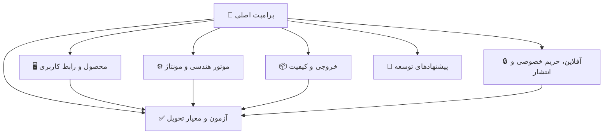

# 🧭 بستهٔ پرامپت حرفه‌ای — Sahand Gear Designer

این بسته، شرح‌کار و پرامپتی چندبخشی برای ساخت یک نرم‌افزار رومیزی ویندوزی با نام **Sahand Gear Designer | طراح چرخ‌دنده سهند** است. متن‌ها طوری تنظیم شده‌اند که بتوانید آن‌ها را به یک دستیار هوش مصنوعیِ برنامه‌نویس بدهید و از او بخواهید برنامه را مرحله‌به‌مرحله طراحی، پیاده‌سازی، آزمایش و مستندسازی کند.

> **روش استفاده:** همهٔ فایل‌های این پوشه را در اختیار هوش مصنوعی بگذارید. ابتدا فایل «پرامپت اصلی» را ارسال کنید و تأکید کنید که پیش از کدنویسی باید تمام فایل‌های پیوندخورده را بخواند. اگر ابزار فقط یک فایل می‌پذیرد، فایل‌ها را به ترتیب زیر به یک پیام/سند واحد اضافه کنید.

## 📚 فهرست فایل‌ها

| فایل | کاربرد |
|---|---|
| [🎯 01 — پرامپت اصلی](01-master-prompt.md) | متن اصلیِ آمادهٔ کپی؛ نقش، هدف، خروجی‌های مورد انتظار و قواعد اجرا |
| [🖥️ 02 — محصول، قابلیت‌ها و رابط کاربری](02-product-and-ui.md) | جریان‌های کاری، نقشهٔ صفحه‌ها، فهرست قابلیت‌ها، آیکون‌ها و طراحی فارسی/راست‌به‌چپ |
| [⚙️ 03 — موتور چرخ‌دنده و مونتاژ](03-gear-engine.md) | انواع چرخ‌دنده، پارامترها، اصول هندسی، ویژگی‌های بدنه و چرخ‌دنده‌های ترکیبی |
| [📦 04 — خروجی‌ها و کیفیت مدل](04-exports-and-quality.md) | فرمت‌های فایل، کیفیت مش، تنظیمات خروجی و الزامات صداقت دربارهٔ پشتیبانی واقعی |
| [🔒 05 — آفلاین، حریم خصوصی و انتشار ویندوزی](05-offline-privacy-and-release.md) | فونت، نصب آفلاین، گزارش خطا، بازخورد، اطلاعات سازنده و حمایت مالی |
| [✅ 06 — آزمون، معیار پذیرش و نقشهٔ اجرا](06-testing-and-roadmap.md) | آزمون‌های هندسی/کاربردی، معیار تحویل و ترتیب پیشنهادی توسعه |
| [🚀 07 — بازبینی امکانات و نقشهٔ راه پیشنهادی](07-feature-review-and-roadmap.md) | پیشنهادهای تکمیلی، اولویت ارزش/هزینه و بسته‌های توسعهٔ پیشنهادی |

## 🗺️ نقشهٔ بسته

## ⚠️ دو تصمیم مهمی که در این بسته صریح شده‌اند

1. عبارت «تمام انواع چرخ‌دنده» به یک **معماری توسعه‌پذیر، فهرست قابلیت‌های روشن و توسعهٔ مرحله‌ای** تبدیل شده است. هیچ سامانهٔ CAD نمی‌تواند بدون تعریف ریاضی، استاندارد و محدودیت، تضمین کند که هر هندسهٔ ممکن یا هر قالب سه‌بعدی موجود را پشتیبانی می‌کند. بنابراین پرامپت، ساخت انواع اصلی و پرکاربرد، آماده‌سازی افزونه‌پذیر برای انواع پیشرفته و اعلام صادقانهٔ وضعیت هر قابلیت را الزام می‌کند.
2. **شمارهٔ کامل کارت بانکی در فایل‌ها درج نشده است.** گذاشتن PAN کامل در کد، فایل عمومی، تاریخچهٔ Git یا خود برنامه خطر سوءاستفاده دارد. بخش حمایت مالی در پرامپت استفاده از پیوند پرداخت امن یا تنظیم محلیِ خارج از مخزن را توصیه می‌کند. نام و راه‌های تماسِ ارائه‌شده برای بخش «دربارهٔ برنامه» ثبت شده‌اند.

## ✍️ اطلاعات مالک/نویسنده که در مشخصات آمده است

- **نام:** سعید نجفی
- **تلفن:** `09144220430`
- **ایمیل:** [Pranses2011@GMail.com](mailto:Pranses2011@GMail.com)
- **وب‌سایت:** [EA-Fixer.ir](http://EA-Fixer.ir)

## 💡 نکتهٔ اجرایی دربارهٔ آفلاین بودن

هستهٔ طراحی، ساخت هندسه، ذخیره‌سازی و خروجی‌گرفتن باید بدون اینترنت کار کند. ارسال ایمیل، ذاتاً به اتصال شبکه نیاز دارد؛ در نتیجه مشخصات، گزارش و بازخورد را در حالت آفلاین محلی نگه می‌دارد و فقط در صورت رضایت کاربر و برقراری اینترنت، از مسیر HTTPS امن و بدون بازکردن برنامهٔ ایمیل ارسال می‌کند. اگر سرویس دریافت/ارسال ایمیلِ سمت سرور فراهم نشده باشد، برنامه نباید وانمود کند که ایمیلی ارسال شده است.
